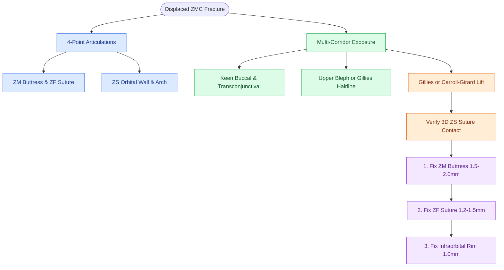

# Zygomaticomaxillary complex fractures disrupt four buttress articulations requiring multi-point reduction

## Active Recall

> [!question]- Which deep internal orbital suture line provides the most reliable landmark for verifying true three-dimensional anatomical reduction of a rotated ZMC fracture?
> *Answer / Clinical Rationale*: The **zygomaticosphenoid (ZS) suture** along the lateral orbital wall. While the anterior ZF suture and infraorbital rim can appear aligned despite significant rotational malalignment, the broad, flat contact of the ZS suture ensures true 3D spatial alignment in all three planes.

> [!question]- What anatomical structure causes mechanical trismus following a posteriorly or medially displaced ZMC fracture?
> *Answer / Clinical Rationale*: Medial or posterior displacement of the **zygomatic arch impinges directly against the coronoid process of the mandible** and temporalis muscle, physically blocking jaw excursion.

> [!question]- What is the standard surgical sequence for internal rigid plate fixation of an unstable, displaced ZMC fracture?
> *Answer / Clinical Rationale*: (1) Confirm 3D reduction at the **ZS suture**; (2) Fix the **zygomaticomaxillary (ZM) buttress** with a $1.5\text{–}2.0\text{ mm}$ L-shaped plate; (3) Fix the **zygomaticofrontal (ZF) suture** with a $1.2\text{–}1.5\text{ mm}$ miniplate; (4) Fix the **infraorbital rim** with a low-profile $1.0\text{–}1.3\text{ mm}$ plate if comminuted.

## Core Clinical & Mechanistic Principles
The **zygomaticomaxillary complex (ZMC / tetrapod)** forms the structural anchor of the lateral midface, defining cheek projection, orbital volume, and anterior-posterior facial width through **four primary bony buttress articulations**:

1. **Zygomaticofrontal (ZF) suture**: Vertical buttress uniting the zygoma to the frontal bone at the lateral orbital rim.
2. **Zygomaticomaxillary (ZM) buttress**: Anterior vertical pillar connecting the zygoma to the alveolar ridge and lateral maxilla.
3. **Zygomaticosphenoid (ZS) suture**: Internal lateral orbital wall articulation with the greater wing of the sphenoid (the gold standard landmark for rotational alignment).
4. **Zygomaticotemporal (ZT) arch**: Horizontal strut joining the zygoma to the squamous temporal bone.

- **Clinical Features**: Malar eminence flattening, subconjunctival hemorrhage (lateral sclera without posterior border), step-off deformities at the infraorbital rim and ZF suture, mechanical **trismus** (coronoid impingement), and **hypoesthesia in the $\text{CN V}_2$ infraorbital nerve distribution** (ipsilateral upper cheek, lateral nose, upper lip, and anterior teeth due to [[Orbital floor blowout fractures with muscle entrapment or significant enophthalmos mandate reconstruction|infraorbital canal disruption]]).

### Surgical Reduction & Rigid Fixation Craft
1. **Surgical Corridors**:
   - *Gingivobuccal Sulcus (Keen)*: Provides direct exposure and fixation of the ZM buttress.
   - *Transconjunctival / Subciliary*: Exposes the infraorbital rim, orbital floor, and lower lateral orbital rim.
   - *[[Upper blepharoplasty requires precise skin crease marking to avoid lagophthalmos|Upper Blepharoplasty]] / Lateral Brow*: Direct access to the ZF suture.
   - *Coronal / Hemicoronal*: Indicated for severe comminuted zygomatic arch or panfacial fractures.
2. **Reduction Techniques**:
   - **Gilles Approach**: Incision in the temporal hairline deep to the deep temporal fascia; an elevator is slid along the temporalis muscle surface deep to the zygomatic arch to exert anterior-lateral lifting force.
   - **Keen Approach**: Transoral elevator placed deep to the zygomatic body through the upper buccal sulcus.
   - **Carroll-Girard Malar Screw**: Direct percutaneous bone screw engagement into the malar prominence for direct 3-axis positional control.
3. **Internal Fixation Strategy (AO Principles)**:
   - Fixation requires $2$-point to $3$-point plate stabilization using low-profile titanium miniplates along tension and compression buttress lines to resist masseteric downward traction.

## Connected Concepts & Graph Traversal
- **Orbital Floor Blowout Correlate**: [[Orbital floor blowout fractures with muscle entrapment or significant enophthalmos mandate reconstruction|Orbital Floor Blowout]]
- **Midface Disjunction Fractures**: [[Le Fort II pyramidal and Le Fort III craniofacial disjunction fractures disrupt facial buttresses|Le Fort II & III Fractures]]
- **Emergent Retrobulbar Hematoma**: [[Acute retrobulbar hematoma in facial trauma requires immediate bedside lateral canthotomy|Retrobulbar Hematoma Rescue]]
- **Mandible Buttress Principles**: [[Mandible fractures require anatomical reduction and load-sharing miniplate fixation along Champy lines of ideal osteosynthesis|Mandible Fracture Fixation]]
- **Anatomical Foundation**: [[Nasal bone fractures are reduced within seven to fourteen days using closed reduction under local or general anesthesia|Nasal Bone Fractures]]
