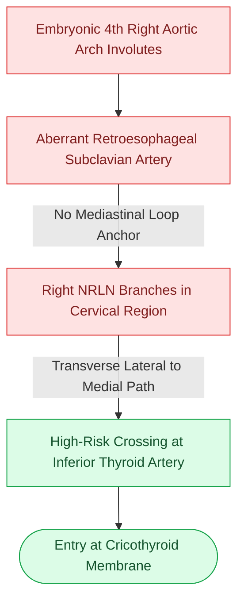

# A nonrecurrent laryngeal nerve arises directly from the vagus due to an aberrant retroesophageal right subclavian artery

## Active Recall

> [!question]- What embryologic vascular anomaly causes a right nonrecurrent laryngeal nerve (NRLN), and what is its reported clinical incidence in thyroid surgery?
> *Answer / Clinical Rationale*: A right NRLN arises due to the abnormal involution of the embryonic **fourth right aortic arch** and persistence of the right dorsal aorta, resulting in an **aberrant right subclavian artery (arteria lusoria)** that arises directly from the descending aortic arch and courses retroesophageally. Without the subclavian artery pulling the nerve down into the mediastinum, the right inferior laryngeal nerve branches directly off the vagus trunk in the cervical region (0.5%–1.0% incidence).

> [!question]- Where does a nonrecurrent laryngeal nerve travel transversely, and why does this path create extreme vulnerability during thyroid lobectomy?
> *Answer / Clinical Rationale*: Rather than ascending vertically in the tracheoesophageal groove, a nonrecurrent nerve exits the vagus nerve high in the neck and courses **horizontally/transversely from lateral to medial**, crossing directly behind or intertwined with the branches of the **inferior thyroid artery** or the [[The recurrent laryngeal nerve is identified within Simon's triangle and followed through Berry's ligament|ligament of Berry]]. Surgeons searching exclusively in the tracheoesophageal groove may inadvertently transect the horizontal nerve during lateral thyroid mobilization or vessel ligation.

## Core Clinical & Mechanistic Principles
During embryonic development, the recurrent laryngeal nerves (RLNs) innervate the sixth branchial arch. As the heart and great vessels descend into the thorax, the left RLN loops under the sixth aortic arch (ligamentum arteriosum/aortic arch), while the right RLN loops under the fourth aortic arch (right subclavian artery). In **arteria lusoria**, the fourth arch fails to form normally; consequently, the **right nonrecurrent laryngeal nerve** takes a direct horizontal course from the cervical [[The carotid sheath is composed of all three layers of deep cervical fascia and forms a vertical neurovascular conduit|vagus trunk]] across the suspensory ligament of Berry to enter the larynx.

### Anatomic Variations and Surgical Safeguards
1. **Types of Nonrecurrent Laryngeal Nerve (Toniato Classification)**:
   - **Type 1 (Superior / High Exit)**: The nerve branches high from the cervical vagus and runs transversely downward with the superior thyroid vascular pedicle.
   - **Type 2A (Transverse at Mid-Pole)**: The nerve courses horizontally at the level of the trunk of the inferior thyroid artery.
   - **Type 2B (Inferior / Low Loop)**: The nerve branches lower and loops horizontally under the distal branches of the inferior thyroid artery before ascending to the larynx.
2. **Left Nonrecurrent RLN Rarity**:
   - Extremely rare (<0.04%); occurs almost exclusively in the setting of **situs inversus totalis** with a right aortic arch and an aberrant retroesophageal left subclavian artery.
3. **Associated Clinical Syndromes**:
   - Often associated with **dysphagia lusoria (Bayford syndrome)** where the anomalous retroesophageal subclavian artery compresses the posterior esophageal wall.
4. **Intraoperative Neuromonitoring (IONM) Signature**:
   - When using IONM, stimulating the vagus nerve at the level of the lower neck/carotid sheath produces a **short latency response (<3.5 ms)** compared to the standard recurrent nerve latency (5–6 ms), alerting the surgeon to a nonrecurrent anomaly before lateral lobe dissection.

## Connected Concepts & Graph Traversal
- **Standard Pathway**: [[The recurrent laryngeal nerve is identified within Simon's triangle and followed through Berry's ligament|Standard RLN Course & Simon's Triangle]]
- **Superior Laryngeal Partner**: [[The superior thyroid artery branches are divided flush on the thyroid capsule to protect the EBSLN|EBSLN Preservation]]
- **Premalignant Esophageal Web**: [[Plummer-Vinson syndrome combines iron deficiency anemia, postcricoid esophageal webs, and mucosal atrophy with malignant potential|Plummer-Vinson Syndrome]]
- **Neuromonitoring Craft**: [[Intraoperative neuromonitoring of the RLN and EBSLN verifies nerve integrity and aids nerve identification|IONM Latency & Amplitude Mapping]]
- **Carotid Neighbor**: [[The carotid sheath is composed of all three layers of deep cervical fascia and forms a vertical neurovascular conduit|Carotid Sheath Vagus Origin]]
