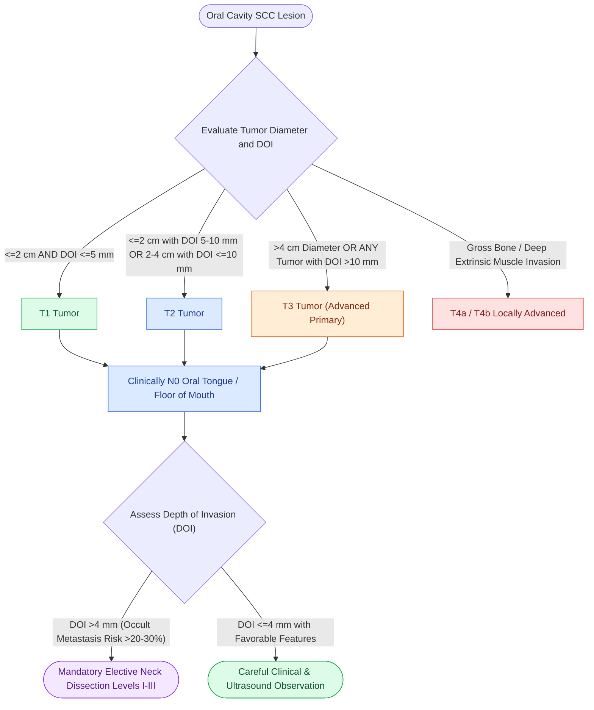

# AJCC 8th edition incorporates depth of invasion into oral cavity T-staging

## Active Recall

> [!question]- How is Depth of Invasion (DOI) measured microscopically?
> *Answer / Clinical Rationale*: From the **horizon of adjacent normal basement membrane** to the deepest infiltrating tumor cell.

> [!question]- Why does a 1.5-cm oral tongue tumor with a DOI of 12 mm stage as T3?
> *Answer / Clinical Rationale*: Because any oral cavity tumor with a **DOI $> 10\text{ mm}$** is automatically upstaged to **T3**.

## Core Clinical & Mechanistic Principles
AJCC 8th Edition utilizes **Depth of Invasion (DOI)** to stage oral cavity SCC:
- **Definition**: Perpendicular distance from the horizon of the basement membrane of adjacent normal mucosa down to the deepest point of tumor invasion.
- **T-Staging Criteria**:
  - **T1**: Tumor $\le 2\text{ cm}$ AND $\text{DOI} \le 5\text{ mm}$.
  - **T2**: Tumor $\le 2\text{ cm}$ with $\text{DOI} > 5\text{ mm}$ to $\le 10\text{ mm}$, OR tumor $> 2\text{ cm}$ to $\le 4\text{ cm}$ with $\text{DOI} \le 10\text{ mm}$.
  - **T3**: Tumor $> 4\text{ cm}$ OR any tumor with $\text{DOI} > 10\text{ mm}$.
  - **T4a**: Gross cortical bone invasion (mandible/maxilla) or deep extrinsic tongue muscles.
- **Rule of 4 mm**: Oral cavity SCC with a $\text{DOI} > 4\text{ mm}$ carries a $>20\text{–}30\%$ risk of [[Elective neck dissection is indicated for oral cavity squamous cell carcinoma with depth of invasion exceeding four millimeters|occult nodal metastasis]] and mandates **[[Selective neck dissection targets high-risk nodal basins while sparing low-risk cervical levels|elective neck dissection]] (Levels I–III)**.

### Surgical Technique & Critical Safety Checks
- **Distinction from Thickness**: Exophytic tumors have large thickness but low DOI; ulcerated lesions have minimal thickness but high DOI.
- **Margin Assessment**: Deep resection margin of $\ge 5\text{ mm}$ is necessary.

## Connected Concepts & Graph Traversal
- **Clear Margins**: [[Oncologic clear margins require at least five millimeters of histological normal tissue|Oncologic Margins]]
- **Elective Neck Dissection**: [[Elective neck dissection is indicated for oral cavity squamous cell carcinoma with depth of invasion exceeding four millimeters|Elective Neck Dissection]]
- **Oral Tongue Carcinoma**: [[Oral tongue carcinoma spreads along intrinsic lingual musculature to bilateral cervical lymphatics|Oral Tongue SCC]]
- **Anatomical Foundation**: [[Intensity-modulated radiation therapy and cisplatin radiosensitization form the standard definitive chemoradiation regimen]]
- **Surgical Lymphadenectomy**: [[Selective neck dissection targets high-risk nodal basins while sparing low-risk cervical levels]]
- **Oncologic Resection & Margins**: [[Hard palate and upper alveolar carcinoma require partial or total maxillectomy]]
- **Aerodigestive / Pharyngolaryngeal**: [[Postcricoid hypopharyngeal carcinoma frequently invades the cervical esophagus and bilateral RLNs]]
