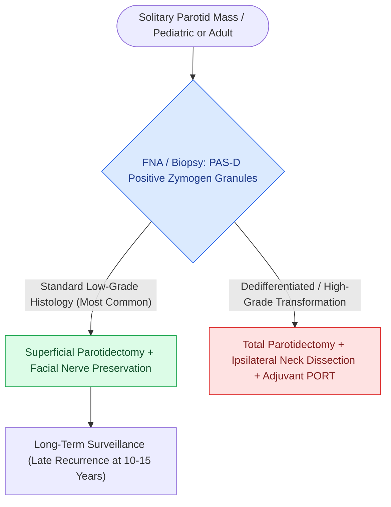

# Acinic cell carcinoma presents as an indolent low-grade parotid neoplasm with serous acinar differentiation

## Active Recall

> [!question]- What special histochemical stain identifies the zymogen secretory granules in acinic cell carcinoma?
> *Answer / Clinical Rationale*: **Periodic acid-Schiff (PAS) stain with diastase resistance**.

> [!question]- What is the standard surgical management for a low-grade acinic cell carcinoma of the superficial parotid lobe?
> *Answer / Clinical Rationale*: **Superficial parotidectomy with clear margins and facial nerve preservation**.

## Core Clinical & Mechanistic Principles
**Acinic Cell Carcinoma** is the second most common pediatric salivary malignancy and accounts for $5\text{–}10\%$ of all parotid neoplasms:
- **Histopathological Architecture**:
  - Composed of cells showing **serous acinar differentiation** containing distinctive periodic acid-Schiff (PAS)-positive, diastase-resistant zymogen granules.
  - Patterns: Solid/lobular, microcystic, papillary-cystic, and follicular.
- **Clinical Behavior**:
  - Typically presents as a slow-growing, mobile, painless mass in the parotid gland.
  - Generally considered a **low-grade malignancy** with excellent 5-year overall survival ($>90\%$), though late recurrences and distant metastases can occur 10–15 years postoperatively.
  - *High-Grade Transformation (Dedifferentiation)*: Rare variant characterized by rapid growth, loss of acinar features, and aggressive behavior.

### Surgical Technique & Critical Safety Checks
- **Surgical Management**: Superficial [[The facial nerve main trunk is localized using the tragal pointer, tympanomastoid suture, and digastric ridge|parotidectomy]] with [[Oncologic clear margins require at least five millimeters of histological normal tissue|clear margins]] and facial nerve preservation. Neck dissection is indicated only for high-grade transformed tumors or clinically node-positive disease.

## Connected Concepts & Graph Traversal
- **Mucoepidermoid Carcinoma**: [[Mucoepidermoid carcinoma is graded by AFIP Brandwein criteria and driven by CRTC1-MAML2 translocation|Mucoepidermoid Carcinoma]]
- **Superficial Parotidectomy**: [[Superficial parotidectomy dissects the facial nerve branches to resect the lateral salivary lobe|Superficial Parotidectomy]]
- **Facial Nerve Grafting**: [[Immediate facial nerve grafting with the great auricular or sural nerve restores facial reanimation|Facial Nerve Grafting]]
- **Anatomical Foundation**: [[AJCC 8th edition incorporates depth of invasion into oral cavity T-staging]]
- **Surgical Lymphadenectomy**: [[Central compartment neck dissection clears level VI nodes between the carotid sheaths and suprasternal notch]]
- **Oncologic Resection & Margins**: [[Marginal mandibulectomy preserves basilar bone height when tumor abuts but does not invade marrow]]
- **Aerodigestive / Pharyngolaryngeal**: [[Subglottic carcinoma spreads to level VI central compartment lymphatics and mediastinal nodes]]
