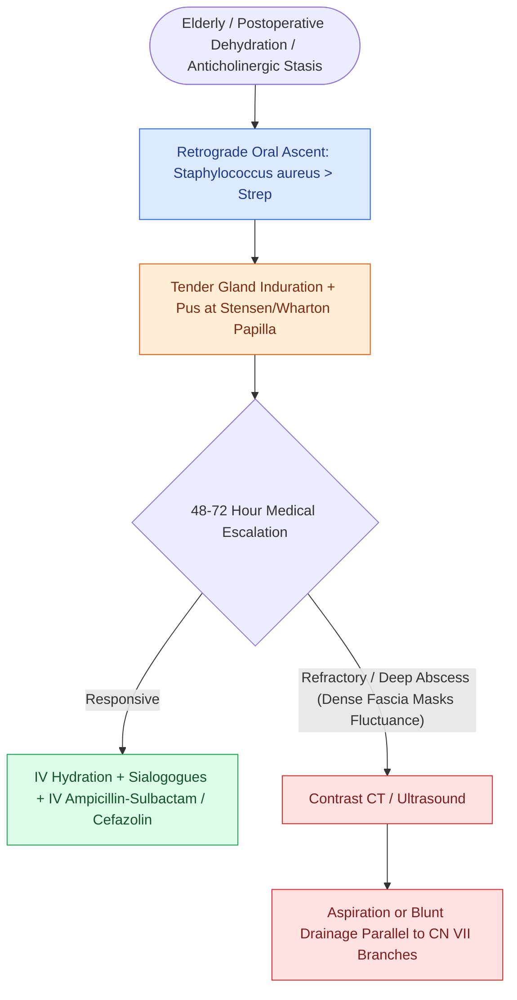

# Acute suppurative sialadenitis affects dehydrated patients and is dominated by Staphylococcus aureus

## Active Recall

> [!question]- What single exam maneuver best separates suppurative bacterial parotitis from mumps?
> *Answer / Clinical Rationale*: Ductal massage: expressible pus at Stensen's papilla means bacterial suppuration; mumps is typically bilateral and non-suppurative.

> [!question]- Why does parotid abscess evade palpation, and what follows from that?
> *Answer / Clinical Rationale*: The dense parotid fascia prevents fluctuance; nonresponders get imaging rather than reassurance.

## Core Clinical & Mechanistic Principles
- Classic host: elderly, dehydrated, postoperative, anticholinergic-medicated, or ductally obstructed — **retrograde ascent of oral flora** through a low-flow duct; **Staphylococcus aureus** leads, with streptococci and anaerobes attending.
- Exam: tender indurated gland with **purulence expressible from the papilla** on massage — the finding that separates [[Suppurative sialadenitis of the parotid and submandibular glands is treated with hydration, sialagogues, and anti-staphylococcal antibiotics|suppurative sialadenitis]] from viral parotitis (mumps: bilateral, no pus) and from inflammatory mimics.
- Nonresolving or fluctuant disease is imaged (ultrasound or contrast CT): abscess in the parotid hides in a gland whose fascia resists fluctuance — the exam under-calls it.
- Recurrent episodes demand a why: stone, stricture, Sjogren hyposalivation, or ductal anatomy — [[Sialendoscopy enables diagnostic visualization and stone extraction in chronic obstructive sialadenitis|sialendoscopy]] is both the question and often the answer.

### Management & Critical Safety Checks
- Treatment: hydration, sialogogues, warm compresses, gland massage, and anti-staphylococcal coverage (MRSA-aware where prevalent); most resolve medically.
- Abscess drainage respects the facial nerve: needle or radially oriented incisions paralleling branches, guided by imaging.

## Connected Concepts & Graph Traversal
- **Medical Treatment Detail**: [[Suppurative sialadenitis of the parotid and submandibular glands is treated with hydration, sialagogues, and anti-staphylococcal antibiotics|Suppurative Sialadenitis Protocol]]
- **Obstructive Cause**: [[Wharton duct sialolithiasis is managed with transoral sialodochoplasty or sialendoscopy|Sialolithiasis Driver]]
- **Diagnostic Sialendoscopy**: [[Sialendoscopy enables diagnostic visualization and stone extraction in chronic obstructive sialadenitis|Sialendoscopic Intervention]]
- **Autoimmune Substrate**: [[Sjogren syndrome causes autoimmune sicca with parotid enlargement and markedly elevated MALT lymphoma risk|Hyposalivation Substrate]]
- **Nerve Geography**: [[The facial nerve main trunk is localized using the tragal pointer, tympanomastoid suture, and digastric ridge|Parotid Facial Nerve Protection]]
- **Neoplastic Differential**: [[Pleomorphic adenoma requires superficial parotidectomy with a cuff of normal tissue to prevent pseudopod recurrence|Pleomorphic Adenoma Differential]]
