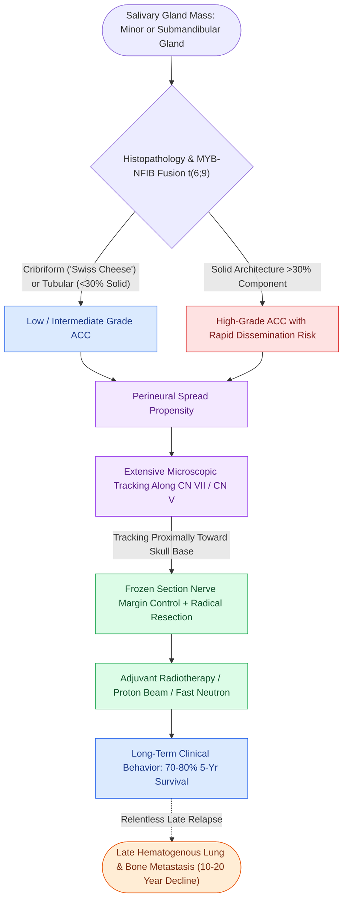

# Adenoid cystic carcinoma exhibits prominent perineural invasion and late distant hematogenous metastasis

## Active Recall

> [!question]- What percentage of solid pattern on histology defines a high-grade, poor-prognosis adenoid cystic carcinoma?
> *Answer / Clinical Rationale*: A **solid component $>30\%$**.

> [!question]- What specific metastatic pattern is characteristic of adenoid cystic carcinoma over prolonged 10-to-20-year follow-up?
> *Answer / Clinical Rationale*: **Late hematogenous distant metastasis to the lungs and bone**, often occurring decades after successful locoregional control.

## Core Clinical & Mechanistic Principles
**Adenoid Cystic Carcinoma ([[Acinic cell carcinoma presents as an indolent low-grade parotid neoplasm with serous acinar differentiation|ACC]])** is an indolent yet relentless malignancy arising in major and minor salivary glands (most common in minor salivary glands and submandibular gland):
- **Histological Patterns & Grading**:
  - **Cribriform ("Swiss Cheese") Pattern**: Cylinders/pseudocysts filled with basement membrane material; most common.
  - **Tubular Pattern**: Well-formed ductal tubules; favorable prognosis.
  - **Solid Pattern**: Sheets of basaloid cells with loss of cribriform spaces; **$>30\%$ solid component indicates high-grade disease** with rapid recurrence.
- **Molecular Driver**: **$t(6;9)(q22-23;p23-24)$ translocation**, resulting in the **MYB-NFIB gene fusion** and MYB overexpression.
- **The Hallmark of Perineural Invasion (PNI)**:
  - Spreads extensively along major and minor cranial nerve tracks (CN VII, CN V branches) far beyond gross margins, tracking into the skull base and intracranial spaces.
- **Clinical Course**: High 5-year survival ($70\text{–}80\%$), but relentless late **hematogenous lung and bone metastasis** drops 15-to-20-year survival to $<20\text{–}30\%$.

### Surgical Technique & Critical Safety Checks
- **Surgical Craft**: Radical resection with frozen section margin control of involved cranial nerves; postoperative adjuvant radiotherapy (fast neutron or proton beam).

## Connected Concepts & Graph Traversal
- **Mucoepidermoid Carcinoma**: [[Mucoepidermoid carcinoma is graded by AFIP Brandwein criteria and driven by CRTC1-MAML2 translocation|Mucoepidermoid Carcinoma]]
- **Facial Nerve Sacrifice**: [[Total parotidectomy with facial nerve sacrifice is indicated for direct malignant nerve invasion|Total Parotidectomy]]
- **Facial Nerve Grafting**: [[Immediate facial nerve grafting with the great auricular or sural nerve restores facial reanimation|Facial Nerve Grafting]]
- **Anatomical Foundation**: [[Lemierre syndrome involves Fusobacterium necrophorum internal jugular thrombophlebitis and septic emboli]]
- **Surgical Lymphadenectomy**: [[Superior mediastinal level VII dissection clears paratracheal lymph nodes below the sternal notch]]
- **Oncologic Resection & Margins**: [[Mandibular reconstruction plates require rigid bicortical screw fixation to withstand masticatory load]]
- **Aerodigestive / Pharyngolaryngeal**: [[Postcricoid hypopharyngeal carcinoma frequently invades the cervical esophagus and bilateral RLNs]]
- **Skull Base Spread Pathways**: [[Perineural tumor spread along cranial nerves V2, V3, and VII follows retrograde skull base pathways through the pterygopalatine fossa, foramen ovale, and stylomastoid foramen|Perineural Spread Pathways]]
