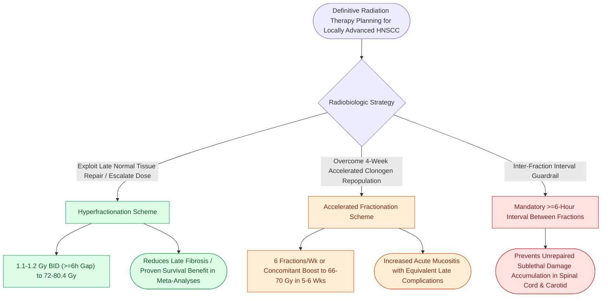

# Altered radiation fractionation schemes exploit differential repair and repopulation kinetics to optimize the therapeutic ratio in head and neck cancer

## Active Recall

> [!question]- How does hyperfractionation differ mechanistically from accelerated fractionation in dose per fraction, total dose, and radiobiological objective?
> *Answer / Clinical Rationale*: **Hyperfractionation** reduces the individual fraction size (**1.1–1.2 Gy twice daily**, separated by $\ge 6\text{ hours}$) and escalates total dose (**72–80.4 Gy**) over the standard 7-week treatment duration. It exploits the differential repair capacity between early-responding tissues (tumors, mucosa) and late-responding normal tissues (neural, vascular, connective tissue, bone) to **decrease late normal tissue toxicity while escalating tumoricidal dose**. In contrast, **accelerated fractionation** maintains near-standard fraction sizes (1.8–2.0 Gy) but compresses overall treatment time (delivering 6 fractions/week or using a concomitant boost) to **counteract accelerated tumor clonogen repopulation** that emerges ~4 weeks into therapy.

> [!question]- Why is an inter-fraction interval of at least 6 hours strictly mandatory when administering twice-daily (BID) radiation therapy?
> *Answer / Clinical Rationale*: An interval of **at least 6 hours** (and ideally 6–8 hours) is mandatory to allow late-responding normal tissues sufficient time to complete **repair of sublethal cellular DNA damage**. Delivering the second fraction before 6 hours elapses causes incomplete cellular repair, behaving radiobiologically as a single large, high-toxicity fraction that drastically increases the catastrophic risk of **late spinal cord myelopathy, cartilage necrosis, and severe carotid fibrosis**.

> [!question]- What is accelerated tumor clonogen repopulation, and why does treatment package time dictate locoregional control?
> *Answer / Clinical Rationale*: Approximately **3 to 4 weeks (28 days)** after initiating radiation therapy, surviving cancer stem cells undergo explosive compensatory proliferation termed **accelerated clonogen repopulation**. Once triggered, tumor repopulation offsets radiation cell-kill by approximately **0.5 to 1.0 Gy per day of prolongation**. Consequently, gaps in radiation must be vigorously avoided, and the total surgical-radiotherapy package time (from the day of surgery to completion of adjuvant radiotherapy) should remain **strictly under 11 weeks (ideally under 100 days)**.

## Core Clinical & Mechanistic Principles

Fractionated external beam radiotherapy relies on the differing radiobiological responses of malignant neoplasms and normal cervical tissues. The clinical success of altered fractionation regimens is rooted in the classical **Four R's of Radiobiology**:

1. **Repair**: Normal tissues repair sublethal single-strand DNA damage more effectively than malignant cells, provided sufficient time ($\ge 6\text{ hours}$) elapses between fractions.
2. **Reassortment (Redistribution)**: Dividing cells surviving a fraction progress through the cell cycle from radioresistant phases (S-phase) into sensitive checkpoints (**G2 and M phases**).
3. **Repopulation**: Prolonging overall treatment time allows surviving clonogens to accelerate division (a major cause of local failure).
4. **Reoxygenation**: Hypoxic, radioresistant core tumor cells become reoxygenated between fractions as peripheral aerated cells die, restoring oxygen-fixation sensitivity.

### Fractionation Taxonomy & Dosing Matrix *(Cummings p.76, Box 5.1)*

| Fractionation Scheme | Dose per Fraction | Frequency | Total Dose | Biological Mechanism & Target |
| :--- | :--- | :--- | :--- | :--- |
| **Conventional** | 1.8–2.0 Gy | 1 fraction/day, 5 days/wk | 66–70 Gy (7 wks) | Baseline tumor control with standard acute and late toxicity |
| **Hyperfractionation** | 1.1–1.2 Gy | 2 fractions/day ($\ge 6\text{h}$ gap), 5 days/wk | 72–80.4 Gy (7 wks) | Sparing of late-responding normal tissues; enables 10–15% dose escalation |
| **Accelerated** | 1.8–2.0 Gy | 6 fractions/wk OR concomitant boost BID | 66–70 Gy (5.5–6 wks) | Abbreviates overall treatment time to thwart accelerated clonogen repopulation |
| **Hypofractionation** | >2.0 Gy (typically 3–6 Gy) | Varied (e.g., 2–3 fractions/wk or SBRT) | 30–50 Gy | Palliative regimens, medically frail patients, or ultra-conformal SBRT |

The clinical application of these radiobiologic principles is evaluated alongside [[Cetuximab targets EGFR overexpression while pembrolizumab and nivolumab inhibit PD-1 in head and neck SCC|systemic radiosensitization agents]] and definitive chemo-RT protocols.

### Clinical Evidence: The MARCH Meta-Analysis
The Meta-Analysis of Radiotherapy in Carcinomas of the Head and neck (MARCH) demonstrated that altered fractionation provides a **significant absolute overall survival benefit of 3.4% at 5 years** compared with conventional fractionation. **Hyperfractionation** showed the greatest survival benefit (**8.2% at 5 years**), particularly in patients with locally advanced disease receiving radiation without concurrent chemotherapy.

### Toxicity Profile Trade-offs
- **Acute Toxicities**: Both hyperfractionated and accelerated regimens produce significantly higher rates of severe **Grade 3/4 confluent acute mucositis** (requiring prophylactic gastrostomy tube placement) and acute dermatitis.
- **Late Toxicities**: Accelerated fractionation produces late toxicities comparable to conventional radiotherapy, whereas hyperfractionation maintains equivalent or lower late toxicity despite total dose escalation due to smaller fraction sizes ($\le 1.2\text{ Gy}$).

## Connected Concepts & Graph Traversal
- **Therapeutic Baseline**: [[Intensity-modulated radiation therapy and cisplatin radiosensitization form the standard definitive chemoradiation regimen|Definitive IMRT and Cisplatin]]
- **Critical Safety / Complication**: [[Post-radiation carotid vasculopathy and osteoradionecrosis represent severe late radiotherapy sequelae|Late Radiation Sequelae & Osteoradionecrosis]]
- **Pathologic Risk Escalation**: [[Extranodal extension in cervical lymph nodes upstages nodal disease and dictates adjuvant chemoradiotherapy|Extranodal Extension and Adjuvant Indications]]
- **Surgical Timing Coordination**: [[Primary pharyngeal closure after total laryngectomy utilizes an inverting Connell technique|Pharyngeal Healing Prior to Radiation]]
- **Reconstructive Tolerance**: [[The fibula osteocutaneous free flap provides up to twenty-five centimeters of vascularized bone for mandible reconstruction|Vascularized Bone Tolerance to Radiotherapy]]
- **Emergency Rescue**: [[Carotid blowout syndrome is classified into threatened, impending, and acute hemorrhage|Radiation-Induced Carotid Blowout Syndrome]]
