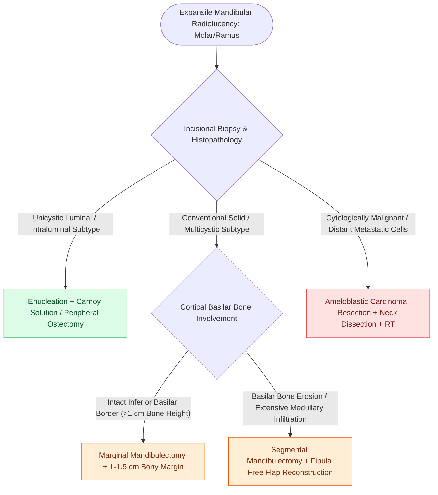

# Ameloblastoma exhibits multilocular soap-bubble radiolucency and requires segmental resection with one-centimeter bony margins

## Active Recall

> [!question]- What characteristic radiographic appearance identifies conventional solid/multicystic ameloblastoma on panoramic radiography and maxillofacial CT?
> *Answer / Clinical Rationale*: A **multilocular, expansile radiolucency with internal bony septations** presenting with classic **"soap bubble"** or **"honeycomb"** architecture, frequently causing marked cortical thinning, tooth displacement, root resorption (knife-edge resorption), and cortical perforation into adjacent soft tissues (most commonly in the mandibular molar/ramus region, $80\%$).

> [!question]- Why is conservative treatment (curettage / simple enucleation) contraindicated for solid/multicystic ameloblastoma?
> *Answer / Clinical Rationale*: Ameloblastoma is a locally aggressive, unencapsulated benign epithelial neoplasm that extends microinvasively through cancellous marrow spaces well beyond macroscopic/radiographic margins. Simple enucleation or curettage carries a catastrophic **recurrence rate of $60\text{–}80\%$**. Definitive surgical management mandates **en bloc segmental mandibulectomy (or marginal mandibulectomy for non-basilar lesions) with $1.0\text{–}1.5\text{ cm}$ clear bony margins** and primary microvascular reconstruction (e.g., [[The fibula free flap provides vascularized cortical bone for composite mandibular reconstruction|fibula free flap]]).

> [!question]- What distinct molecular mutations differentiate mandibular from maxillary ameloblastomas?
> *Answer / Clinical Rationale*: Mandibular ameloblastomas harbor **$BRAF\text{ V600E}$ mutations** in up to $80\%$ of cases (which can respond to targeted BRAF inhibitors like dabrafenib in unresectable/recurrent cases), whereas maxillary ameloblastomas are driven predominantly by **$SMO$ (Smoothened)** activating mutations in the Sonic Hedgehog pathway.

## Core Clinical & Mechanistic Principles

**Ameloblastoma** is the most common clinically significant odontogenic neoplasm, arising from odontogenic epithelium (dental lamina rests of Serres, enamel organ, or lining of dentigerous cysts):

### Histopathologic Subtypes and Molecular Drivers
- **Conventional Solid / Multicystic Ameloblastoma ($85\%$)**: High recurrence ($>60\text{–}80\%$) if enucleated; mandates $1.0\text{–}1.5\text{ cm}$ clear bony margin resection ([[Marginal mandibulectomy preserves basilar bone height when tumor abuts but does not invade marrow|marginal]] or [[The fibula osteocutaneous free flap provides up to twenty-five centimeters of vascularized bone for mandible reconstruction|segmental mandibulectomy]]).
- **Unicystic Ameloblastoma ($10\text{–}15\%$)**: Younger patients (2nd–3rd decades); luminal and intraluminal variants may be treated conservatively with enucleation plus chemical cauterization (Carnoy solution / modified Carnoy) or peripheral ostectomy, whereas mural invasion warrants en bloc resection.
- **Molecular Driver Divergence**: Mandibular tumors are characterized by **$BRAF\text{ V600E}$ mutations** ($>80\%$), whereas maxillary ameloblastomas frequently demonstrate **$SMO$ (Smoothened)** mutations in the Sonic Hedgehog pathway.

### Histopathologic Features of Classical Ameloblastoma
- **Vickers-Gorlin Criteria**:
  - Peripheral layer of columnar cells with hyperchromatic nuclei showing **reverse polarization** (nuclei aligned away from the basement membrane, creating subnuclear vacuolization).
  - Central core of loosely arranged polygonal cells resembling the embryological **stellate reticulum**.

## Connected Concepts & Graph Traversal
- **Mandibular Resection Types**: [[Marginal mandibulectomy preserves basilar bone height when tumor abuts but does not invade marrow|Marginal vs Segmental Mandibulectomy]]
- **Microvascular Mandibular Reconstruction**: [[The fibula osteocutaneous free flap provides up to twenty-five centimeters of vascularized bone for mandible reconstruction|Fibula Free Flap Mandibular Reconstruction]]
- **Odontogenic Keratocysts**: [[Odontogenic keratocysts arise from PTCH1 mutations in Gorlin syndrome and exhibit high recurrence after simple enucleation|Odontogenic Keratocyst Differential]]
- **Pre-Plating Techniques**: [[Pre-plating the intact mandible before osteotomy preserves accurate dental occlusion and contour|Mandibular Pre-Plating Craft]]
- **Differential Diagnosis**: [[Calcifying epithelial odontogenic tumors, adenomatoid odontogenic tumors, odontomas, and odontogenic myxomas exhibit distinct histopathologic hallmarks and biologic behaviors|Odontogenic Tumor Differential Panel]]
- **Conservative Variant Differential**: [[Unicystic ameloblastoma luminal and intraluminal variants permit conservative enucleation while the mural subtype mandates formal segmental resection|Unicystic Ameloblastoma]]
- **Fibro-Osseous Differential**: [[Craniofacial fibrous dysplasia and cherubism manifest as benign fibro-osseous jaw lesions managed with surgical contouring|Fibrous Dysplasia & Cherubism Differential]]
