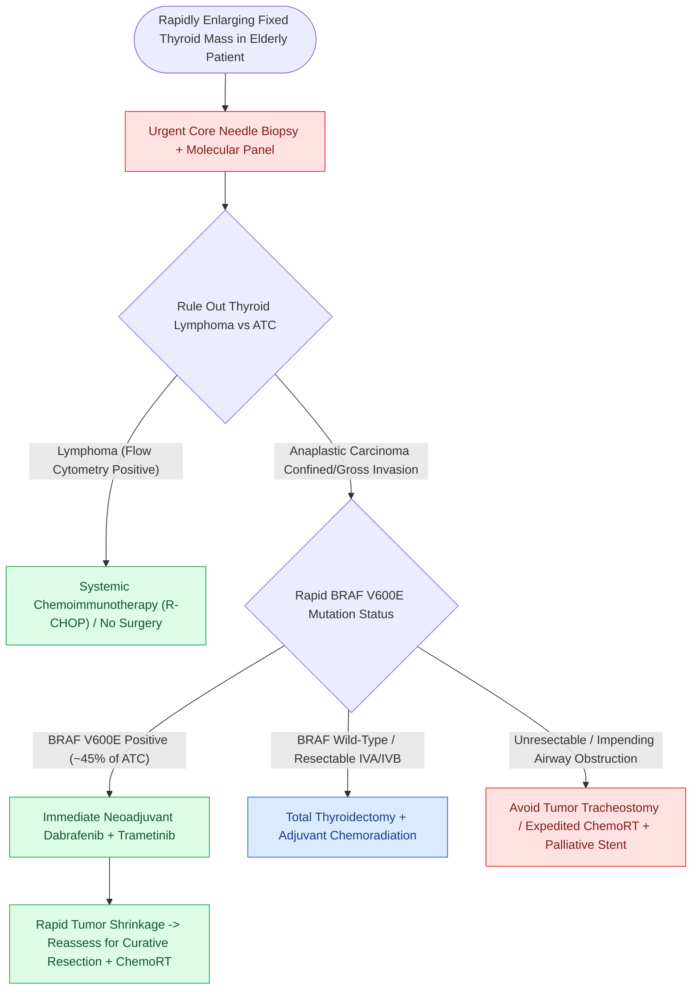

# Anaplastic thyroid carcinoma is an airway and molecular emergency requiring immediate BRAF testing

## Active Recall

> [!question]- Why does every rapidly growing thyroid mass in an elderly patient get core biopsy with flow cytometry?
> *Answer / Clinical Rationale*: To separate anaplastic carcinoma from thyroid lymphoma — near-identical presentations with opposite treatments (chemoimmunotherapy, not resection, for lymphoma).

> [!question]- What changed the role of BRAF testing from prognostic to emergent, and why is surgical tracheostomy avoided when possible in ATC?
> *Answer / Clinical Rationale*: Neoadjuvant BRAF/MEK inhibition (**dabrafenib + trametinib**) can render V600E-positive ATC resectable and alters week-one management. Surgical tracheostomy through gross tumor is avoided when possible because ATC rapidly **infiltrates and fungates through the tracheostoma wound**, creating a necrotic, bleeding airway site.

## Core Clinical & Mechanistic Principles
- Phenotype: elderly patient, rapidly enlarging fixed thyroid mass over weeks, hoarseness/dysphagia/stridor — all ATC is **stage IV by definition** (IVA intrathyroidal, IVB gross extrathyroidal/nodal, IVC distant).
- It frequently arises from a dedifferentiated differentiated carcinoma; histology shows pleomorphic spindle/giant cells; the differential that changes everything is **lymphoma** (treatable without surgery) — core biopsy urgently, with flow cytometry.
- **Molecular emergency**: rapid [[BRAF V600E and TERT promoter mutations drive aggressive papillary thyroid carcinoma behavior|BRAF V600E]] testing, because **neoadjuvant dabrafenib-trametinib** can convert borderline-resectable disease and has rewritten selected IVB/IVC outcomes; checkpoint inhibition combines in current protocols.
- Airway doctrine is counterintuitive: tracheostomy through tumor is morbid, often hastens local misery, and is avoided when possible in favor of expedited definitive therapy and goals-of-care clarity.

### Management & Critical Safety Checks
- Week-one bundle: tissue with molecular panel, cross-sectional staging, multidisciplinary conference, airway plan, and an honest prognosis conversation — this disease is measured in weeks and the calendar is part of the treatment.
- Resectable IVA/selected IVB: surgery plus chemoradiation; V600E-positive advanced disease: targeted induction then reassessment.

## Connected Concepts & Graph Traversal
- **Molecular Driver Mutation**: [[BRAF V600E and TERT promoter mutations drive aggressive papillary thyroid carcinoma behavior|BRAF and TERT Mutational Dynamics]]
- **Differential Biopsy Standard**: [[Suspected cervical lymphoma requires excisional or core biopsy because cytology cannot assess architecture|Thyroid Lymphoma Core Biopsy]]
- **Dedifferentiation Substrate**: [[Papillary thyroid carcinoma spreads via cervical lymphatics to central and lateral neck compartments|Differentiated Precursor & Dedifferentiation]]
- **Endocrine Counterpart**: [[Medullary thyroid carcinoma arises from parafollicular C cells and mandates RET testing with calcitonin surveillance|Medullary Thyroid Carcinoma]]
- **Airway Decision Making**: [[Standard open tracheotomy utilizes horizontal intersinusoidal or Bjork flap entry|Tracheostomy in Airway Compression]]
- **Precursor Histologic Variant**: [[High-risk papillary thyroid carcinoma histologic variants portend aggressive extrathyroidal invasion, radioiodine refractoriness, and adverse prognosis|Aggressive PTC Histologic Variants]]
