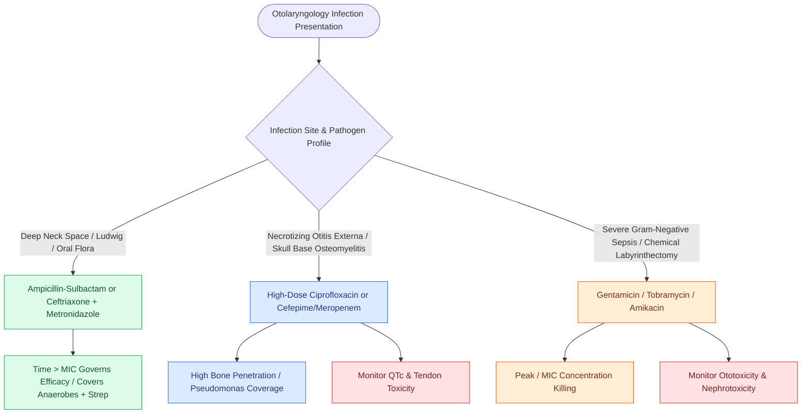

# Antimicrobial stewardship in otolaryngology selects targeted bactericidal agents based on tissue penetration and pathogen resistance

## Active Recall

> [!question]- Which antimicrobial classes exhibit concentration-dependent killing versus time-dependent killing, and how does this govern clinical dosing?
> *Answer / Clinical Rationale*: - **Concentration-Dependent (Peak/$MIC$ ratio governs efficacy)**: **Aminoglycosides (Gentamicin, Tobramycin, Amikacin)** and **Fluoroquinolones (Ciprofloxacin, Levofloxacin)**. Optimal bacterial eradication requires high transient peak concentrations (often once-daily high-dose pulse dosing) to maximize post-antibiotic effect. - **Time-Dependent ($Time > MIC$ governs efficacy)**: **$\beta$-Lactams (Penicillins, Cephalosporins, Carbapenems)** and **Vancomycin**. Efficacy depends on maintaining serum/tissue drug levels above the minimum inhibitory concentration for $\ge 50\text{–}70\%$ of the dosing interval (favoring frequent bolus or extended continuous infusions).

> [!question]- What are the empirical intravenous regimens of choice for acute coalescent mastoiditis, necrotizing otitis externa, deep neck space infection, and Ludwig angina?
> *Answer / Clinical Rationale*: - **Acute Coalescent Mastoiditis**: High-dose **IV Ceftriaxone ($100\text{ mg/kg/day}$) OR Ampicillin-Sulbactam (Unasyn) $\pm$ Vancomycin** (targeting *Streptococcus pneumoniae*, *Streptococcus pyogenes*, *Staphylococcus aureus*). - **Necrotizing (Malignant) Otitis Externa**: High-dose **IV Ciprofloxacin ($400\text{ mg}$ q8h) OR Cefepime / Meropenem / Piperacillin-Tazobactam** for 6–8 weeks (targeting *Pseudomonas aeruginosa* bone penetration). - **Deep Neck Infection & Ludwig Angina**: **Ampicillin-Sulbactam ($3\text{ g}$ q6h) OR Ceftriaxone + Metronidazole ($500\text{ mg}$ q8h) $\pm$ Vancomycin** (targeting oral polymicrobial flora, streptococci, and anaerobes like *Fusobacterium* and *Prevotella*).

> [!question]- What specific toxicities limit aminoglycosides and fluoroquinolones in otolaryngology?
> *Answer / Clinical Rationale*: - **Aminoglycosides**: **Vestibulotoxicity** (Gentamicin/Streptomycin damages type I vestibular hair cells) and **Cochleotoxicity** (Amikacin/Tobramycin/Neomycin damages outer hair cells in basal turn) plus **acute tubular necrosis nephrotoxicity** (potentiated by loop diuretics). - **Fluoroquinolones**: **Tendinopathy and tendon rupture** (Achilles tendon risk, especially with concurrent corticosteroids), **QTc prolongation**, cartilage toxicity in pediatrics, and CNS stimulation/seizures.

## Core Clinical & Mechanistic Principles
Effective antimicrobial stewardship in otolaryngology balances pathogen spectrum coverage with tissue-specific penetration (cortical temporal bone, laryngeal cartilage, CSF, and fascial planes):

- **Pharmacodynamic Killing Profiles**:
  - **Time-Dependent ($\text{Time} > \text{MIC}$)**: $\beta$-lactams (penicillins, cephalosporins, carbapenems) and glycopeptides (vancomycin) require drug concentrations exceeding the minimum inhibitory concentration for $\ge 50\text{–}70\%$ of the dosing interval, favoring continuous infusions or regular interval dosing.
  - **Concentration-Dependent ($\text{Peak}/\text{MIC}$ and $\text{AUC}/\text{MIC}$)**: Fluoroquinolones (ciprofloxacin) and aminoglycosides (gentamicin) achieve maximal bacterial killing and extended post-antibiotic effect with high transient peak concentrations.
- **Infection-Specific Regimens**:
  - **Necrotizing (Malignant) Otitis Externa**: Mandates high bone-penetrating antipseudomonal agents ([[Malignant necrotizing otitis externa is an invasive pseudomonal skull base osteomyelitis in elderly diabetic patients|oral/IV ciprofloxacin]] $750\text{ mg}$ BID or IV cefepime/meropenem) for 6–8 weeks with serial ESR/CRP surveillance.
  - **Deep Neck Space Infections & Ludwig Angina**: Polymicrobial coverage against oral streptococci, *Staphylococcus aureus*, and anaerobes (*Fusobacterium necrophorum*, *Prevotella*, *Bacteroides*) across [[Deep cervical fascia divides into superficial, middle, and deep layers that define surgical planes|deep cervical fascial layers]] via IV ampicillin-sulbactam ($3\text{ g}$ q6h) or ceftriaxone ($2\text{ g}$ daily) + metronidazole ($500\text{ mg}$ q8h), guarding against [[Lemierre syndrome involves Fusobacterium necrophorum internal jugular thrombophlebitis and septic emboli|Lemierre septic thrombophlebitis]].

### High-Yield Surgical Antibiotic Prophylaxis (ASHP Guidelines)
- **Clean-Contaminated Head & Neck Surgery** (e.g., composite resection, laryngectomy, free flap reconstruction entering upper aerodigestive mucosal tract): **Ampicillin-Sulbactam ($3\text{ g}$ IV)** OR **Cefazolin ($2\text{–}3\text{ g}$) + Metronidazole ($500\text{ mg}$)** administered within 60 minutes prior to incision, redosed intraoperatively every 2 half-lives, and discontinued within 24 hours postoperatively.

## Connected Concepts & Graph Traversal
- **Malignant Otitis Externa**: [[Malignant necrotizing otitis externa is an invasive pseudomonal skull base osteomyelitis in elderly diabetic patients|Malignant Otitis Externa Protocols]]
- **Deep Neck Infection**: [[Deep cervical fascia divides into superficial, middle, and deep layers that define surgical planes|Deep Fascial Spaces]]
- **Lemierre Thrombophlebitis**: [[Lemierre syndrome involves Fusobacterium necrophorum internal jugular thrombophlebitis and septic emboli|Lemierre Syndrome]]
- **Invasive Fungal Sinusitis**: [[Acute invasive fungal rhinosinusitis requires emergent surgical debridement and systemic amphotericin B|Invasive Fungal Rhinosinusitis]]
- **Peritonsillar Abscess**: [[Peritonsillar abscess presents with unilateral palatal fullness, uvular deviation, and trismus requiring drainage|Peritonsillar Abscess Management]]
