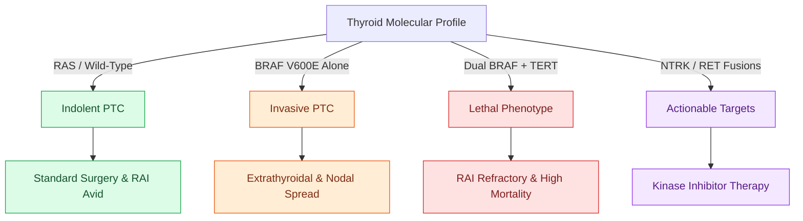

# BRAF V600E and TERT promoter mutations drive aggressive papillary thyroid carcinoma behavior

## Active Recall

> [!question]- What clinical and pathological features are associated with the BRAF V600E mutation in papillary thyroid carcinoma?
> *Answer / Clinical Rationale*: **Extrathyroidal extension (ETE)**, **cervical lymph node metastasis**, loss of radioiodine avidity, and higher recurrence risk.

> [!question]- What is the clinical significance of co-existing BRAF V600E and TERT promoter mutations in differentiated thyroid cancer?
> *Answer / Clinical Rationale*: It defines a **high-risk aggressive phenotype** with significantly elevated risks of distant metastasis, radioiodine refractoriness, and mortality.

## Core Clinical & Mechanistic Principles
Molecular alterations in differentiated thyroid carcinoma provide critical prognostic information:
- **BRAF V600E Mutation**:
  - Most common oncogenic driver in [[Papillary thyroid carcinoma spreads via cervical lymphatics to central and lateral neck compartments|Papillary Thyroid Carcinoma]] (PTC), occurring in **$45\text{–}60\%$** of cases.
  - Causes constitutive activation of the MAPK/ERK kinase pathway, driving cellular proliferation.
  - Associated with aggressive pathological features: extrathyroidal extension (ETE), cervical lymph node metastasis, advanced stage, loss of radioiodine (RAI) avidity (radioiodine refractoriness), and higher recurrence rates.
- **TERT Promoter Mutations (C228T and C250T)**:
  - Create *de novo* ETS transcription factor binding sites, upregulating telomerase reverse transcriptase (TERT) and preventing telomere shortening.
  - Found in $10\text{–}15\%$ of PTCs and $>50\%$ of anaplastic thyroid carcinomas.
- **The BRAF + TERT Synergistic Duet**:
  - Co-occurrence of **both BRAF V600E and TERT promoter mutations** produces the most lethal phenotype in differentiated thyroid cancer, with drastically increased risk of distant metastasis, recurrence, and disease-specific mortality.

### Surgical Technique & Critical Safety Checks
- **Other Key Alterations**: *RAS* mutations (follicular variant PTC / follicular carcinoma), *RET/PTC* fusions, *PAX8-PPARG* fusions, and *NTRK* fusions (targetable with Larotrectinib).

## Connected Concepts & Graph Traversal
- **Bethesda Staging**: [[The Bethesda system for reporting thyroid cytopathology stratifies malignancy risk and guides surgical decision-making|Bethesda System]]
- **Papillary Carcinoma**: [[Papillary thyroid carcinoma spreads via cervical lymphatics to central and lateral neck compartments|Papillary Thyroid Carcinoma]]
- **Anaplastic Cancer**: [[Anaplastic thyroid carcinoma is an airway and molecular emergency requiring immediate BRAF testing|Anaplastic Thyroid Cancer]]
- **Anatomical Foundation**: [[Cervical lymph node levels I through VII define regional metastatic drainage basins]]
- **Surgical Lymphadenectomy**: [[Modified radical neck dissection types I, II, and III preserve non-lymphatic structures]]
- **Oncologic Resection & Margins**: [[Transcervical pull-through resection mobilizes oral tongue tumors without dividing the mandible]]
- **Aerodigestive / Pharyngolaryngeal**: [[Lingual artery branches require clip ligation during TORS base of tongue resection]]
- **Histologic Variant Correlate**: [[High-risk papillary thyroid carcinoma histologic variants portend aggressive extrathyroidal invasion, radioiodine refractoriness, and adverse prognosis|Aggressive PTC Histologic Variants]]
