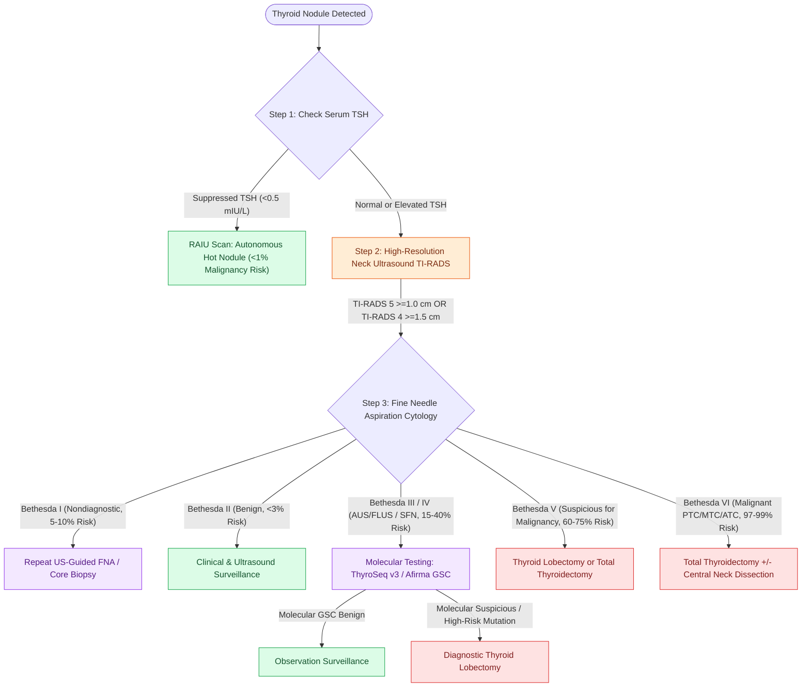

# Bethesda cytology and molecular testing stratify thyroid nodule malignancy risk before surgery

## Active Recall

> [!question]- What is the initial management pathway for a thyroid nodule with a suppressed serum TSH?
> *Answer / Clinical Rationale*: Order a **radioiodine uptake (RAIU) scan**. If the nodule is autonomously functioning ("hot"), the risk of malignancy is **$<1\%$**, and FNA is avoided.

> [!question]- What are the ACR TI-RADS size cutoffs for performing an ultrasound-guided fine-needle aspiration?
> *Answer / Clinical Rationale*: **$\ge 1.0\text{ cm}$ for TI-RADS 5** (highly suspicious); **$\ge 1.5\text{ cm}$ for TI-RADS 4** (moderately suspicious); and **$\ge 2.5\text{ cm}$ for TI-RADS 3** (mildly suspicious).

> [!question]- What surveillance protocol is indicated for a patient with a history of mantle radiation for Hodgkin lymphoma at age 16?
> *Answer / Clinical Rationale*: Begin screening thyroid ultrasound **5 years after radiation exposure** (age 21) and repeat **every 2–3 years indefinitely**.

## Core Clinical & Mechanistic Principles
The modern evaluation of a thyroid nodule follows a disciplined, step-by-step diagnostic cascade designed to avoid unnecessary biopsies and surgeries while identifying high-risk malignancies:

- **Upstream Diagnostic Pathway (The TSH-First Protocol)**:
  1. **Serum TSH Evaluation**: The mandatory initial laboratory test.
     - *Suppressed TSH ($<0.5\ \text{mIU/L}$)*: Order a **$^{123}\text{I}$ / $^{99m}\text{Tc}$ Radioiodine Uptake (RAIU) Scan**. An autonomously hyperfunctioning ("hot") nodule has a **$<1\%$ malignancy risk** and rarely requires FNA; treat for hyperthyroidism.
     - *Normal or Elevated TSH*: Proceed to high-resolution neck ultrasound (US) to evaluate parenchymal architecture, nodule dimensions, and cervical lymph node stations (Levels I–VI).
  2. **Sonographic Stratification (ACR TI-RADS & ATA Risk Categories)**:
     - High-risk ultrasound hallmarks: **Solid composition, marked hypoechogenicity, taller-than-wide shape, irregular/lobulated margins, and microcalcifications / punctate echogenic foci**.
     - *FNA Size Thresholds*:
       - **TI-RADS 5 / ATA High Suspicion**: FNA if **$\ge 1.0\text{ cm}$** ($70\text{–}90\%$ malignancy risk).
       - **TI-RADS 4 / ATA Intermediate Suspicion**: FNA if **$\ge 1.5\text{ cm}$** ($10\text{–}20\%$ malignancy risk).
       - **TI-RADS 3 / ATA Low Suspicion**: FNA if **$\ge 2.5\text{ cm}$** ($<5\%$ malignancy risk).
       - **TI-RADS 1–2 / Purely Cystic**: No FNA indicated regardless of size (aspirate only for compressive symptoms).
     - *Subcentimeter Nodules ($<1.0\text{ cm}$)*: Routine FNA is contraindicated; observe with serial ultrasound unless high-risk features exist (sonographic abutment to the trachea or [[The recurrent laryngeal nerve is identified within Simon's triangle and followed through Berry's ligament|recurrent laryngeal nerve]], clinical vocal fold paralysis, suspicious lymphadenopathy, or high-risk genetic syndromes).
     - *Nodule Growth Threshold*: A size increase of **$\ge 20\%$ in at least two dimensions with a minimum absolute increase of $\ge 2\text{ mm}$** warrants repeat FNA.

- **High-Risk Screening Cohorts**:
  - *Genetic Syndromes Requiring Screening Ultrasound*: Cowden syndrome (*PTEN* mutation), Familial Adenomatous Polyposis (*APC*), Werner syndrome (*WRN*), Carney complex (*PRKAR1A*), *DICER1* syndrome, and *TREC2* variants.
  - *Therapeutic Radiation Protocol*: History of therapeutic neck/cranial/bone marrow radiation **before age 25** mandates baseline ultrasound **5 years post-exposure**, repeated **every 2–3 years indefinitely**.

- **The Bethesda System for Reporting Thyroid Cytopathology (3rd Edition)**:
  - **Bethesda I (Nondiagnostic / Unsatisfactory, $5\text{–}10\%$ risk)**: Repeat FNA with ultrasound guidance.
  - **Bethesda II (Benign, $<3\%$ risk)**: Clinical and ultrasound surveillance.
  - **Bethesda III (Atypia of Undetermined Significance / AUS, $15\text{–}30\%$ risk)**: Molecular testing (ThyroSeq v3 / Afirma GSC) or repeat FNA.
  - **Bethesda IV (Follicular Neoplasm / SFN, $25\text{–}40\%$ risk)**: Molecular testing or diagnostic [[The 2025 ATA guidelines establish active surveillance criteria and lobectomy preference for low-risk differentiated thyroid cancer|thyroid lobectomy]].
  - **Bethesda V (Suspicious for Malignancy, $60\text{–}75\%$ risk)**: Surgical resection (lobectomy vs total thyroidectomy).
  - **Bethesda VI (Malignant, $97\text{–}99\%$ risk)**: Surgical resection + compartment-oriented neck dissection.

- **Molecular Testing Classifiers (ThyroSeq v3 & Afirma GSC)**:
  - *Rule-Out Power*: High **Negative Predictive Value ($>95\%$)** in Bethesda III/IV nodules allows patients with "negative / benign-call" results to avoid diagnostic lobectomy and undergo active ultrasound surveillance.
  - *Rule-In Power*: Detection of isolated *BRAF* V600E, *RET/PTC* fusions, or *TERT* promoter mutations confers high Positive Predictive Value ($>95\%$) and directs definitive oncologic resection.

### Surgical Technique & Critical Safety Checks
- **Bayesian Honesty in Molecular Interpretation**: Negative predictive value is strictly prevalence-dependent. In a tertiary referral center with a high baseline malignancy prevalence ($>40\%$), a "negative" molecular panel is less reassuring than in a community setting, warranting close sonographic surveillance.

## Connected Concepts & Graph Traversal
- **2025 ATA Guidelines**: [[The 2025 ATA guidelines establish active surveillance criteria and lobectomy preference for low-risk differentiated thyroid cancer|2025 ATA Differentiated Thyroid Cancer Guidelines]]
- **Papillary Cancer Biology**: [[Papillary thyroid carcinoma spreads via cervical lymphatics to central and lateral neck compartments|Papillary Thyroid Cancer Lymphatics]]
- **Follicular Adenoma vs Carcinoma**: [[Follicular thyroid carcinoma is distinguished from follicular adenoma by capsular and vascular invasion|Follicular Thyroid Neoplasms]]
- **RLN Surgical Landmark**: [[The recurrent laryngeal nerve is identified within Simon's triangle and followed through Berry's ligament|Recurrent Laryngeal Nerve & Berry's Ligament]]
- **Postoperative Hypocalcemia**: [[Post-thyroidectomy hypocalcemia is managed with oral calcium, calcitriol, and intravenous calcium gluconate|Post-Thyroidectomy Calcium Protocols]]
- **Parathyroid Sestamibi Localization**: [[Preoperative sestamibi SPECT and 4D-CT localize hyperfunctioning parathyroid glands|Parathyroid Localization Imaging]]
