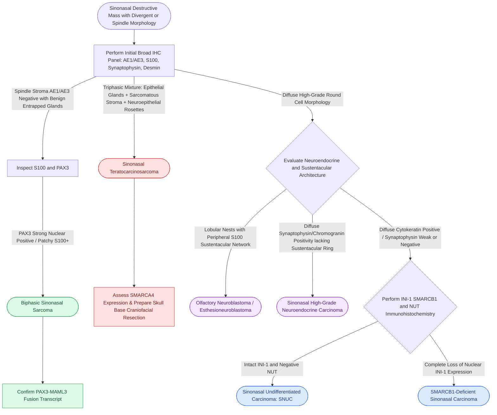

# Biphasic sinonasal malignancies exhibit divergent epithelial, mesenchymal, and neural differentiation requiring diagnostic immunohistochemical panels

## Active Recall

> [!question]- What defines the histologic composition and definitive molecular fusion of biphasic sinonasal sarcoma (BSNS)?
> *Answer / Clinical Rationale*: BSNS is characterized by an infiltrative **cellular spindle cell proliferation** admixed with entrapped, invaginating **benign-appearing glandular respiratory epithelium**. It is driven by recurrent **PAX3-MAML3** gene fusions [t(2;4)(q35;q31.1)] in >75% of cases (or less commonly *PAX3-FOXO1*). On immunohistochemistry, the spindle cell component is **PAX3-positive**, patchy S100-positive, and SMA-positive, while negative for cytokeratins (which only highlight the benign entrapped glands).

> [!question]- How does sinonasal teratocarcinosarcoma (SN-TCS) differ histopathologically and clinically from true sinonasal carcinosarcoma?
> *Answer / Clinical Rationale*: SN-TCS is a unique, highly aggressive **triphasic neoplasm** composed of: (1) malignant epithelial elements (adenocarcinoma or squamous cell carcinoma); (2) malignant mesenchymal elements (rhabdomyosarcoma, chondrosarcoma, or osteosarcoma); and (3) immature/fetal **neuroectodermal elements** (primitive neuroepithelial rosettes, neurofilaments). In contrast, true carcinosarcoma lacks primitive fetal neuroectodermal tissue. SN-TCS has an ominous clinical course, with rapid skull base invasion, high local recurrence, and a median survival of under 2 years.

> [!question]- What immunohistochemical staining panel differentiates sinonasal undifferentiated carcinoma (SNUC) from high-grade neuroendocrine carcinoma and olfactory neuroblastoma?
> *Answer / Clinical Rationale*: (1) **SNUC**: Strongly **pan-cytokeratin positive (AE1/AE3, CK8/18)** and EMA-positive, with weak or negative neuroendocrine markers (synaptophysin patchy/weak, chromogranin negative); (2) **Sinonasal Neuroendocrine Carcinoma (SNEC / Small cell)**: Strongly and diffusely **synaptophysin-positive, chromogranin-positive, and CD56-positive**; and (3) **Olfactory Neuroblastoma (ONB)**: Arranged in lobules with a peripheral sustentacular network highlighting **S100 and SOX10**, while tumor cells are **synaptophysin-positive, calretinin-positive**, and cytokeratin negative or weak.

## Core Clinical & Mechanistic Principles

The sinonasal tract harbors one of the most anatomically complex and histologically diverse spectra of neoplasms in the human body *(Cummings p.227–234)*. Tumors with **biphasic, triphasic, or multiphenotypic differentiation** frequently defy standard small-biopsy interpretation, requiring extensive panel-based immunohistochemistry (IHC) and targeted molecular testing to distinguish indolent entities from lethal skull base malignancies *(Cummings p.231–234)*.

### Spectrum of Biphasic and Multilineage Sinonasal Malignancies

#### 1. Biphasic Sinonasal Sarcoma (BSNS)
- **Clinical Presentation**: Arises in middle-aged adults (predominantly females) within the superior nasal cavity and ethmoid sinuses, presenting with unilateral nasal obstruction and epistaxis.
- **Histopathology**: Monotonous, cellular fascicular spindle cell proliferation resembling fibrosarcoma or synovial sarcoma, intertwined with proliferating, non-neoplastic hyperplastic respiratory glands.
- **IHC Profile**: Spindle cells demonstrate diffuse nuclear **PAX3 positivity**, focal nuclear/cytoplasmic **S100 positivity**, and smooth muscle actin (**SMA**) positivity. Cytokeratins (AE1/AE3) stain only the entrapped epithelial glands.
- **Molecular Pathology**: Driven by **PAX3-MAML3** chimeric fusion transcripts; exhibits low-to-intermediate metastatic risk but high local recurrence if margins are positive.

#### 2. Sinonasal Teratocarcinosarcoma (SN-TCS)
- **Clinical Presentation**: Extremely aggressive midline sino-orbital and anterior skull base mass in adult males, presenting with rapid epistaxis, proptosis, and cranial neuropathies.
- **Histopathology**: Triphasic histology exhibiting:
  - *Malignant Epithelial*: Glands (adenocarcinoma) and squamous sheets.
  - *Malignant Mesenchymal*: Spindle sarcomatous stroma, rhabdomyoblastic differentiation (myoglobin, desmin), and immature cartilage/bone.
  - *Neuroectodermal*: Primitive neuroepithelial tubules, Homer-Wright/Flexner-Wintersteiner-like rosettes, and ganglionic cells.
- **IHC Profile**: Heterogeneous multilineage reactivity (Cytokeratins in epithelial areas, Desmin/Myogenin in rhabdomyoblastic foci, Synaptophysin/Chromogranin in neuroectodermal components). Frequently demonstrates loss of **SMARCA4 (BRG1)** expression.

#### 3. Sinonasal Carcinosarcoma (True Malignant Mixed Tumor)
- **Histopathology**: Intimate mixture of malignant high-grade carcinoma (squamous cell carcinoma or adenocarcinoma) and high-grade sarcomatous stroma (fibrosarcoma, chondrosarcoma, osteosarcoma).
- **Pathogenesis**: Monoclonal divergent dedifferentiation of a high-grade epithelial carcinoma, lacking primitive neuroepithelial rosettes.

#### 4. SMARCB1 (INI-1)-Deficient Sinonasal Carcinoma
- **Histopathology**: Sheets of non-keratinizing basaloid, rhabdoid, or plasmacytoid cells with abundant pink cytoplasm and vesicular nuclei.
- **IHC Profile**: Complete loss of nuclear **SMARCB1 (INI-1)** expression in tumor cells with retained expression in background stromal vessels; variable cytokeratin positivity.

### Differential Diagnostic Panel for Sinonasal Malignancies

| Neoplasm | Architectural Hallmarks | Epithelial Markers (AE1/AE3, CK) | Neuroendocrine (Synap, Chromo) | Neural / Sustentacular (S100, SOX10) | Molecular / Unique Diagnostic Signature |
| :--- | :--- | :--- | :--- | :--- | :--- |
| **Biphasic Sinonasal Sarcoma** | Spindle fascicles + invaginating glands | Negative in stroma | Negative | Patchy S100+ | **PAX3-MAML3 fusion**, PAX3+ |
| **Sinonasal Teratocarcinosarcoma** | Triphasic: carcinoma, sarcoma, neuroectoderm | Positive in glands | Positive in rosettes | Variable | Primitive neural tubules, SMARCA4 loss |
| **Sinonasal Undifferentiated (SNUC)** | High mitotic sheets, necrosis, no pearls | **Strong / Diffuse+** | Weak / Negative | Negative | Pan-CK+, EMA+, absence of differentiation |
| **Olfactory Neuroblastoma (ONB)** | Lobular nests, fibrillary neuropil, rosettes | Negative to patchy | **Strong / Diffuse+** | **S100+ sustentacular ring** | Calretinin+, Hyams grading (I-IV) |
| **Sinonasal Neuroendocrine (SNEC)** | Salt-and-pepper chromatin, organoid nests | Positive | **Diffuse Synap+/Chromo+** | Negative | High-grade neuroendocrine markers |
| **SMARCB1-Deficient Carcinoma** | Rhabdoid/plasmacytoid monomorphic sheets | Variable Cytokeratins | Variable | Negative | **Loss of INI-1 (SMARCB1) expression** |

### Surgical & Multimodal Management Principles

1. **Surgical Clearance**: Complex sinonasal malignancies with anterior skull base, cribriform plate, or orbital invasion require multidisciplinary oncologic resection followed by vascularized flap transfer or [[Multi-layer skull base reconstruction combines underlay, inlay, and overlay barriers|multi-layer skull base reconstruction]]. Resections must obtain negative frozen-section margins along dural boundaries.
2. **Adjuvant Therapy**: High recurrence rates in teratocarcinosarcoma and biphasic sarcoma necessitate adjuvant intensity-modulated radiation therapy (IMRT) combined with platinum-based systemic chemotherapy.

## Connected Concepts & Graph Traversal
- **🔗 Undifferentiated Aggressive Counterpart (Sinus)**: [[Sinonasal undifferentiated carcinoma exhibits aggressive neuroendocrine features requiring multimodal therapy|Sinonasal Undifferentiated Carcinoma]]
- **Olfactory Neuroepithelial Malignancy**: [[Esthesioneuroblastoma arises from olfactory neuroepithelium and is staged by the Kadish classification|Esthesioneuroblastoma]]
- **🔗 Benign Mimic with Malignant Potential (Sinus)**: [[Sinonasal inverting papilloma requires subperiosteal excision and hyperostotic bone drill-out|Sinonasal Inverting Papilloma]]
- **🔗 Endoscopic Anterior Skull Base Corridor (Sinus)**: [[Transcribriform EEA provides access to olfactory groove meningiomas and esthesioneuroblastomas|Transcribriform EEA]]
- **Open Surgical Exposure Corridors**: [[Midface degloving, lateral rhinotomy, and Weber-Fergusson approaches provide graded open exposure for sinonasal and skull base malignancies|Open Sinonasal Surgical Approaches]]
- **🔗 Pediatric Parameningeal Malignancy (Pediatrics)**: [[Pediatric head and neck rhabdomyosarcoma stratifies into favorable orbital and unfavorable parameningeal sites managed with multimodality chemoradiation|Pediatric Parameningeal Rhabdomyosarcoma]]
