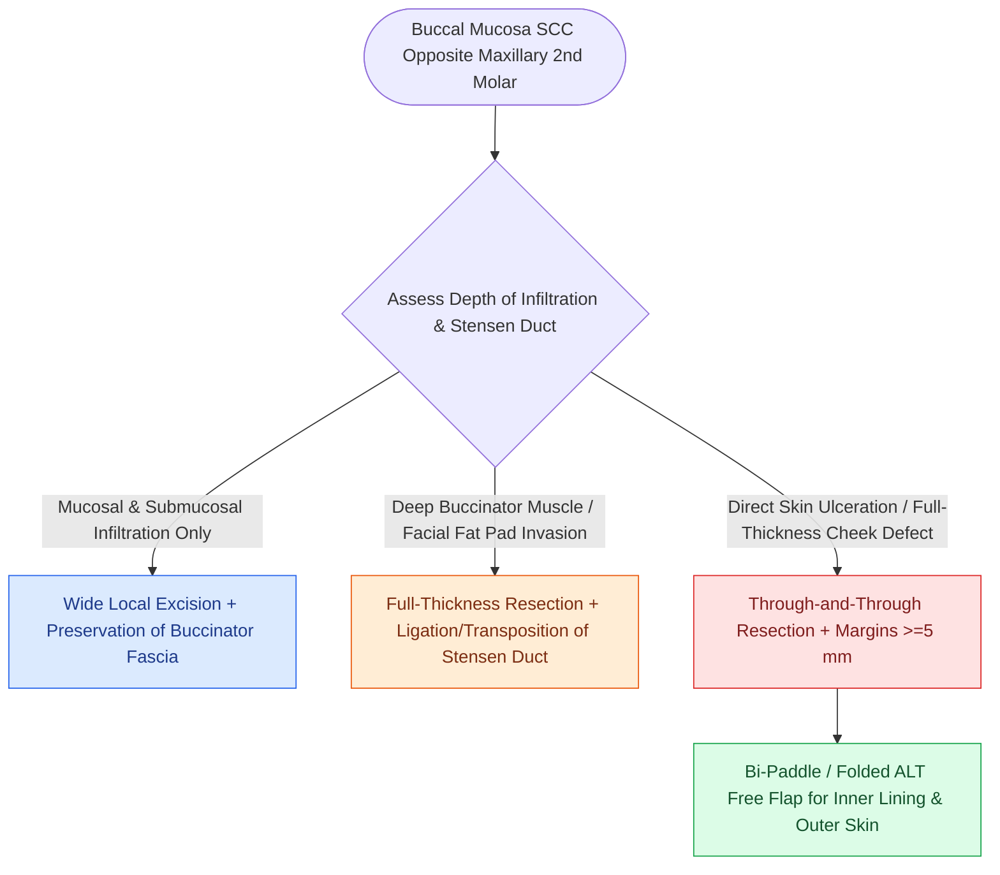

# Buccal mucosa carcinoma exhibits high rates of local recurrence and Stensen duct involvement

## Active Recall

> [!question]- Where does Stensen's (parotid) duct open in the oral cavity?
> *Answer / Clinical Rationale*: On the buccal mucosa opposite the **maxillary second molar tooth**.

> [!question]- What reconstructive option provides both internal mucosal lining and external skin coverage for through-and-through cheek defects?
> *Answer / Clinical Rationale*: A **chimeric or folded Anterolateral Thigh (ALT) free flap**.

## Core Clinical & Mechanistic Principles
Squamous cell carcinoma of the **buccal mucosa** is an aggressive oral malignancy associated with smokeless tobacco / betel nut chewing:
- **Anatomical Relationships**:
  - The mucosa covers the buccinator muscle and the buccal fat pad of Bichat.
  - **Stensen (Parotid) Duct**: Traverses the buccinator muscle and opens on a papilla opposite the maxillary second molar.
  - **Facial Nerve & Facial Artery**: Course immediately superficial to the buccinator muscle in the cheek.
- **Patterns of Infiltration**:
  - Infiltrates through the thin buccinator muscle into the buccal fat pad and subcutaneous tissue of the cheek, and may ulcerate through the overlying skin.
  - Spreads along Stensen's duct into the parotid gland.

### Surgical Technique & Critical Safety Checks
- **Surgical Execution**: Wide local excision with full-thickness through-and-through resection of cheek skin if involved. If Stensen's duct is divided, ligate it cleanly or transpose the proximal stump.
- **Reconstruction**: Reconstruct with an **ALT flap** (can be harvested as a bipaddle flap for inner lining and outer skin coverage) (see [[The anterolateral thigh flap provides versatile volume and can be harvested as a chimeric flap|ALT Free Flap]]).

## Connected Concepts & Graph Traversal
- **ALT Flap**: [[The anterolateral thigh flap provides versatile volume and can be harvested as a chimeric flap|ALT Free Flap]]
- **Clear Margins**: [[Oncologic clear margins require at least five millimeters of histological normal tissue|Oncologic Margins]]
- **Parotid Surgery**: [[The facial nerve main trunk is localized using the tragal pointer, tympanomastoid suture, and digastric ridge|Parotid Surgery]]
- **Anatomical Foundation**: [[Post-radiation carotid vasculopathy and osteoradionecrosis represent severe late radiotherapy sequelae]]
- **Surgical Lymphadenectomy**: [[Endovascular covered stenting and coil embolization provide emergent control of carotid blowout]]
- **Oncologic Resection & Margins**: [[Step-cut chevron mandibulotomy maximizes bone surface contact and rotational stability]]
- **Aerodigestive / Pharyngolaryngeal**: [[Circumferential laryngopharyngectomy requires tubed microvascular or visceral flap reconstruction]]
