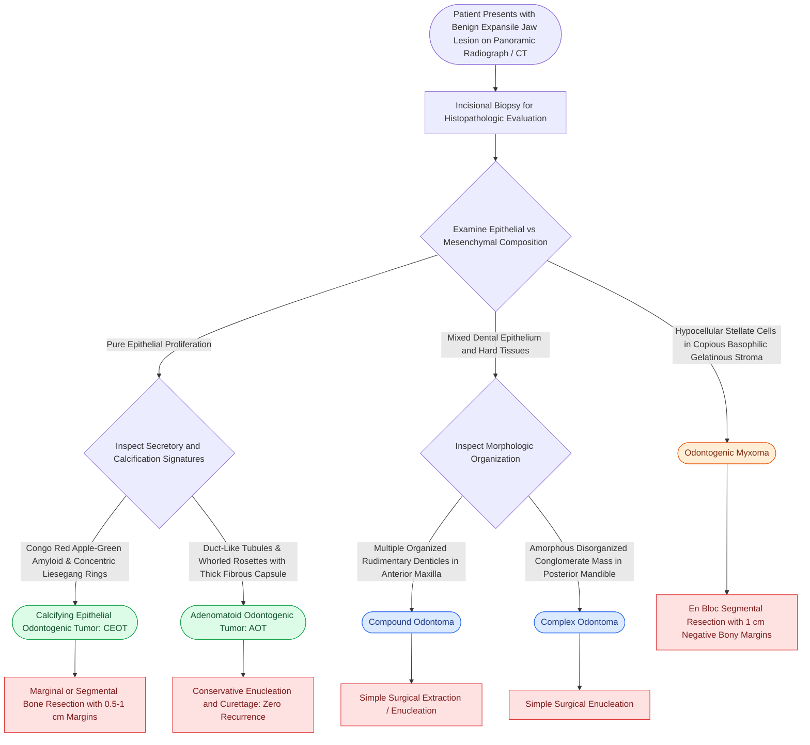

# Calcifying epithelial odontogenic tumors, adenomatoid odontogenic tumors, odontomas, and odontogenic myxomas exhibit distinct histopathologic hallmarks and biologic behaviors

## Active Recall

> [!question]- What is the pathognomonic histopathologic triad of the Calcifying Epithelial Odontogenic Tumor (CEOT / Pindborg tumor)?
> *Answer / Clinical Rationale*: (1) Discrete sheets and islands of **polyhedral epithelial cells with prominent intercellular bridges** and nuclear pleomorphism (without atypical mitoses); (2) abundant extracellular globular deposits of **homogeneous eosinophilic amyloid-like material** (derived from odontogenic ameloblast-associated protein) that exhibits **apple-green birefringence** under polarized light following Congo red staining; and (3) concentric calcified lamellar spherules termed **Liesegang rings** that coalesce into dense radiopaque masses.

> [!question]- What is the typical clinical presentation, anatomic predilection, and microscopic architecture of an Adenomatoid Odontogenic Tumor (AOT)?
> *Answer / Clinical Rationale*: AOT classically presents in **young females (second decade, <20 years)** as an asymptomatic expansion in the **anterior maxilla**, 75% of the time associated with the crown of an impacted canine (mimicking a dentigerous cyst). Histologically, it is encapsulated and features: (1) solid nodules and whorls of polyhedral epithelial cells; (2) **duct-like tubular structures** lined by cuboidal to columnar epithelial cells with nuclei polarized away from the lumen; and (3) small rosettes with minimal eosinophilic material. Because it is thick-walled and well-encapsulated, simple conservative enucleation and curettage is 100% curative with zero recurrence.

> [!question]- How do compound and complex odontomas differ anatomically, histomorphologically, and radiographically?
> *Answer / Clinical Rationale*: **Compound odontoma**: Occurs predominantly in the **anterior maxilla**; consists of multiple small, anatomically organized **rudimentary tooth-like structures (denticles)** containing orderly enamel, dentin, cementum, and pulp arranged in correct morphologic orientation. Radiographically, it appears as a cluster of miniature teeth surrounded by a radiolucent halo. **Complex odontoma**: Occurs predominantly in the **posterior mandible (molar region)**; consists of a single, disorganized **amorphous conglomerate mass of mature dental hard tissues** lacking anatomic tooth geometry. Radiographically, it appears as a dense, irregular radiopaque mass surrounded by a thin radiolucent line.

## Core Clinical & Mechanistic Principles

Odontogenic tumors comprise an extraordinarily diverse family of jaw lesions derived from epithelial, ectomesenchymal, or mixed components of the developing tooth apparatus *(Cummings p.221–226)*. Correct histopathologic classification is essential because biologic behavior ranges from self-limiting developmental hamartomas curable with simple curettage to aggressively infiltrative neoplasms requiring segmental bone resection *(Cummings p.223–225)*.

### Histogenetic Classification of Benign Odontogenic Tumors

#### 1. Pure Epithelial Odontogenic Tumors
- **Calcifying Epithelial Odontogenic Tumor (CEOT / Pindborg Tumor)**:
  - *Demographics & Site*: Adults (30–50 years); 75% arise in the posterior mandible (premolar-molar area), often associated with an impacted mandibular molar.
  - *Histopathology*: Sheets of polyhedral epithelial cells showing distinct cell borders, prominent intercellular bridges, and marked nuclear pleomorphism (which frequently leads to mistaken overdiagnosis as metastatic carcinoma). The background contains amorphous eosinophilic amyloid that stains with **Congo red (displaying apple-green birefringence under polarized light)** and calcifies into concentric **Liesegang rings**.
  - *Biologic Behavior*: Locally invasive with cortical bone perforation; recurrence rate is 15–20% following simple curettage. Requires conservative surgical resection with 0.5 to 1.0 cm clear bony margins.
- **Adenomatoid Odontogenic Tumor (AOT)**:
  - *Demographics & Site*: "Two-thirds tumor" (two-thirds female, two-thirds in second decade, two-thirds in maxilla, two-thirds associated with impacted canine).
  - *Histopathology*: Thick fibrous capsule enclosing solid epithelial whorls, pseudoglandular or duct-like hollow tubules lined by columnar cells, and eosinophilic material.
  - *Biologic Behavior*: Completely benign, non-invasive hamartomatous proliferation; easily enucleated from surrounding bone without recurrence.

#### 2. Mixed Epithelial and Ectomesenchymal Tumors (Odontomas)
Odontomas are developmental malformations (hamartomas) rather than true autonomous neoplasms:
- **Compound Odontoma**:
  - Contains differentiated enamel, dentin, cementum, and pulp organized into recognizable miniature tooth-like units (denticles).
  - Predominantly localized to the incisor-canine area of the maxilla.
  - Often prevents normal eruption of permanent succedaneous teeth.
- **Complex Odontoma**:
  - Consists of disorganized, haphazard aggregates of mature enamel matrix, dentin, cementum, and pulp tissue forming a solid calcified mass.
  - Predominantly localized to the posterior mandible.
  - Enucleation with conservative curettage is definitive for both types; recurrence is essentially zero.

#### 3. Pure Ectomesenchymal Odontogenic Tumors
- **Odontogenic Myxoma**:
  - *Derivation*: Arises from the ectomesenchyme of the dental papilla or dental follicle.
  - *Demographics & Site*: Young adults (10–30 years); affects the mandible more than maxilla.
  - *Histopathology*: Abundant, loose, gelatinous, basophilic **extracellular matrix rich in hyaluronic acid and chondroitin sulfate**, populated by bland, hypocellular stellate and spindle cells with delicate cytoplasmic processes. Lacks an epithelial component or fibrous capsule.
  - *Radiography*: Expansile, multilocular radiolucency with fine, delicate trabeculations described as a **"soap-bubble", "honeycomb", "tennis-racket", or "stepladder" pattern**.
  - *Biologic Behavior*: Highly infiltrative; the gelatinous tumor matrix creeps into adjacent cancellous marrow spaces beyond radiographic boundaries. Curettage results in a **25% local recurrence rate**. Treatment requires complete en bloc or segmental resection with 1.0 cm bony margins.

### Comparative Clinicopathologic Matrix

| Neoplasm | Origin | Anatomic Site | Key Histologic Hallmarks | Radiographic Appearance | Recommended Surgical Strategy |
| :--- | :--- | :--- | :--- | :--- | :--- |
| **CEOT (Pindborg)** | Epithelial | Posterior mandible (75%) | Polyhedral cells, amyloid globules, **Liesegang rings** | Mixed radiolucent-radiopaque ("driven-snow") | Resection with 0.5–1 cm bony margins |
| **AOT** | Epithelial | Anterior maxilla (canine) | **Duct-like tubules**, whorls, rosettes, thick capsule | Unilocular radiolucency around crown; snowstorm flecks | Conservative enucleation & curettage |
| **Compound Odontoma** | Mixed | Anterior maxilla | Multiple organized miniature **denticles** | Collection of small radiopaque tooth-like denticles | Conservative enucleation |
| **Complex Odontoma** | Mixed | Posterior mandible | Disorganized conglomerate of hard dental tissues | Dense conglomerate radiopacity with radiolucent halo | Conservative enucleation |
| **Odontogenic Myxoma** | Mesenchymal | Mandible > Maxilla | Gelatinous matrix, stellate cells, **non-encapsulated** | Multilocular "tennis-racket" / "stepladder" radiolucency | En bloc resection with 1.0 cm margins |

### Surgical & Anatomic Considerations

1. **Biopsy & Margin Planning**: Prior to definitive operative intervention, accurate deep bone biopsy avoids confusing the cellular pleomorphism of CEOT with malignant carcinoma or confusing the myxoid matrix of an odontogenic myxoma with normal tooth follicles.
2. **Surgical Precision**: Transoral exposure for conservative enucleation of AOT and odontomas is performed under local nerve blockade using [[Dental local anesthesia relies on anatomic landmarks to block the inferior alveolar, greater palatine, and superior alveolar nerves|mandibular and maxillary nerve blocks]]. In contrast, for infiltrative odontogenic myxomas and large CEOT lesions, segmental mandibulectomy with immediate vascularized fibula free flap reconstruction is required to achieve oncologic cure while preserving masticatory occlusion.

## Connected Concepts & Graph Traversal
- **Locally Aggressive Epithelial Benchmark**: [[Ameloblastoma exhibits multilocular soap-bubble radiolucency and requires segmental resection with one-centimeter bony margins|Ameloblastoma Staging & Resection]]
- **Syndromic Keratocystic Paradigm**: [[Odontogenic keratocysts arise from PTCH1 mutations in Gorlin syndrome and exhibit high recurrence after simple enucleation|Odontogenic Keratocysts]]
- **Pericoronal Follicular Cyst**: [[Dentigerous cysts arise from the follicular epithelium surrounding the crown of an unerupted third molar|Dentigerous Cysts]]
- **Benign Fibro-Osseous Differential**: [[Craniofacial fibrous dysplasia and cherubism manifest as benign fibro-osseous jaw lesions managed with surgical contouring|Fibro-Osseous Jaw Lesions]]
- **Quadrant Dental Topography**: [[The Universal Numbering System and Palmer Notation designate primary and permanent dentition across four oral quadrants|Dental Topography & Numbering]]
- **Definitive Bony Resection**: [[Segmental mandibulectomy resects full-thickness bone for medullary invasion and irradiated bone recurrence|Segmental Mandibulectomy]]
