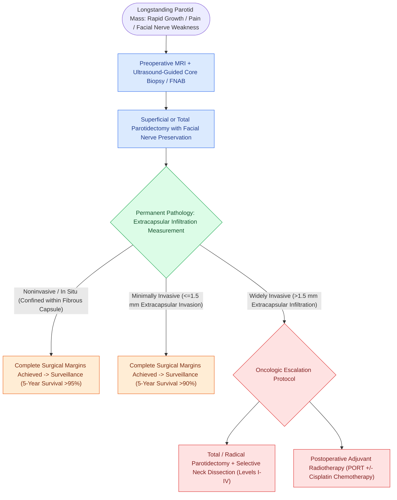

# Carcinoma ex pleomorphic adenoma arises from longstanding benign mixed tumors and is stratified by capsular invasion into noninvasive, minimally invasive, and widely invasive subtypes

## Active Recall

> [!question]- How does the depth of extracapsular invasion stratify carcinoma ex pleomorphic adenoma (CXPA) into three distinct prognostic tiers, and how does this dictate clinical management?
> *Answer / Clinical Rationale*: CXPA is categorized by the extent of malignant penetration beyond the fibrous capsule: **noninvasive (intracapsular/in situ)** has zero capsular breach; **minimally invasive** exhibits $\le 1.5\text{ mm}$ of invasion into adjacent salivary tissue; **widely invasive** extends $>1.5\text{ mm}$ beyond the capsule. Noninvasive and minimally invasive variants have a $>90\%$ 5-year survival and are cured with complete parotidectomy with clear margins alone, whereas widely invasive CXPA carries a poor prognosis ($<30\text{–}40\%$ survival) requiring total parotidectomy, neck dissection, and adjuvant radiation therapy.
>
> [!question]- What quartet of clinical signs in a patient presenting with a longstanding, slow-growing parotid mass strongly indicates malignant conversion to CXPA?
> *Answer / Clinical Rationale*: **Sudden rapid acceleration of growth**, **new-onset pain**, **fixation to overlying skin or masseter muscle**, and **facial nerve paresis or paralysis**. The development of facial nerve weakness in the setting of a previously asymptomatic pre-existing parotid nodule is virtually pathognomonic of malignant transformation.

## Core Clinical & Mechanistic Principles

**Carcinoma ex pleomorphic adenoma (CXPA)** represents the malignant transformation of epithelial elements within a pre-existing benign [[Pleomorphic adenoma requires superficial parotidectomy with a cuff of normal tissue to prevent pseudopod recurrence|pleomorphic adenoma]], accounting for approximately 12% of all malignant salivary neoplasms and 3% of all salivary gland tumors:
- **Pathogenesis & Transformation Timeline**:
  - The lifetime cumulative risk of malignant conversion in an unoperated pleomorphic adenoma is 1.5% at 5 years, escalating to **9.5% to 10% after 15 years**.
  - Clonal progression involves initial architectural and cytogenetic rearrangements of *PLAG1* or *HMGA2*, followed by secondary accumulation of *TP53* mutations, loss of heterozygosity at 17p, and amplification of *HER2/neu* (ERBB2).
  - The carcinomatous component most frequently dedifferentiates into **salivary duct carcinoma**, high-grade adenocarcinoma not otherwise specified (NOS), or undifferentiated carcinoma.
- **Histopathologic Stratification by Capsular Infiltration**:
  1. *Noninvasive (Intracapsular / In Situ) CXPA*: The malignant carcinoma is confined entirely within the lumen and fibrous pseudocapsule of the benign mixed tumor, with intact capsular boundaries.
  2. *Minimally Invasive CXPA*: Malignant epithelial cells penetrate through the fibrous capsule, but the maximum linear extent of infiltration into adjacent salivary parenchyma measures **$\le 1.5\text{ mm}$**.
  3. *Widely Invasive CXPA*: Malignant elements infiltrate extensively into surrounding normal salivary tissue, adipose tissue, skeletal muscle, or periosteum, extending **$>1.5\text{ mm}$** beyond the capsular edge.

### Surgical Technique, Facial Nerve Management, & Nodal Staging

1. **Parotidectomy Resection Strategy**:
   - For tumors preoperatively suspected of being benign pleomorphic adenomas, standard [[Superficial parotidectomy dissects the facial nerve branches to resect the lateral salivary lobe|superficial parotidectomy]] with identification and preservation of the facial nerve trunk and branches is performed. Enucleation is contraindicated.
   - When widely invasive CXPA is confirmed, completion total parotidectomy is required.
   - If the facial nerve branches are anatomically distinct from tumor, they are dissected free and preserved. Direct malignant encasement or preoperative facial paralysis mandates en bloc sacrifice of involved nerve segments back to clean frozen-section margins.
2. **Management of Cervical Lymphatics & Adjuvant Therapy**:
   - Noninvasive and minimally invasive CXPA carry a $<5\%$ risk of regional lymph node metastasis; elective neck dissection is not indicated.
   - Widely invasive CXPA carries an occult nodal metastasis rate of **40% to 50%**. An ipsilateral selective neck dissection clearing Levels I through IV is mandatory even in the clinically negative (cN0) neck.
   - Postoperative intensity-modulated radiotherapy (60–66 Gy) is indicated for all widely invasive tumors, close or positive surgical margins, high-grade histology, perineural invasion, and pathological nodal involvement.

## Connected Concepts & Graph Traversal

- **Benign Precursor Neoplasm**: [[Pleomorphic adenoma requires superficial parotidectomy with a cuff of normal tissue to prevent pseudopod recurrence|Pleomorphic Adenoma]]
- **High-Grade Malignant Dedifferentiation**: [[Salivary duct carcinoma is an aggressive high-grade malignancy expressing androgen receptors and HER2|Salivary Duct Carcinoma Phenotype]]
- **Aggressive Radical Extirpation**: [[Total parotidectomy with facial nerve sacrifice is indicated for direct malignant nerve invasion|Total Radical Parotidectomy]]
- **Immediate Facial Reanimation**: [[Immediate facial nerve grafting with the great auricular or sural nerve restores facial reanimation|Cable Nerve Grafting]]
- **Adjuvant Oncologic Escalation**: [[Intensity-modulated radiation therapy and cisplatin radiosensitization form the standard definitive chemoradiation regimen|Postoperative Chemoradiation]]
- **Low-Grade Histological Contrast**: [[Acinic cell carcinoma presents as an indolent low-grade parotid neoplasm with serous acinar differentiation|Acinic Cell Carcinoma Comparison]]
