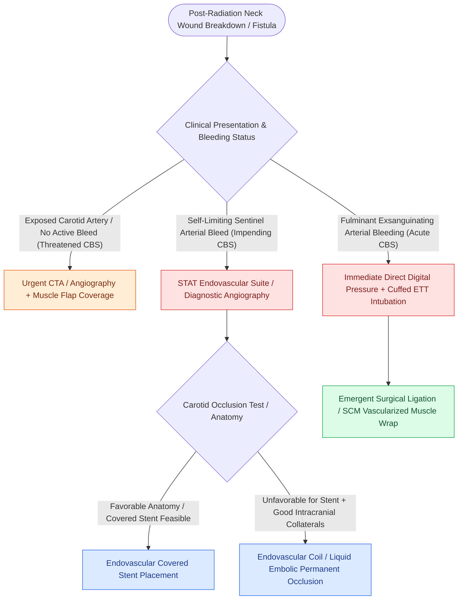

# Carotid blowout syndrome is classified into threatened, impending, and acute hemorrhage

## Active Recall

> [!question]- What clinical triad represents the highest risk setting for carotid blowout syndrome?
> *Answer / Clinical Rationale*: **Prior radiation therapy**, **pharyngocutaneous salivary fistula**, and **overlying skin flap breakdown/wound dehiscence**.

> [!question]- What is the definition of an 'impending' carotid blowout?
> *Answer / Clinical Rationale*: A self-limiting **sentinel arterial bleed** that temporarily stops, heralding an impending catastrophic rupture.

## Core Clinical & Mechanistic Principles
**Carotid Blowout Syndrome (CBS)** is a catastrophic complication of head and neck cancer surgery, characterized by rupture of the extracranial carotid artery or its branches:
- **Etiology & Risk Factors**:
  1. Prior high-dose radiotherapy ($>60\text{–}70\text{ Gy}$ causing adventitial necrosis and vasa vasorum thrombosis).
  2. [[Pharyngocutaneous fistula is managed with wound care, nutritional support, and surgical flap closure|Pharyngocutaneous fistula]] exposing the carotid artery to saliva and oral flora.
  3. Wound breakdown, flap necrosis, and persistent local tumor recurrence.
- **Clinical Classification**:
  - **Threatened CBS**: Exposed carotid artery visible in a dehiscent neck wound or fistula bed without active bleeding (high imminent rupture risk).
  - **Impending CBS**: Self-limiting "sentinel bleed" that resolves spontaneously or with local pressure; precursor to catastrophic hemorrhage.
  - **Acute CBS**: Uncontrolled, fulminant exsanguinating arterial hemorrhage through the neck wound or oral cavity.

## References
1. Medina, J.E., Vasan, N.R. (2013). Neck Dissection. In Johnson, J.J., Rosen, C.A. (Eds.), *Bailey’s Head and Neck Surgery-Otolaryngology* 5e (pp. 1807-1838). Baltimore, MD: Lippincott Williams & Wilkins.
2. Mydlarz, W.K., Eisele, D.W. (2020). Complications of Neck Surgery. In Flint, P.W., et al. (Eds.), *Cummings Otolaryngology Head and Neck Surgery* 7e (pp. 1831-1839). Philadelphia, PA: Elsevier.
3. Suárez, C., Fernández-Alvarez, V., Hamoir, M., et al. (2018). Carotid blowout syndrome: Modern trends in management. *Cancer Manag Res*, 10:5617-5628.

## Connected Concepts & Graph Traversal
- **Endovascular Control**: [[Endovascular covered stenting and coil embolization provide emergent control of carotid blowout|Endovascular Management]]
- **Radiation Vasculopathy**: [[Post-radiation carotid vasculopathy and osteoradionecrosis represent severe late radiotherapy sequelae|Radiation Vasculopathy]]
- **Pharyngocutaneous Fistula**: [[Pharyngocutaneous fistula is managed with wound care, nutritional support, and surgical flap closure|Fistula Management]]
- **Anatomical Foundation**: [[The danger space permits unrestricted infection spread from skull base to posterior mediastinum]]
- **Surgical Lymphadenectomy**: [[The spinal accessory nerve is identified at the Erb point and anterior border of the SCM]]
- **Oncologic Resection & Margins**: [[Marginal mandibulectomy preserves basilar bone height when tumor abuts but does not invade marrow]]
- **Aerodigestive / Pharyngolaryngeal**: [[Circumferential laryngopharyngectomy requires tubed microvascular or visceral flap reconstruction]]
