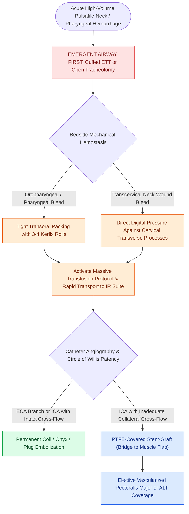

# Carotid blowout syndrome management includes throat packing, endovascular embolization, and carotid stenting

## Active Recall

> [!question]- Why is securing a cuffed airway prioritized over blood product transfusion during acute carotid blowout?
> *Answer / Clinical Rationale*: Patients with acute carotid blowout die rapidly from **airway asphyxiation and drowning in aspirated blood**; inflating a cuffed endotracheal tube isolates the lungs, enabling successful pharyngeal packing and ongoing volume resuscitation.

> [!question]- What is the primary long-term failure mechanism of covered stent-graft placement in irradiated carotid blowout patients?
> *Answer / Clinical Rationale*: The stent-graft is deployed within a **contaminated, poorly vascularized, saliva-exposed wound bed**, leading to chronic graft bacterial colonization, persistent pseudoaneurysm, and **high rates of catastrophic recurrent re-bleeding**.

## Core Clinical & Mechanistic Principles
**[[Carotid blowout syndrome is classified into threatened, impending, and acute hemorrhage|Carotid Blowout Syndrome]] (CBS)** is the rupture of the extracranial carotid artery or its major branches, occurring almost exclusively in patients with advanced head and neck squamous cell carcinoma following multimodal therapy ([[Radical neck dissection removes levels I through V while sacrificing CN XI, the IJV, and the SCM|radical neck dissection]], high-dose radiation therapy, tumor recurrence, wound dehiscence, or [[Pharyngocutaneous fistula is managed with wound care, nutritional support, and surgical flap closure|pharyngocutaneous fistula]]). Mortality in acute CBS ranges from **40% to 80%**, with acute asphyxiation from blood pooling in the tracheobronchial tree representing the primary mechanism of death. Immediate algorithmic resuscitation and transfer to Interventional Radiology (IR) or the Operating Room is mandatory:

- **The Three Stages of Carotid Blowout Syndrome**:
  1. **Threatened CBS**: Physical or radiologic exposure of the carotid sheath to air, saliva, or active tumor necrosis without bleeding.
  2. **Impending CBS**: A self-limited, spontaneous **[[Sentinel bleeding in head and neck cancer patients requires urgent CT angiography to evaluate for threatened carotid blowout|sentinel bleed]]** ($>5–20\text{ mL}$) into the oral cavity, pharynx, or cervical wound, herald of imminent catastrophic rupture within 24 to 72 hours.
  3. **Acute CBS**: Exsanguinating, high-volume pulsatile hemorrhage requiring immediate bedside physical tamponade.

- **Acute Bedside Resuscitation Protocol**:
  - **Immediate Airway Control Takes Precedence Over Transfusion**: Patients die rapidly of **asphyxiation and airway soiling**, not hypovolemia. Perform immediate endotracheal intubation using a cuffed tube; if blood floods the field, establish an emergent [[Standard open tracheotomy utilizes horizontal intersinusoidal or Bjork flap entry|open tracheostomy or cricothyrotomy]].
  - **Aggressive Oropharyngeal Packing**: Following cuffed airway securement, pack the pharynx tightly with **3 to 4 unfolded Kerlix gauze rolls** advanced deeply into the pyriform sinus and tonsillar bed to tamponade mucosal hemorrhage against the cervical spine.
  - **External Direct Digital Pressure**: For transcervical bleeding, apply precise, focal digital pressure directly over the carotid bifurcation against the transverse processes of the cervical vertebrae. *Strictly avoid blind instrument clamping in the neck*, which lacerates adjacent cranial nerves (CN X, XII) and tears the friable carotid wall.
  - **Resuscitation**: Activate Massive Transfusion Protocol (MTP), maintain mean arterial pressure, and reverse therapeutic coagulopathy.

### Key Consultation Supplies
- Coaxial surgical headlight
- Personal protective equipment (fluid-shield face mask, gown, sterile gloves)
- Dual large-bore suction setups with sterile Yankauer tips
- Flexible fiberoptic video nasopharyngoscope
- Airway emergency cart with assortment of cuffed endotracheal tubes and open tracheotomy kit
- Pharyngeal packing pack: 4 rolls of sterile Kerlix gauze, long curved Kelly / tonsil clamps, tongue depressors
- Rapid infuser and blood administration sets (for massive transfusion protocol activation)

### Endovascular & Reconstructive Modalities
1. **Transcatheter Endovascular Embolization (Deconstructive)**:
   - Primary treatment for external carotid artery (ECA) branches (lingual, facial, maxillary) using micro-coils, Gelfoam, or liquid embolic agents (Onyx).
   - If the Internal Carotid Artery (ICA) or Common Carotid Artery (CCA) is ruptured, permanent coil or Amplatzer vascular plug sacrifice is performed provided collateral intracranial flow through the circle of Willis is documented.
2. **Endovascular Covered Stenting (Reconstructive)**:
   - Placement of a PTFE-covered stent-graft (e.g., Gore Viabahn) across the CCA/ICA pseudoaneurysm preserves cerebral blood flow in patients who cannot tolerate vessel sacrifice.
   - *Critical Limitation*: In irradiated, saliva-contaminated necrotic wound beds, stent infection occurs in up to 40% of cases, leading to delayed recurrent blowout. Covered stenting should be viewed as a **hemostatic bridge to elective surgical reconstruction or vascularized muscle flap coverage** (e.g., pectoralis major or anterolateral thigh free flap).

## References
1. Medina, J.E., Vasan, N.R. (2013). Neck Dissection. In Johnson, J.J., Rosen, C.A. (Eds.), *Bailey’s Head and Neck Surgery-Otolaryngology* 5e (pp. 1807-1838). Baltimore, MD: Lippincott Williams & Wilkins.
2. Mydlarz, W.K., Eisele, D.W. (2020). Complications of Neck Surgery. In Flint, P.W., et al. (Eds.), *Cummings Otolaryngology Head and Neck Surgery* 7e (pp. 1831-1839). Philadelphia, PA: Elsevier.
3. Suárez, C., Fernández-Alvarez, V., Hamoir, M., et al. (2018). Carotid blowout syndrome: Modern trends in management. *Cancer Manag Res*, 10:5617-5628.
4. Manzoor, N.F., Pezaee, R.P., Ray, A., et al. (2017). Contemporary management of carotid blowout syndrome using endovascular techniques. *Laryngoscope*, 127(2):383-390.

## Connected Concepts & Graph Traversal
- **Classification & Staging**: [[Carotid blowout syndrome is classified into threatened, impending, and acute hemorrhage|Carotid Blowout Classification]]
- **Diagnostic Protocol**: [[Sentinel bleeding in head and neck cancer patients requires urgent CT angiography to evaluate for threatened carotid blowout|Sentinel Bleed Workup & CTA]]
- **Tracheal Counterpart**: [[Massive tracheostomy hemorrhage requires cuff overinflation, digital compression, and emergent surgical or endovascular control|Tracheostomy Massive Bleeding]]
- **Flap Protection**: [[Postoperative free flap compromise within forty-eight hours requires emergent surgical re-exploration for pedicle salvage|Vascularized Muscle Flap Coverage]]
- **Surgical Anatomy**: [[The parapharyngeal space is an inverted pyramid connecting peritonsillar, masticator, parotid, and retropharyngeal spaces|Carotid Sheath in Parapharyngeal Space]]
