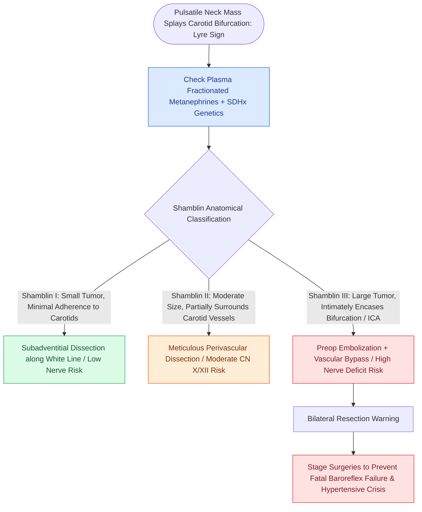

# Carotid body paragangliomas splay the bifurcation and are graded by the Shamblin classification

## Active Recall

> [!question]- Describe the imaging feature separating carotid body from vagal paraganglioma.
> *Answer / Clinical Rationale*: Carotid body tumors splay ICA from ECA (lyre sign); vagal tumors displace the carotid axis anteriorly/medially without splaying.

> [!question]- Why does an SDHB mutation change the entire care plan?
> *Answer / Clinical Rationale*: It confers multifocality and metastatic potential — driving whole-body surveillance, family testing, and greater caution about intervention timing.

## Core Clinical & Mechanistic Principles
- Imaging signature: avidly enhancing mass **splaying the internal and external carotids (lyre sign)** at the bifurcation — versus vagal paragangliomas, which displace both vessels anteromedially without splaying, and schwannomas, which enhance less avidly.
- **Shamblin**: I minimal carotid attachment; II partial encasement; III circumferential encasement — the grade predicts vascular reconstruction likelihood and cranial nerve (X, XII, sympathetic) injury risk.
- Genetics moved center stage: **SDHx germline mutations** (notably SDHB — multifocality and malignant potential) mandate testing in essentially all cervical paragangliomas, with family cascade screening and whole-body surveillance in carriers.
- Function check before any manipulation: secretory head-neck paragangliomas are uncommon but plasma metanephrines are cheap and the intraoperative surprise is not.

### Management & Critical Safety Checks
- Management is not reflexively surgical: observation for small/elderly/bilateral disease, radiation for control in poor candidates; surgery (subadventitial dissection along the white line, early vascular control, lighted expectations for Shamblin III) when growth or symptoms demand.
- Bilateral resections risk **baroreflex failure**; stage them and warn the anesthetic team (see [[Jugular paragangliomas arise from the glomus body in the adventitia of the jugular bulb|Glomus Jugulare Pathology]]).

## Connected Concepts & Graph Traversal
- **Jugular Skull Base Paraganglioma**: [[Jugular paragangliomas arise from the glomus body in the adventitia of the jugular bulb|Glomus Jugulare Pathology]]
- **Skull Base Paraganglioma Staging**: [[Fisch classification categorizes temporal bone and skull base paragangliomas from Class A to Class D|Fisch Temporal Bone Paraganglioma Staging]]
- **Preoperative Embolization**: [[Preoperative embolization reduces intraoperative blood loss in hypervascular glomus jugulare tumors|Endovascular Embolization Technique]]
- **Carotid Vascular Emergency**: [[Carotid blowout syndrome is classified into threatened, impending, and acute hemorrhage|Carotid Injury & Blowout Planning]]
- **Anatomical Exposure Corridors**: [[Penetrating neck trauma anatomical zones I, II, and III dictate surgical exposure corridors|Zone II Carotid Bifurcation Access]]
- **Differential Diagnosis**: [[Jugular foramen masses differentiate into paraganglioma, schwannoma, and meningioma based on bone erosion patterns and MRI signal characteristics|Jugular Foramen Mass Differential]]
