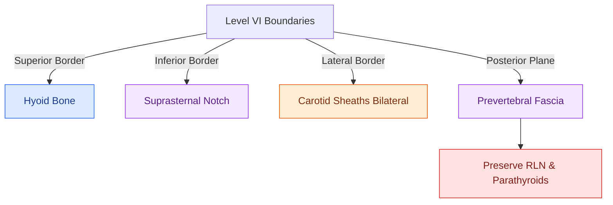

# Central compartment neck dissection clears level VI nodes between the carotid sheaths and suprasternal notch

## Active Recall

> [!question]- What anatomical boundaries define the central compartment (Level VI) of the neck?
> *Answer / Clinical Rationale*: The **hyoid bone superiorly**, **suprasternal notch inferiorly**, and the **medial borders of the common carotid arteries laterally**.

> [!question]- What are the prelaryngeal lymph nodes on the cricothyroid membrane called?
> *Answer / Clinical Rationale*: The **Delphian lymph nodes**.

## Core Clinical & Mechanistic Principles
**Central Compartment Neck Dissection (Level VI Dissection)** encompasses the lymph nodes situated in the anterior midline of the neck:
- **Anatomical Boundaries**:
  - **Superior Boundary**: Hyoid bone.
  - **Inferior Boundary**: Suprasternal notch (innominate artery).
  - **Lateral Boundaries**: Medial borders of the common carotid arteries bilaterally.
  - **Posterior Boundary**: Prevertebral fascia (tracheoesophageal groove and esophagus).
- **Lymph Node Subgroups Included**:
  - **Prelaryngeal (Delphian) Nodes**: Above thyroid isthmus on cricothyroid membrane.
  - **Pretracheal Nodes**: Anterior to trachea below isthmus.
  - **Paratracheal Nodes (Bilateral)**: In tracheoesophageal grooves along recurrent laryngeal nerves.
- **Primary Indications**: Papillary and medullary thyroid carcinomas, advanced subglottic laryngeal cancer, and cervical tracheal tumors.

### Surgical Technique & Critical Safety Checks
- **Technical Hazards**:
  - **Recurrent Laryngeal Nerve (RLN)**: Must be skeletonized and preserved bilaterally.
  - **Parathyroid Glands (Superior & Inferior)**: Must be identified and preserved with their vascular supply; devascularized glands must be minced and **autotransplanted into the SCM** to prevent permanent hypoparathyroidism (see [[The recurrent laryngeal nerve is identified within Simon's triangle and followed through Berry's ligament|RLN in Thyroidectomy]]).

## Connected Concepts & Graph Traversal
- **Thyroidectomy**: [[The recurrent laryngeal nerve is identified within Simon's triangle and followed through Berry's ligament|RLN in Thyroidectomy]]
- **Parathyroid Preservation**: [[Superior and inferior parathyroid glands maintain constant anatomical relationships to the RLN and ITA|Parathyroid Anatomy]]
- **Thyroid Cancer**: [[Papillary thyroid carcinoma spreads via cervical lymphatics to central and lateral neck compartments|Papillary Thyroid Carcinoma]]
- **Anatomical Foundation**: [[AJCC 8th edition incorporates depth of invasion into oral cavity T-staging]]
- **Surgical Lymphadenectomy**: [[Level I dissection requires facial vessel ligation and preservation of the lingual and hypoglossal nerves]]
- **Oncologic Resection & Margins**: [[Hard palate and upper alveolar carcinoma require partial or total maxillectomy]]
- **Aerodigestive / Pharyngolaryngeal**: [[Total laryngectomy achieves en bloc laryngeal resection with permanent end-stoma]]
