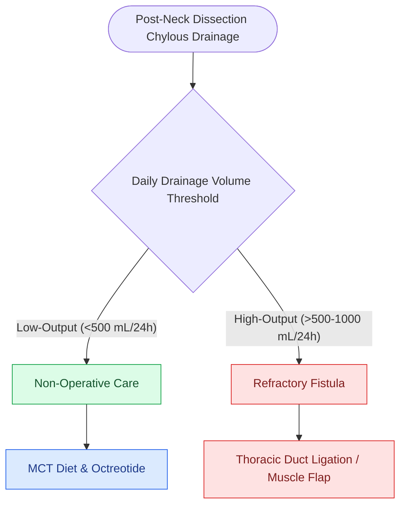

# Cervical chyle leaks are managed with MCT diet, octreotide, or surgical thoracic duct ligation

## Active Recall

> [!question]- Why does a Medium-Chain Triglyceride (MCT) diet reduce thoracic duct chyle flow?
> *Answer / Clinical Rationale*: MCTs are water-soluble and absorbed **directly into the portal venous system**, completely bypassing lymphatic lacteals and the thoracic duct.

> [!question]- What drain output threshold defines a high-output chyle leak requiring surgical re-exploration?
> *Answer / Clinical Rationale*: Drain output **$>1,000\text{ mL/day}$ for $>48\text{–}72\text{ hours}$** or persistent leak $>14$ days unresponsive to conservative measures.

## Core Clinical & Mechanistic Principles
Postoperative **cervical chyle leak** occurs in $1\text{–}3\%$ of neck dissections, presenting with high drain output that turns milky-white upon resumption of enteral feeding:
- **Complications**: Severe electrolyte wasting (hyponatremia, hypokalemia), metabolic acidosis, hypovolemia, profound lymphopenia, and flap dehiscence from enzymatic tissue breakdown.
- **Stepwise Management Algorithm**:
  1. **Low-Output Leak ($<500\text{ mL/day}$)**:
     - **Medium-Chain Triglyceride (MCT) Diet**: Long-chain fatty acids are packaged into chylomicrons and enter thoracic duct lymphatics; MCTs (C6–C12) are absorbed directly across enterocytes into the portal vein, reducing duct flow.
     - **Octreotide / Somatostatin**: Subcutaneous infusion ($100\text{ mcg}$ TID) reduces splanchnic blood flow and gastrointestinal lymphatic secretions.
     - **Pressure Dressing**: Compresses dead space over left Level IV.
  2. **High-Output Leak ($>1,000\text{ mL/day}$ or Persistent $>14$ Days)**:
     - **NPO + Total Parenteral Nutrition (TPN)**.
     - **Surgical Re-exploration**:
       - *Transcervical Exploration*: Ingest heavy cream preoperatively; identify leak under Valsalva; suture-ligate duct with 3-0 Prolene/Silk; apply fibrin glue and local SCM/omohyoid muscle flap.
       - *Thoracoscopic (VATS) Ligation*: Ligate thoracic duct supradiaphragmatically between the aorta and azygos vein.

### Surgical Technique & Critical Safety Checks
- **Interventional Radiology Option**: Percutaneous thoracic duct cannulation and coil embolization via transabdominal lymphangiography (see [[Thoracic duct anatomy in the left level IV space predisposes to intraoperative chyle fistula|Thoracic Duct Anatomy]]).

## Connected Concepts & Graph Traversal
- **Thoracic Duct Anatomy**: [[Thoracic duct anatomy in the left level IV space predisposes to intraoperative chyle fistula|Thoracic Duct Anatomy]]
- **Level IV Dissection**: [[Levels II through IV internal jugular chain dissection mobilizes the carotid sheath packet|Jugular Chain Dissection]]
- **Neck Dissection**: [[Radical neck dissection removes levels I through V while sacrificing CN XI, the IJV, and the SCM|Neck Dissection]]
- **Anatomical Foundation**: [[Extranodal extension in cervical lymph nodes upstages nodal disease and dictates adjuvant chemoradiotherapy]]
- **Surgical Lymphadenectomy**: [[Modified radical neck dissection types I, II, and III preserve non-lymphatic structures]]
- **Oncologic Resection & Margins**: [[Oral tongue carcinoma spreads along intrinsic lingual musculature to bilateral cervical lymphatics]]
- **Aerodigestive / Pharyngolaryngeal**: [[TORS radical tonsillectomy requires careful identification of the internal carotid artery posterolaterally]]
