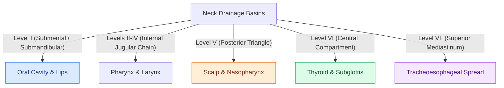

# Cervical lymph node levels I through VII define regional metastatic drainage basins

## Active Recall

> [!question]- Which sentinel node explains the phenomenon of skip metastasis from the oral tongue directly to Level III/IV?
> *Answer / Clinical Rationale*: The **jugulo-omohyoid node**, located at the crossing of the omohyoid muscle and internal jugular vein, receives direct lymphatic channels from the oral tongue.

> [!question]- Where is the Delphian lymph node located, and what primary sites does it report?
> *Answer / Clinical Rationale*: It sits on the anterior surface of the **cricothyroid membrane** in Level VI; it drains the **subglottis, anterior glottis, and thyroid isthmus**.

> [!question]- Why must superficial parotidectomy be considered when evaluating a suspicious parotid mass in a patient with previous temple or scalp skin cancer?
> *Answer / Clinical Rationale*: The **parotid gland contains an extensive intraglandular lymph node basin** that serves as the primary echelon drainage station for cutaneous squamous cell carcinoma and melanoma of the temple, forehead, anterior scalp, and lateral face.

## Core Clinical & Mechanistic Principles
The Robbins / AAO-HNS classification categorizes cervical lymphatics into seven anatomically distinct nodal basins, organized around constant **named sentinel lymph nodes** and regional drainage pathways:

- **Anatomical Levels (I–VII)**:
  - **Level I**: Submental (IA) and Submandibular (IB). Level IB clearance mandates skeletonizing the facial vessels to remove the **perifacial lymph nodes**.
  - **Level II (Upper Jugular)**: Skull base to hyoid; split by CN XI into **IIA** (anterior/inferior) and **IIB** (posterior/superior, [[Level II lymph nodes are anatomically divided into IIA and IIB by the spinal accessory nerve|submuscular recess]]).
  - **Level III (Mid-Jugular)**: Hyoid to cricoid arch / omohyoid tendon crossing.
  - **Level IV (Lower Jugular)**: Cricoid arch to clavicle; contains the thoracic duct on the left and right lymphatic ducts on the right.
  - **Level V (Posterior Triangle)**: Posterior SCM to anterior trapezius; split by the cricoid plane into **VA** (superior) and **VB** (inferior, containing the transverse cervical vessels).
  - **Level VI (Central Compartment)**: Hyoid to suprasternal notch between medial borders of carotid sheaths.
  - **Level VII (Superior Mediastinum)**: Paratracheal lymph nodes inferior to the suprasternal notch down to the innominate (brachiocephalic) artery.

- **The Named Sentinel Nodes & Clinical Reports**:
  - **Jugulodigastric Node (Subdigastric Node — Level II)**: Sits at the junction of the posterior digastric belly and IJV; sentinel node for the **palatine tonsil, base of tongue, and oropharynx**; most commonly palpable non-pathologic node.
  - **Jugulo-omohyoid Node (Level III/IV Junction)**: Sits where the intermediate tendon of the omohyoid crosses the IJV; functions as the **oral tongue sentinel**, explaining the classic **"skip metastasis"** where tongue SCC bypasses Levels I/II to present directly in mid/lower jugular nodes.
  - **Delphian (Prelaryngeal) Node (Level VI)**: Sits directly on the **cricothyroid membrane**; drains the subglottis, anterior vocal cords, and thyroid isthmus. Positivity heralds aggressive subglottic extension, stomal recurrence risk, or thyroid malignancy.
  - **Perifacial Nodes (Level IB)**: Ride the facial vessels; first echelon for **lower lip, buccal mucosa, and midfacial skin** malignancies.
  - **Parotid Lymph Node Basin**: Intraglandular and periglandular nodes serve as the first-echelon station for the **temple, forehead, anterior scalp, external auditory canal, and lateral facial skin** (metastatic [[High-risk cutaneous squamous cell carcinoma drains first to parotid and perifacial nodal basins|cutaneous SCC]] or melanoma).
  - **Virchow's Node (Troisier's Sign — Left Level VB)**: Left supraclavicular node sitting at the confluence of the thoracic duct and left subclavian vein; indicates **infradiaphragmatic malignancy** (gastric, pancreatic, pelvic).

### Surgical Technique & Critical Safety Checks
- **Predictable Metastatic Patterns**: Oral cavity drains to Levels I, II, III; larynx/pharynx to Levels II, III, IV; thyroid to Levels VI, III, IV, VB; cutaneous posterior scalp to Level V.
- **Level IIB Morbidity**: In cN0 laryngeal carcinoma, Level IIB clearance can be spared to minimize trapezius traction neuropraxia.

## Connected Concepts & Graph Traversal
- **Level II Subdivisions**: [[Level II lymph nodes are anatomically divided into IIA and IIB by the spinal accessory nerve|Level IIA and IIB Subdivisions]]
- **Comprehensive Dissection**: [[Radical neck dissection removes levels I through V while sacrificing CN XI, the IJV, and the SCM|Radical Neck Dissection]]
- **Selective Dissection**: [[Selective neck dissection targets high-risk nodal basins while sparing low-risk cervical levels|Selective Neck Dissection]]
- **Spinal Accessory Nerve**: [[The spinal accessory nerve is identified at the Erb point and anterior border of the SCM|CN XI Nerve Identification & Erb Point]]
- **Oral Cavity Drainage**: [[Transcervical pull-through resection mobilizes oral tongue tumors without dividing the mandible|Oral Cavity Resection & Drainage]]
- **Hypopharyngeal Drainage**: [[Hypopharyngeal piriform sinus carcinoma requires partial or total laryngopharyngectomy|Piriform Sinus Lymphatic Drainage]]
