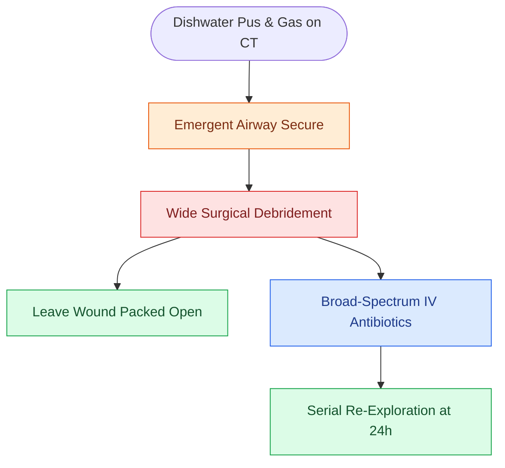

# Cervical necrotizing fasciitis requires emergent surgical debridement and broad-spectrum antimicrobial coverage

## Active Recall

> [!question]- Why does cutaneous anesthesia develop over areas of advanced necrotizing fasciitis?
> *Answer / Clinical Rationale*: Subcutaneous microvascular thrombosis causes ischemic necrosis of cutaneous sensory nerves traversing the fascia.

> [!question]- What is the role of clindamycin in the antimicrobial treatment of necrotizing fasciitis?
> *Answer / Clinical Rationale*: Clindamycin **suppresses synthesis of bacterial exotoxins and superantigens**.

## Core Clinical & Mechanistic Principles
**Cervical Necrotizing Fasciitis (CNF)** is a fulminant infection of cervical fascia, subcutaneous fat, and skin:
- **Etiology**: Odontogenic or peritonsillar infections in immunocompromised hosts (diabetes, alcoholism, renal failure).
- **Clinical Signs**:
  - "Dishwater" gray foul-smelling purulent exudate.
  - Skin erythema transitioning to violaceous bullae, cutaneous anesthesia (microvascular thrombosis of sensory nerves), and **subcutaneous crepitus**.
  - Severe systemic toxicity and septic shock.
- **Surgical Mandate**: **Immediate, aggressive surgical debridement** down to bleeding fascia, combined with wide open drainage.

### Surgical Technique & Critical Safety Checks
- **Microbiology**: Type I (Polymicrobial mixed aerobes and anaerobes) or Type II (Group A *Streptococcus*).
- **Medical Adjuncts**: Broad-spectrum IV coverage (Vancomycin + Piperacillin-Tazobactam + Clindamycin) and planned **second-look debridement in 24–48 hours** (see [[The danger space permits unrestricted infection spread from skull base to posterior mediastinum|Danger Space]]).

## Connected Concepts & Graph Traversal
- **Danger Space**: [[The danger space permits unrestricted infection spread from skull base to posterior mediastinum|Danger Space]]
- **Ludwig Angina**: [[Ludwig angina presents with bilateral submandibular cellulitis and woody floor of mouth induration compromising the airway|Ludwig Angina]]
- **Lemierre Syndrome**: [[Lemierre syndrome involves Fusobacterium necrophorum internal jugular thrombophlebitis and septic emboli|Lemierre Syndrome]]
- **Anatomical Foundation**: [[Cetuximab targets EGFR overexpression while pembrolizumab and nivolumab inhibit PD-1 in head and neck SCC]]
- **Surgical Lymphadenectomy**: [[Superior mediastinal level VII dissection clears paratracheal lymph nodes below the sternal notch]]
- **Oncologic Resection & Margins**: [[Pre-plating the intact mandible before osteotomy preserves accurate dental occlusion and contour]]
- **Aerodigestive / Pharyngolaryngeal**: [[Lingual artery branches require clip ligation during TORS base of tongue resection]]
