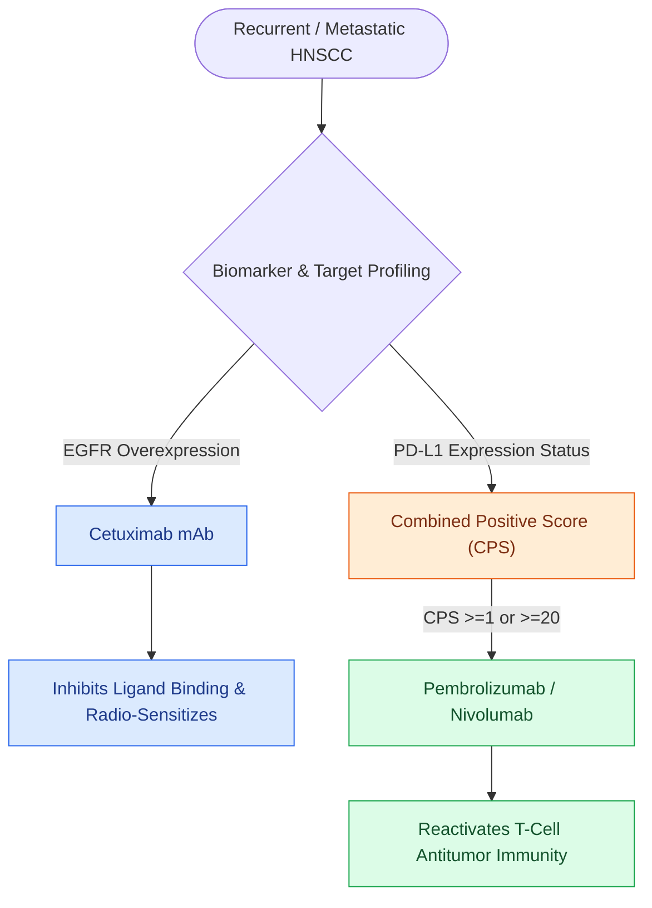

# Cetuximab targets EGFR overexpression while pembrolizumab and nivolumab inhibit PD-1 in head and neck SCC

## Active Recall

> [!question]- What receptor does Cetuximab target, and what cutaneous toxicity correlates with therapeutic response?
> *Answer / Clinical Rationale*: Cetuximab targets **EGFR**; an **acneiform papulopustular rash** correlates with improved survival.

> [!question]- What biomarker score determines eligibility for first-line single-agent pembrolizumab in recurrent/metastatic HNSCC?
> *Answer / Clinical Rationale*: The **Combined Positive Score (CPS) $\ge 1$**.

## Core Clinical & Mechanistic Principles
Targeted molecular therapy and checkpoint inhibition in head and neck SCC:
- **Cetuximab (anti-EGFR Monoclonal Antibody)**:
  - EGFR is overexpressed in $>90\%$ of HNSCC.
  - Cetuximab blocks ligand-induced receptor tyrosine kinase phosphorylation and MAPK/AKT signaling.
  - *Bonner Trial*: Cetuximab + radiotherapy demonstrated superior locoregional control and survival over RT alone in patients unfit for cisplatin.
- **Pembrolizumab & Nivolumab (anti-PD-1 Checkpoint Inhibitors)**:
  - PD-1 on T-cells binds PD-L1 on tumor cells, causing T-cell exhaustion.
  - Anti-PD-1 antibodies restore cytotoxic T-cell anti-tumor activity.
  - *KEYNOTE-048 Trial*: First-line pembrolizumab $\pm$ platinum-5FU improved overall survival in recurrent/metastatic HNSCC with CPS $\ge 1$.

### Surgical Technique & Critical Safety Checks
- **Cetuximab Toxicity**: Acneiform skin rash (correlates with clinical response), hypomagnesemia from renal wasting, infusion reactions.
- **Immunotherapy Toxicities (irAEs)**: Endocrinopathies (thyroiditis, hypophysitis), pneumonitis, colitis (see [[Intensity-modulated radiation therapy and cisplatin radiosensitization form the standard definitive chemoradiation regimen|Chemoradiation]]).

## Connected Concepts & Graph Traversal
- **Chemoradiotherapy**: [[Intensity-modulated radiation therapy and cisplatin radiosensitization form the standard definitive chemoradiation regimen|Chemoradiation]]
- **Carcinogenesis**: [[Tobacco and alcohol carcinogenesis drives TP53 mutation and field cancerization in upper aerodigestive tract|Carcinogenesis]]
- **HPV Oncology**: [[HPV-positive oropharyngeal squamous cell carcinoma exhibits distinct biological behavior and staging|HPV Oncology]]
- **Anatomical Foundation**: [[Deep cervical fascia divides into superficial, middle, and deep layers that define surgical planes]]
- **Surgical Lymphadenectomy**: [[Selective neck dissection targets high-risk nodal basins while sparing low-risk cervical levels]]
- **Oncologic Resection & Margins**: [[Buccal mucosa carcinoma exhibits high rates of local recurrence and Stensen duct involvement]]
- **Aerodigestive / Pharyngolaryngeal**: [[Lingual artery branches require clip ligation during TORS base of tongue resection]]
