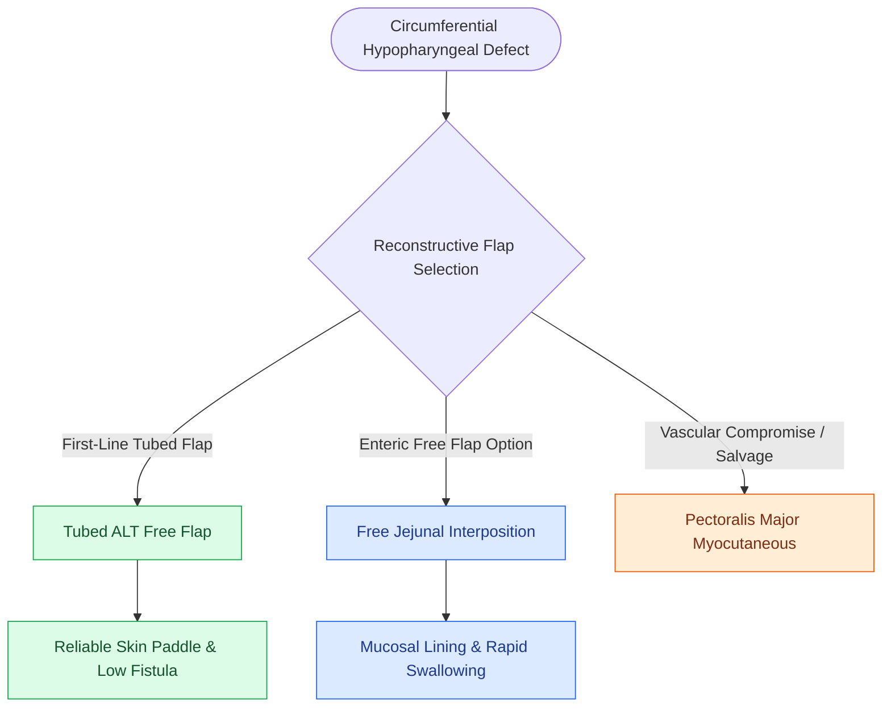

# Circumferential laryngopharyngectomy requires tubed microvascular or visceral flap reconstruction

## Active Recall

> [!question]- What is the primary advantage of a tubed ALT free flap over a free jejunal graft for circumferential pharyngeal reconstruction?
> *Answer / Clinical Rationale*: The tubed ALT flap is non-secretory and non-motile, providing **superior tracheoesophageal (TEP) speech quality** without uncoordinated wet peristalsis.

> [!question]- What device is placed intraoperatively across a tubed pharyngeal reconstruction to divert saliva during healing?
> *Answer / Clinical Rationale*: A **salivary bypass tube** (e.g., Montgomery salivary stent).

## Core Clinical & Mechanistic Principles
Resection of extensive hypopharyngeal or cervical esophageal carcinomas often requires a **circumferential total laryngopharyngectomy**, leaving a complete $360^\circ$ pharyngoesophageal defect from the oropharynx to the mediastinal esophagus:
- **Reconstructive Options**:
  1. **Tubed Anterolateral Thigh (ALT) Free Flap**:
     - *Advantages*: Large, pliable skin paddle, low donor site morbidity, non-mucus secreting (prevents 'wet' voice), facilitates excellent [[Tracheoesophageal puncture TEP and voice prosthesis restore pulmonary-driven alaryngeal speech|tracheoesophageal puncture]] (TEP) speech.
     - *Execution*: Skin paddle is rolled into a cylinder over a salivary bypass tube / bougie with an inverting seam.
  2. **Tubed Radial Forearm Free Flap (RFFF)**:
     - *Advantages*: Ultra-thin and pliable; ideal for short-to-medium segmental defects.
  3. **Free Jejunal Autograft**:
     - *Advantages*: Natural mucous-lined cylinder with intrinsic peristalsis; rapid revascularization.
     - *Disadvantages*: Requires laparotomy, secretes copious uncoordinated mucus, poor TEP speech intelligibility.
  4. **Gastric Pull-Up**:
     - *Indication*: When tumor extends deep into the thoracic esophagus toward the carina.

### Surgical Technique & Critical Safety Checks
- **Salivary Bypass Stent**: A Montgomery salivary bypass tube is placed across the reconstruction for 2–3 weeks to divert saliva past the proximal and distal anastomotic seams.

## Connected Concepts & Graph Traversal
- **Piriform Sinus SCC**: [[Hypopharyngeal piriform sinus carcinoma requires partial or total laryngopharyngectomy|Piriform Sinus SCC]]
- **ALT Free Flap**: [[The anterolateral thigh flap provides versatile volume and can be harvested as a chimeric flap|ALT Free Flap]]
- **RFFF Free Flap**: [[The radial forearm free flap provides thin, pliable fasciocutaneous tissue for oral and pharyngeal defects|RFFF Free Flap]]
- **Anatomical Foundation**: [[Extranodal extension in cervical lymph nodes upstages nodal disease and dictates adjuvant chemoradiotherapy]]
- **Surgical Lymphadenectomy**: [[Cervical chyle leaks are managed with MCT diet, octreotide, or surgical thoracic duct ligation]]
- **Oncologic Resection & Margins**: [[Buccal mucosa carcinoma exhibits high rates of local recurrence and Stensen duct involvement]]
- **Aerodigestive / Pharyngolaryngeal**: [[TORS radical tonsillectomy requires careful identification of the internal carotid artery posterolaterally]]
