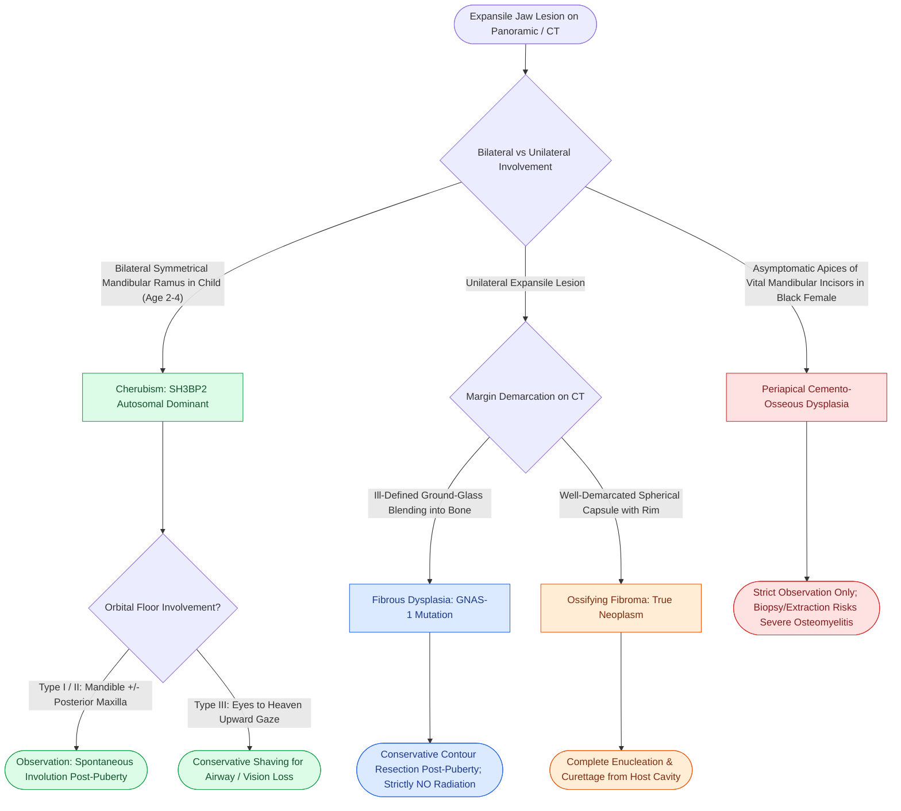

# Craniofacial fibrous dysplasia and cherubism manifest as benign fibro-osseous jaw lesions managed with surgical contouring

## Active Recall

> [!question]- What molecular genetic defect causes fibrous dysplasia, and what clinical syndromes arise based on the embryonic timing of this mutation?
> *Answer / Clinical Rationale*: Fibrous dysplasia is caused by a somatic, postzygotic activating missense mutation in the **$GNAS-1$ gene** on chromosome **20q13.3**, encoding the $\alpha$-subunit of the stimulatory G-protein ($G_s\alpha$). This mutation permanently disables GTPase activity, producing constitutive adenylyl cyclase activation and toxic hyper-accumulation of intracellular cyclic AMP (cAMP). This arrests osteoblasts in an immature, non-matrix-forming state. The embryonic timing of the mutation dictates the phenotypic spectrum:
> - **Very early embryonic mutation**: Affects pluripotent stem cells, producing **McCune-Albright syndrome** (polyostotic fibrous dysplasia, unilateral large café-au-lait macules with jagged "coast of Maine" borders, and autonomous hyperfunctioning endocrinopathies, most commonly precocious puberty).
> - **Slightly later mutation**: Produces **Jaffe-Lichtenstein syndrome** (polyostotic fibrous dysplasia with café-au-lait macules, but no endocrinopathy).
> - **Late embryonic / postnatal mutation**: Produces **monostotic fibrous dysplasia** or **craniofacial fibrous dysplasia** (isolated contiguous involvement of skull and facial bones without systemic manifestations).

> [!question]- What pathognomonic radiographic and histologic features differentiate fibrous dysplasia from ossifying fibroma?
> *Answer / Clinical Rationale*:
> - **Fibrous Dysplasia**:
>   - *Radiography*: Expansile, poorly circumscribed lesion that **blends imperceptibly into adjacent normal cortical bone** without a defined margin, exhibiting a classic homogeneous **"ground glass"** or **"orange peel" (peau d'orange)** radiodensity *(CummingsReview2017, Ch10, p.209, Fig. 10.10)*.
>   - *Histology*: Irregular, disconnected, C-shaped or curvilinear trabeculae of immature **woven bone resembling "Chinese characters" or "alphabet soup"**, embedded in a cellular fibrous stroma. Trabeculae **strictly lack osteoblastic rimming**.
> - **Ossifying Fibroma**:
>   - *Radiography*: **Sharply demarcated, spherical or oval expansile lesion** surrounded by a distinct radiolucent fibrous capsule and an intact, expanded outer bony cortex *(CummingsReview2017, Ch10, p.210, Fig. 10.12)*.
>   - *Histology*: Mixture of woven and lamellar bone trabeculae that **exhibit prominent peripheral osteoblastic rimming** and spherules of cementum-like calcification within a dense cellular stroma. Because it is encapsulated, it separates cleanly (enucleates) from surrounding host bone.

> [!question]- What genetic mutation defines cherubism, what is its inheritance pattern, and why is radical surgical resection contraindicated?
> *Answer / Clinical Rationale*: Cherubism is an **autosomal dominant** disorder with high penetrance ($100\%$ in males, $50\text{–}70\%$ in females) caused by mutations in the **$SH3BP2$ (SH3-domain binding protein 2)** gene on chromosome **4p16.3**, producing hyperactive osteoclastogenesis and TNF-$\alpha$ hyperproduction. It presents at ages **2 to 4 years** with bilateral, symmetrical, painless expansion of the posterior mandible and maxilla. Type III cherubism invades the orbital floor, displacing the globes superiorly and exposing sclera below the iris to create an **"eyes turned toward heaven"** upward gaze *(CummingsReview2017, Ch10, p.210, Fig. 10.11)*. Histologically, it reveals a proliferation of multinucleated giant cells within vascular fibrous tissue. **Radical resection is strictly contraindicated** because cherubism is a self-limiting condition that naturally **stabilizes at puberty and undergoes spontaneous involution and osteosclerosis** into young adulthood. Surgical management is restricted to conservative contour burring or curettage only if critical airway compromise, severe masticatory impairment, or optic neuropathy occurs.

## Core Clinical & Mechanistic Principles

Fibro-osseous lesions of the jaws constitute a diverse group of non-neoplastic hamartomas and benign neoplasms characterized by the replacement of normal lamellar architecture with cellular fibrous connective tissue that produces irregular osteoid, woven bone, or cementoid calcifications:

### Comparative Pathology of Jaw Fibro-Osseous Lesions

| Entity | Genetic Driver | Demographics & Primary Site | Radiographic Appearance | Histopathology | Surgical Management |
| :--- | :--- | :--- | :--- | :--- | :--- |
| **Fibrous Dysplasia** | $GNAS-1$ (20q13.3 somatic mutation) | 1st–2nd decades; Maxilla $>$ Mandible; Craniofacial bones | Ill-defined, fusiform **"ground-glass"** or **peau d'orange**; expands cortex without perforation *(Fig 10.10)* | "Chinese character" woven bone trabeculae; **NO osteoblastic rimming**; cellular fibrous stroma | Conservative contour shaving delayed until post-puberty; **Radiation strictly banned** (sarcoma risk) |
| **Cherubism** | $SH3BP2$ (4p16.3 autosomal dominant) | Ages 2–4 years; Males ($100\%$ penetrance) $>$ Females; Bilateral jaws | Bilateral multilocular expansile radiolucencies; cortical thinning; "eyes to heaven" *(Fig 10.11)* | Multinucleated osteoclast-like giant cells; vascular fibrous tissue; perivascular eosinophilic cuffs | **Watchful waiting**; spontaneous regression post-puberty; cosmetic contouring if obstructive |
| **Ossifying Fibroma** | Sporadic (neoplastic) | 3rd–4th decades; Females $>$ Males; Mandibular premolar/molar | Well-circumscribed, spherical/oval radiolucency with central radiopacity and fibrous capsule *(Fig 10.12)* | Fibrous stroma with woven and lamellar bone; **prominent osteoblastic rimming**; cementoid globules | Complete surgical **enucleation** (separates cleanly from surrounding bone) |
| **Periapical Cemento-Osseous Dysplasia** | Reactive / Idiosyncratic | Middle-aged females ($>70\%$ of African descent); Mandibular incisors | Radiolucent evolving to mixed and dense radiopaque apices with radiolucent halo *(Fig 10.13)* | Fibroblastic stroma with cementum-like calcified droplets and woven bone; teeth remain **vital** | **Observation only**; zero surgical or endodontic intervention |

### Surgical Principles & Critical Safety Rules
1. **Radiation Contraindication in Fibrous Dysplasia**:
   - Ionizing radiation must **never be administered** for fibrous dysplasia. Radiation exposure is associated with a catastrophic $0.4\text{–}4\%$ rate of **secondary malignant transformation** into osteosarcoma, fibrosarcoma, or undifferentiated pleomorphic sarcoma, often decades after treatment.
2. **Timing of Contour Resection in Fibrous Dysplasia**:
   - Because fibrous dysplasia lesions are estrogen- and hormone-sensitive, growth typically accelerates during childhood and stabilizes following completion of puberty (usually by age 20 to 25).
   - Minor contour surgery should be deliberately **deferred until skeletal maturity** to minimize aggressive post-surgical recurrence.
   - Immediate surgical intervention is reserved for progressive cranial nerve impingement (e.g., optic nerve unroofing in the optic canal for vision loss) or severe nasal airway occlusion.
3. **Cherubism Staging *(CummingsReview2017, Ch10, p.209–210)*:**
   - **Type I**: Confined to the bilateral ascending ramus and mandibular angle.
   - **Type II**: Diffuse bilateral involvement of the ramus, angle, and body anteriorly up to the mental foramen, with posterior maxillary involvement.
   - **Type III**: Massive involvement of the entire maxilla and mandible, sparing only the coronoid processes and condyles. Orbital floor destruction produces the classic cherubic upward gaze.

Comprehensive anatomical and therapeutic integration links these principles directly to [[The fibula osteocutaneous free flap provides up to twenty-five centimeters of vascularized bone for mandible reconstruction|Fibula Free Flap]].

## Connected Concepts & Graph Traversal
- **Benign Odontogenic Differential**: [[Ameloblastoma exhibits multilocular soap-bubble radiolucency and requires segmental resection with one-centimeter bony margins|Ameloblastoma Differential]]
- **Cystic Differential**: [[Dentigerous cysts arise from the follicular epithelium surrounding the crown of an unerupted third molar|Dentigerous Cysts]]
- **Pseudocyst Differential**: [[Stafne bone defects represent asymptomatic cortical lingual mandibular concavities containing ectopic salivary gland tissue|Stafne Bone Defect]]
- **Mandibular Resection Principle**: [[Segmental mandibulectomy resects full-thickness bone for medullary invasion and irradiated bone recurrence|Segmental Mandibulectomy]]
- **Mandibular Contouring**: [[Marginal mandibulectomy preserves basilar bone height when tumor abuts but does not invade marrow|Marginal Bone Contouring]]
