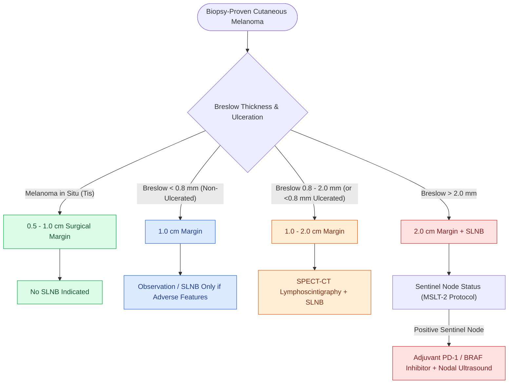

# Cutaneous head and neck melanoma is staged by Breslow depth and sentinel lymph node biopsy

## Active Recall

> [!question]- At what Breslow threshold is SLNB discussed and what has replaced routine completion dissection after a positive sentinel?
> *Answer / Clinical Rationale*: 0.8 mm (or ulcerated thinner lesions); positive sentinels now go to nodal ultrasound surveillance plus adjuvant systemic therapy in most cases.

> [!question]- What makes desmoplastic melanoma a distinct surgical problem?
> *Answer / Clinical Rationale*: Amelanotic presentation delays diagnosis; neurotropism follows nerves (including VII) beyond visible margins — wider excision and consideration of adjuvant radiation.

## Core Clinical & Mechanistic Principles
Cutaneous head and neck melanoma accounts for $>20\%$ of all melanomas despite representing $<10\%$ of total skin surface area, characterized by aggressive microvascular invasion and complex, non-contiguous lymphatic drainage across [[Cervical lymph node levels I through VII define regional metastatic drainage basins|cervical lymph node basins]]:

- **AJCC 8th Edition T-Staging & Excision Margins**:
  - **Melanoma in Situ (Tis)**: Excision with $0.5\text{–}1.0\text{ cm}$ radial margins; SLNB is not indicated.
  - **T1a**: Breslow depth $<0.8\text{ mm}$ without ulceration (excision with $1.0\text{ cm}$ margins; SLNB not routinely recommended unless high-risk features present).
  - **T1b**: Breslow depth $0.8\text{–}1.0\text{ mm}$ without ulceration, OR $<0.8\text{ mm}$ with ulceration (excision with $1.0\text{ cm}$ margins + SLNB).
  - **T2a**: Breslow depth $>1.0\text{–}2.0\text{ mm}$ without ulceration (excision with $1.0\text{–}2.0\text{ cm}$ margins + SLNB).
  - **T2b**: Breslow depth $>1.0\text{–}2.0\text{ mm}$ with ulceration (excision with $1.0\text{–}2.0\text{ cm}$ margins + SLNB).
  - **T3a**: Breslow depth $>2.0\text{–}4.0\text{ mm}$ without ulceration (excision with $2.0\text{ cm}$ margins + SLNB).
  - **T3b**: Breslow depth $>2.0\text{–}4.0\text{ mm}$ with ulceration (excision with $2.0\text{ cm}$ margins + SLNB).
  - **T4a**: Breslow depth $>4.0\text{ mm}$ without ulceration (excision with $2.0\text{ cm}$ margins + SLNB).
  - **T4b**: Breslow depth $>4.0\text{ mm}$ with ulceration (excision with $2.0\text{ cm}$ margins + SLNB).
- **AJCC 8th Edition Regional Nodal Staging (N)**:
  - **N1a**: 1 clinically occult / microscopically detected positive lymph node (identified on SLNB).
  - **N1b**: 1 clinically detected / macroscopically positive lymph node (confirmed pathologically).
  - **N2a**: 2–3 clinically occult / microscopically detected positive lymph nodes.
  - **N2b**: 2–3 clinically detected / macroscopically positive lymph nodes.
  - **N2c**: Presence of in-transit, satellite, or microsatellite metastases WITHOUT concurrent regional lymph node metastases.
  - **N3**: $\ge 4$ positive lymph nodes, matted nodal masses, or any in-transit / satellite metastasis WITH concurrent regional nodal metastases.
- **Nodal Management Post-MSLT-2**:
  - Following the landmark [[The MSLT-1 and MSLT-2 trials establish sentinel lymph node biopsy utility and ultrasound surveillance safety in melanoma|MSLT-1 and MSLT-2 trials]], discovery of micrometastatic disease in a sentinel lymph node does **not mandate routine completion neck dissection**. Instead, close serial high-resolution nodal ultrasound surveillance paired with adjuvant systemic immunotherapy (anti-PD-1 pembrolizumab/nivolumab) or targeted therapy (BRAF/MEK inhibitors for *BRAF* V600E mutations) provides equivalent overall survival with significantly reduced surgical morbidity.
- **Desmoplastic Melanoma Nuance**:
  - Highly neurotropic, amelanotic variant with high propensity for perineural tracking along the branches of the facial nerve trunk; requires wide subfascial clearance and adjuvant post-operative radiotherapy.

### Management & Critical Safety Checks
- **Intraparotid Sentinel Nodes**: Preoperative SPECT-CT is vital when lymphoscintigraphy demonstrates drainage to parotid lymph nodes; sentinel harvest within the parotid gland requires careful superficial parotid dissection and identification of [[The facial nerve main trunk is localized using the tragal pointer, tympanomastoid suture, and digastric ridge|facial nerve branches]].

## Connected Concepts & Graph Traversal
- **Lymphoscintigraphy Evidence**: [[The MSLT-1 and MSLT-2 trials establish sentinel lymph node biopsy utility and ultrasound surveillance safety in melanoma|MSLT-1 and MSLT-2 Clinical Trial Practice]]
- **Parotid Basin Landmark**: [[The facial nerve main trunk is localized using the tragal pointer, tympanomastoid suture, and digastric ridge|Parotid Sentinel Node Dissection & CN VII]]
- **Cervical Nodal Drainage**: [[Cervical lymph node levels I through VII define regional metastatic drainage basins|Cervical Lymph Node Basin Mapping]]
- **Cutaneous Carcinoma Parallel**: [[High-risk cutaneous squamous cell carcinoma drains first to parotid and perifacial nodal basins|Parotid & Perifacial Nodal Metastases]]
- **Immunotherapy Backbone**: [[Cetuximab targets EGFR overexpression while pembrolizumab and nivolumab inhibit PD-1 in head and neck SCC|Anti-PD-1 Immune Checkpoint Blockade]]
