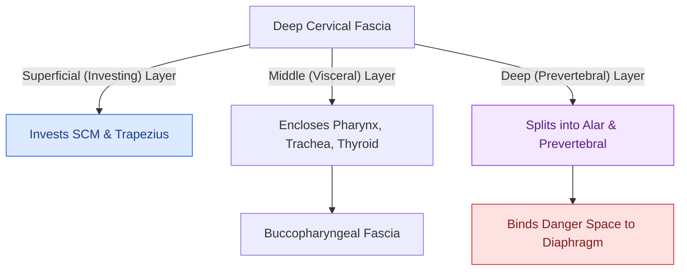

# Deep cervical fascia divides into superficial, middle, and deep layers that define surgical planes

## Active Recall

> [!question]- Is the cervical sympathetic trunk contained within the carotid sheath?
> *Answer / Clinical Rationale*: **No**; the sympathetic trunk lies **posteromedial to the carotid sheath**, resting directly on longus colli and longus capitis **deep to the prevertebral fascia**.

> [!question]- What motor nerve violates the deep-surface rule by coursing on the superficial surface of its target muscle?
> *Answer / Clinical Rationale*: The **nerve to the mylohyoid** (branch of V3), which runs along the superficial (inferior) surface of the mylohyoid muscle in the submandibular triangle.

> [!question]- What anatomical boundary separates the retropharyngeal space from the danger space?
> *Answer / Clinical Rationale*: The **alar fascia** (the anterior lamina of the deep prevertebral layer); the retropharyngeal space lies anterior to the alar fascia (ending at T1–T2), while the danger space lies between the alar and prevertebral fascia proper (extending to the diaphragm).

## Core Clinical & Mechanistic Principles
The cervical fascial system compartmentalizes the neck into concentric tubes. Surgery is the craft of navigating the avascular potential spaces between these fascial tubes; infection is what occurs when suppurative fluid dissects them:

- **The Three Core Surgical Meta-Rules**:
  1. **Packaging Rule**: Laryngeal nerves each travel paired with a corresponding arterial branch — internal branch of superior laryngeal nerve (iSLN) with the superior laryngeal artery through the thyrohyoid membrane; external branch of superior laryngeal nerve (eSLN) with the superior thyroid artery; recurrent laryngeal nerve (RLN) with the inferior laryngeal artery at the cricothyroid articulation.
  2. **Deep-Surface Rule**: Motor nerves enter muscles through their **deep surface** (platysma, sternocleidomastoid, trapezius, infrahyoid straps). *Critical Exception*: The **nerve to mylohyoid** runs on the muscle's **superficial (inferior) surface** in the [[Submandibular gland excision requires preservation of the marginal mandibular, lingual, and hypoglossal nerves|submandibular triangle]].
  3. **Piercing-Point Rule**: Cutaneous sensory nerves pierce fascia at constant puncta — the four branches of the superficial cervical plexus (great auricular, lesser occipital, transverse cervical, supraclavicular) emerge as **Erb's cluster** at the mid-posterior border of the SCM.

- **Concentric Fascial Layers & Compartments**:
  - **Superficial Cervical Fascia**: Subcutaneous connective tissue enveloping the **platysma** (derived from Arch 2 $\rightarrow$ innervated on its deep surface by CN VII cervical/marginal branches). Standard neck dissection flaps are elevated in the **subplatysmal plane** on the glistening investing layer.
  - **Deep Cervical Fascia — Superficial (Investing) Layer**: Splits around the SCM and trapezius muscles; encapsulates the submandibular and parotid glands; roofs both anterior and posterior cervical triangles.
  - **Deep Cervical Fascia — Middle (Visceral / Pretracheal) Layer**:
    - *Muscular Division*: Sheathes the infrahyoid strap muscles. Midline raphe is an avascular fusion line.
    - *Visceral Division*: Encloses the thyroid gland, trachea, larynx, and cervical esophagus, continuing posteriorly over the constrictor muscles as the **buccopharyngeal fascia**.
  - **Deep Cervical Fascia — Deep (Prevertebral) Layer**:
    - Encases the vertebral column, longus colli/capitis, scalenes, **phrenic nerve**, and brachial plexus roots.
    - Splits ventrally into the anterior **alar fascia** (fusing at T1–T2 with the visceral fascia) and the posterior **prevertebral fascia proper** (extending to the coccyx).
  - **The Carotid Sheath Condominium**: Formed by contributions from all three deep fascial layers. Contains the common/internal carotid artery medially, internal jugular vein laterally, and **vagus nerve (CN X)** posteriorly in the groove between them.
  - **Sympathetic Trunk Localization**: The **cervical sympathetic trunk is NOT inside the carotid sheath**; it lies **posteromedial to the sheath**, embedded on longus colli/capitis muscles **deep to the prevertebral fascia**. Horner syndrome indicates pathology or dissection deep to the prevertebral plane.

### Surgical Technique & Critical Safety Checks
- **The Floor Rule**: Keep the **prevertebral fascia intact** across levels IV and V. All underlying structures (phrenic nerve, brachial plexus trunks, dorsal scapular nerve) remain safe. A paralyzed hemidiaphragm postoperatively confirms prevertebral fascial breach.

## Connected Concepts & Graph Traversal
- **Danger Space Anatomy**: [[The danger space permits unrestricted infection spread from skull base to posterior mediastinum|Danger Space Boundaries]]
- **Retropharyngeal Space**: [[The retropharyngeal space extends from skull base to tracheal bifurcation and contains lymph nodes draining the nasopharynx|Retropharyngeal Space Boundaries]]
- **Parapharyngeal Space**: [[The parapharyngeal space is an inverted pyramid connecting peritonsillar, masticator, parotid, and retropharyngeal spaces|Parapharyngeal Space Compartments]]
- **Subplatysmal Dissection**: [[Subplatysmal flap elevation and Martin's maneuver protect the marginal mandibular nerve|Subplatysmal Flap Elevation]]
- **Prevertebral Floor Rule**: [[Level V dissection requires skeletonization of the prevertebral fascia while protecting the phrenic nerve|Level V Floor Rule]]
- **Surgical Neck Dissection**: [[Radical neck dissection removes levels I through V while sacrificing CN XI, the IJV, and the SCM|Radical Neck Dissection]]
- **Deep Neck Infection**: [[Ludwig angina presents with bilateral submandibular cellulitis and woody floor of mouth induration compromising the airway|Ludwig Angina Airway Compromise]]
- **Cross-Sectional Imaging Correlate**: [[Deep neck fascial spaces cross-sectional CT compartmentalization organizes suprahyoid and infrahyoid head and neck pathology|Deep Neck Space CT Compartmentalization]]
