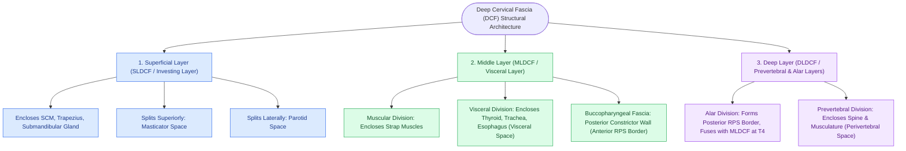
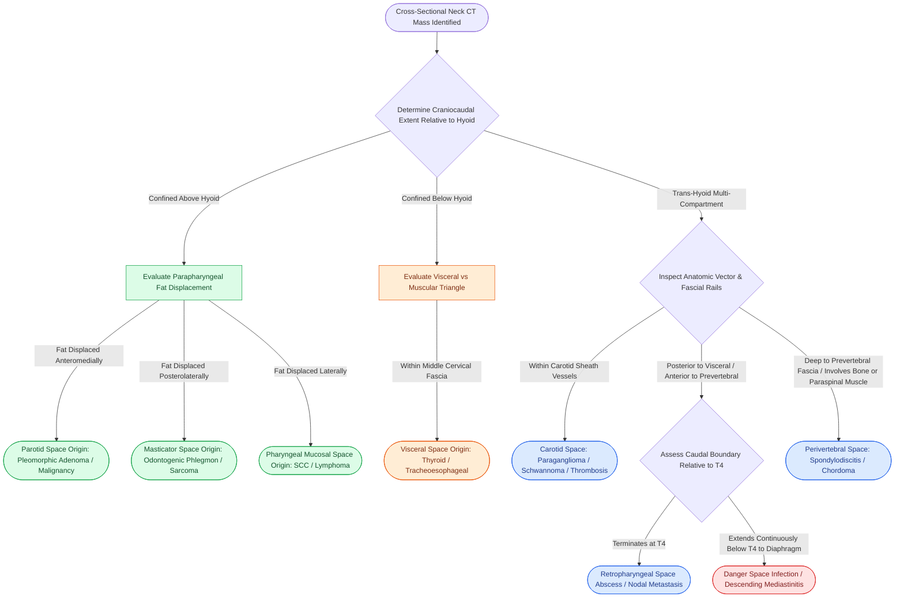

# Deep neck fascial spaces cross-sectional CT compartmentalization organizes suprahyoid and infrahyoid head and neck pathology

## Active Recall

> [!question]- How does the hyoid bone anatomically partition deep neck spaces on cross-sectional CT into suprahyoid-only, infrahyoid-only, and trans-hyoid compartments?
> *Answer / Clinical Rationale*: The **hyoid bone** serves as the central dividing boundary of the neck. Deep neck spaces are classified into: (1) **Suprahyoid-only spaces** located superior to the hyoid body and greater cornua: *parapharyngeal space (prestyloid)*, *masticator space*, *parotid space*, *sublingual space*, *submandibular space*, and *pharyngeal mucosal space*; (2) **Infrahyoid-only spaces** located between the hyoid and clavicles/sternum: *anterior cervical space (visceral space)* containing thyroid, larynx, and trachea; and (3) **Trans-hyoid (longitudinal) spaces** that extend continuously across the hyoid level from the skull base down into the mediastinum: *carotid space*, *retropharyngeal space*, *danger space*, and *perivertebral space*. Identifying whether a mass crosses the hyoid immediately narrows the diagnostic differential on axial CT.

> [!question]- What are the three layers of the deep cervical fascia and how do they define the boundaries of the masticator, parotid, and visceral spaces?
> *Answer / Clinical Rationale*: The deep cervical fascia comprises: (1) **Superficial (investing) layer (SLDCF)**: splits to envelope the sternocleidomastoid, trapezius, parotid gland (*parotid space*), and muscles of mastication plus mandible (*masticator space*); (2) **Middle (visceral/buccopharyngeal) layer (MLDCF)**: encloses the pharynx, larynx, trachea, esophagus, and thyroid gland (*visceral space*), with its posterior extension forming the buccopharyngeal fascia that bounds the retropharyngeal space anteriorly; and (3) **Deep (prevertebral/alar) layer (DLDCF)**: splits into an anterior *alar division* (fusing with visceral fascia at T4) and a posterior *prevertebral division* (spanning skull base to coccyx), completely enclosing the vertebral column, paraspinal muscles, and vertebral vessels (*perivertebral space*).

> [!question]- On cross-sectional contrast-enhanced CT, what key anatomical displacement patterns determine the specific space of origin for a deep neck mass?
> *Answer / Clinical Rationale*: The primary diagnostic landmark on axial CT is the **parapharyngeal space (PPS) fat pad**, which acts as a passive anatomical buoy displaced away from the epicenter of an adjacent space mass: (1) **Parotid space mass** displaces PPS fat *anteromedially*; (2) **Carotid space mass** displaces PPS fat *anteriorly*; (3) **Masticator space mass** displaces PPS fat *posterolaterally*; (4) **Pharyngeal mucosal space mass** displaces PPS fat *laterally*; and (5) **Retropharyngeal space mass** displaces PPS fat *anterolaterally* while displacing the prevertebral muscles *posteriorly*. Additionally, intrinsic internal landmarks (e.g., flow voids in carotid space, mandibular ramus erosion in masticator space) establish definitive space localization.

## Core Clinical & Mechanistic Principles

The cross-sectional radiology of the neck is predicated on understanding the deep cervical fascia and the potential anatomical compartments it creates. Rather than treating the neck as a continuous mass of soft tissue, cross-sectional CT and MRI compartmentalize pathology into specific spaces defined by fascial reflections *(Cummings p.247–284)*.

### Deep Cervical Fascia Cross-Sectional Architecture

The deep cervical fascia divides into three discrete layers that dictate the pathways of tumor extension and infectious phlegmon:

### Deep Neck Spaces Cross-Sectional Compartmentalization Matrix

| Space | Longitudinal Extent | Fascial Envelopes | Core Anatomic Contents | Classic Pathologies & CT Diagnostic Signatures |
| :--- | :--- | :--- | :--- | :--- |
| **Parapharyngeal (Prestyloid)** | Skull base to greater cornu of hyoid | Medial: MLDCF; Lateral: SLDCF; Posterior: Tensor vascular styloid fascia | Fat, internal maxillary artery branches, ascending pharyngeal branches, trigeminal V3 branches | Lipoma, pleomorphic adenoma (minor salivary), schwannoma; CT shows fat attenuation with passive mass displacement |
| **Parotid** | Zygomatic arch to mandibular angle | SLDCF (investing layer splits around parotid) | Parotid gland, intraparotid lymph nodes, facial nerve (CN VII), retromandibular vein, external carotid artery | Pleomorphic adenoma, Warthin tumor, mucoepidermoid carcinoma, first branchial anomaly; displaces PPS fat anteromedially |
| **Masticator** | Skull base (sphenoid wing) to inferior mandibular border | SLDCF (investing layer splits over masseter & pterygoids) | Ramus/body of mandible, masseter, temporalis, medial/lateral pterygoids, CN V3, inferior alveolar neurovascular bundle | Odontogenic infection, sarcoma (rhabdomyosarcoma, osteosarcoma), schwannoma of V3; displaces PPS fat posterolaterally |
| **Pharyngeal Mucosal** | Skull base to cricoid cartilage | Middle layer (buccopharyngeal fascia on deep surface) | Mucosa, Waldeyer ring (adenoids, palatine/lingual tonsils), pharyngeal constrictors, minor salivary glands | Squamous cell carcinoma, lymphoma, peritonsillar abscess, Tornwaldt cyst; displaces PPS fat laterally |
| **Carotid (Poststyloid)** | Skull base (jugular foramen/carotid canal) to aortic arch | All 3 layers of DCF contribute to carotid sheath | Internal carotid artery, internal jugular vein, CN IX, CN X, CN XI, CN XII, sympathetic chain, deep cervical nodes | Paraganglioma (carotid body, glomus vagale), schwannoma, neurofibroma, Lemierre syndrome; displaces PPS fat anteriorly |
| **Retropharyngeal** | Skull base to T4 (carina / alar fascia fusion) | Anterior: Buccopharyngeal fascia (MLDCF); Posterior: Alar fascia (DLDCF) | Fat, nodes of Rouvière (lateral retropharyngeal nodes draining nasopharynx and sinuses) | Suppurative lymphadenitis/abscess in young children, metastatic nasopharyngeal/sinus carcinoma; flattens prevertebral muscles |
| **Danger Space** | Skull base to diaphragm (posterior mediastinum) | Anterior: Alar fascia; Posterior: Prevertebral fascia (DLDCF) | Loose areolar tissue (no lymph nodes) | Unrestricted descending necrotizing mediastinitis; cross-sectional CT shows non-enhancing low attenuation traversing past T4 |
| **Perivertebral** | Skull base to coccyx | Entirely enclosed by prevertebral layer of DLDCF | Vertebral bodies, discs, prevertebral muscles (longus colli/capitis), paraspinal muscles, vertebral artery/vein | Spondylodiscitis, epidural abscess, chordoma, chondrosarcoma, metastasis; elevates prevertebral muscles anteriorly |
| **Visceral (Anterior Cervical)** | Hyoid bone to superior mediastinum (pericardium) | Enclosed by visceral division of MLDCF | Thyroid gland, parathyroid glands, larynx, hypopharynx, cervical trachea, esophagus, recurrent laryngeal nerves | Multinodular goiter, thyroid carcinoma, esophageal perforation, Zenker diverticulum, subglottic stenosis |

### Radiologic Diagnostic Nuances on CT

1. **Retropharyngeal vs Danger vs Perivertebral Space Discrimination**:
   - *Retropharyngeal space (RPS)* fluid collections are bounded laterally by the carotid sheaths (protecting against [[Carotid blowout syndrome is classified into threatened, impending, and acute hemorrhage|carotid blowout]]) and inferiorly by the fusion of the alar fascia with the visceral fascia at approximately T4. RPS collections compress the posterior pharyngeal wall anteriorly and displace the longus colli muscles posteriorly.
   - *Danger space* fluid collections possess no inferior anatomical barrier; they course unimpeded through the posterior mediastinum down to the level of the diaphragm (T12–L1).
   - *Perivertebral space (PVS)* lesions lie deep to the prevertebral fascia, directly lifting the longus colli muscles *anteriorly* off the vertebral bodies and frequently demonstrating osseous cortical erosion, disc space loss, or vertebral marrow enhancement.

2. **Contrast Enhancement Signatures**:
   - True mature abscesses demonstrate complete central hypodensity (fluid attenuation: 10–25 HU) surrounded by a thin, smooth, uniform peripheral enhancing rim.
   - Phlegmon manifests as ill-defined soft tissue stranding, fat haziness, and heterogeneous non-rim enhancement without a liquefactive necrotic core.
   - Necrotic lymphadenitis (common in HPV-associated SCC, tuberculosis, and suppurative adenitis) exhibits an irregular, thick, nodular rim with central non-enhancing hypodensity.

## Connected Concepts & Graph Traversal
- **Anatomical Foundation**: [[Deep cervical fascia divides into superficial, middle, and deep layers that define surgical planes|Deep Cervical Fascial Layers]]
- **Infection Pathway**: [[Deep neck space infections spread along cervical fascial planes between the pharynx, mediastinum, and skull base|Deep Neck Infection Spread Dynamics]]
- **Central Diagnostic Hub**: [[The parapharyngeal space is an inverted pyramid connecting peritonsillar, masticator, parotid, and retropharyngeal spaces|Parapharyngeal Space Hub]]
- **Lethal Longitudinal Conduit**: [[The danger space permits unrestricted infection spread from skull base to posterior mediastinum|Danger Space Conduit]]
- **Anterior Visceral Boundary**: [[The retropharyngeal space extends from skull base to tracheal bifurcation and contains lymph nodes draining the nasopharynx|Retropharyngeal Space]]
- **Neurovascular Rail**: [[The carotid sheath is composed of all three layers of deep cervical fascia and forms a vertical neurovascular conduit|Carotid Sheath Fascial Conduit]]
