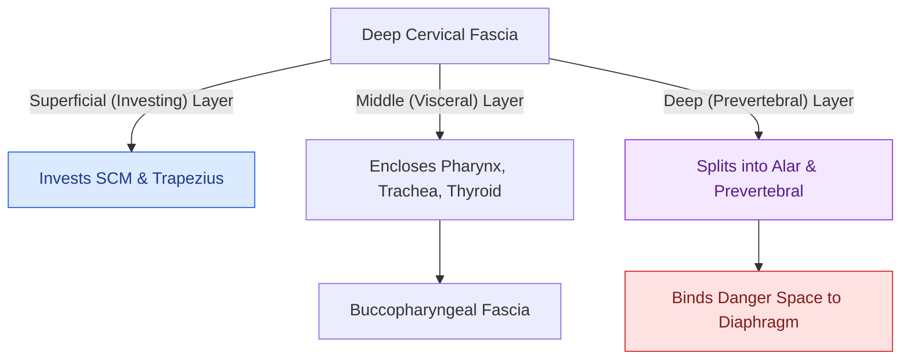

# Deep neck space infections spread along cervical fascial planes between the pharynx, mediastinum, and skull base

## Active Recall

> [!question]- What anatomical fascial boundaries define the 'Danger Space' of the neck, and how far inferiorly does it extend?
> *Answer / Clinical Rationale*: The Danger Space is bounded anteriorly by the **alar fascia** and posteriorly by the **prevertebral fascia**, extending from the **skull base to the diaphragm (posterior mediastinum)**.

> [!question]- What anatomical structure divides the parapharyngeal space into [[The parapharyngeal space is an inverted pyramid connecting peritonsillar, masticator, parotid, and retropharyngeal spaces|pre-styloid and post-styloid compartments]]?
> *Answer / Clinical Rationale*: The **styloid process** (and its attached muscles: stylohyoid, styloglossus, stylopharyngeus).

## Core Clinical & Mechanistic Principles
**Deep Neck Space Infections (DNSIs)** are severe suppurative infections arising from odontogenic, tonsillar, or salivary sources that travel along predictable pathways defined by the **[[Deep cervical fascia divides into superficial, middle, and deep layers that define surgical planes|cervical fascial layers]]**:
- **Cervical Fascial Architecture**:
  1. **Superficial Cervical Fascia**: Encloses platysma and muscles of facial expression.
  2. **Deep Cervical Fascia (Three Layers)**:
     - **Investing Layer (Superficial Layer)**: Encloses SCM, trapezius, parotid, and submandibular glands; attaches to mandible, skull base, and clavicle.
     - **Visceral / Pretracheal Layer (Middle Layer)**: Encloses thyroid, trachea, and esophagus; extends into the anterior mediastinum and pericardium.
     - **Prevertebral / Alar Layer (Deep Layer)**: Encloses cervical vertebrae and paraspinous muscles; extends from skull base to coccyx.
- **The Critical Longitudinal Fascial Spaces**:
  - **Retropharyngeal Space**: Lies between the bucconasopharyngeal fascia (anteriorly) and the alar fascia (posteriorly); extends from the skull base down to the **superior mediastinum at T1–T4** (where alar and visceral fascia fuse).
  - **The "Danger Space" (Space 4)**: Lies between the **alar fascia anteriorly** and the **prevertebral fascia posteriorly**; extends uninterrupted from the **skull base all the way to the posterior mediastinum and diaphragm (at T12)**. Serves as a low-resistance conduit for fatal [[Descending necrotizing mediastinitis from deep neck infections mandates urgent surgical drainage and broad-spectrum antimicrobial escalation|descending necrotizing mediastinitis]].
  - **Parapharyngeal Space**: Inverted pyramid divided by the styloid process into the **pre-styloid compartment** (internal maxillary artery, fat, medial pterygoid; trismus) and **post-styloid compartment** (carotid sheath: ICA, IJV, CN IX–XII, sympathetic chain; Horner syndrome, lower cranial neuropathies).

### Key Consultation Supplies
- Personal protective equipment (PPE): Eye protection/face shield, mask, gown, gloves
- Surgical headlight and tongue depressors
- Flexible video nasopharyngolaryngoscope with recording tower
- Topical decongestant/anesthetic spray (0.05% oxymetazoline / 4% lidocaine)
- Sterile aspiration setup: 18-gauge needle, 10- or 20-mL syringe, culture swab and anaerobic transport tube
- Bedside incision and drainage / airway cart: 11- and 15-blade scalpels, curved Kelly/tonsil hemostats, #7 and #10 Frazier suctions, 1/4-inch iodoform or plain packing gauze, Penrose drains, 3-0 silk/nylon sutures

### Diagnostic Evaluation & Clinical Management
1. **Airway Assessment First**:
   - Evaluate for stridor, tachypnea, tripoding, muffled voice, tongue elevation, trismus, and drooling.
   - Perform bedside flexible fiberoptic laryngoscopy under topical spray to assess base of tongue, posterior pharyngeal wall bulging, and laryngeal patency.
   - If airway distress is present, avoid unmonitored sedation or supine imaging; arrange immediate OR transfer for [[Awake fiberoptic intubation is the preferred airway technique for angioedema with impending obstruction|awake fiberoptic intubation]] or [[Standard open tracheotomy utilizes horizontal intersinusoidal or Bjork flap entry|awake tracheostomy]].
2. **Diagnostic Imaging Protocols**:
   - **Contrast-Enhanced CT Neck**: Gold standard to differentiate phlegmon from mature rim-enhancing fluid collection, determine exact fascial space localization, identify vascular patency ([[Lemierre syndrome involves Fusobacterium necrophorum internal jugular thrombophlebitis and septic emboli|internal jugular vein thrombosis]]), and detect bony erosion.
   - **CT Chest with Contrast**: Mandatory if infection extends inferior to the hyoid, involves the retropharyngeal or danger spaces, or if mediastinal widening/pleural effusion is suspected.
3. **Surgical Indications & Approaches**:
   - *Phlegmon (<2 cm, non-enhancing center, stable airway)*: Trial of 24–48 hours of parenteral antibiotics with serial airway and clinical reassessments.
   - *Abscess (>2–3 cm, fluctuance, failed medical therapy, airway compromise, septic shock)*: Operative incision and drainage.
   - *Transoral Approach*: Selected medialized peritonsillar or mid-retropharyngeal collections without lateral vascular extension.
   - *Transcervical Approach*: Apron or transverse collar incision along Langer's lines, raising [[Subplatysmal flap elevation and Martin's maneuver protect the marginal mandibular nerve|subplatysmal flaps]], dissecting anterior/posterior to the sternocleidomastoid, and placing dependent corrugated Penrose or closed-suction drains.
4. **Microbiology & Culture Collection**:
   - Collect fluid directly via aspirate trap or anaerobic syringe; send for Gram stain, aerobic/anaerobic cultures, and fungal/AFB stains if immunocompromised.

## References
1. Christian, J.M., Felts, C.B., Beckman, N.A., et al. (2020). Deep Neck and Odontogenic Infections. In Flint, P.W., et al. (Eds.), *Cummings Otolaryngology Head and Neck Surgery* 7e (pp. 141-154). Philadelphia, PA: Elsevier.
2. Boscolo-Rizzo, P., Stellin, M., Muzzi, E., et al. (2012). Deep neck infections: a study of 365 cases highlighting recommendations for management and treatment. *Eur Arch Otorhinolaryngol*, 269(4):1241-1249.
3. Vieira, F., Allen, S.M., Stocks, R.M., Thompson, J.W. (2008). Deep neck infection. *Otolaryngol Clin North Am*, 41(3):459-483.

## Connected Concepts & Graph Traversal
- **Ludwig Angina**: [[Ludwig angina presents with bilateral submandibular cellulitis and woody floor of mouth induration compromising the airway|Ludwig Angina]]
- **Lemierre Syndrome**: [[Lemierre syndrome involves Fusobacterium necrophorum internal jugular thrombophlebitis and septic emboli|Lemierre Syndrome]]
- **Antibiotic Regimens**: [[Empiric antimicrobial therapy for deep neck space infections targets polymicrobial oral flora and MRSA|DNSI Antimicrobial Therapy]]
- **Danger Space Extension**: [[The danger space permits unrestricted infection spread from skull base to posterior mediastinum|Danger Space Infection Spread]]
- **Retropharyngeal Space**: [[The retropharyngeal space extends from skull base to tracheal bifurcation and contains lymph nodes draining the nasopharynx|Retropharyngeal Abscess]]
