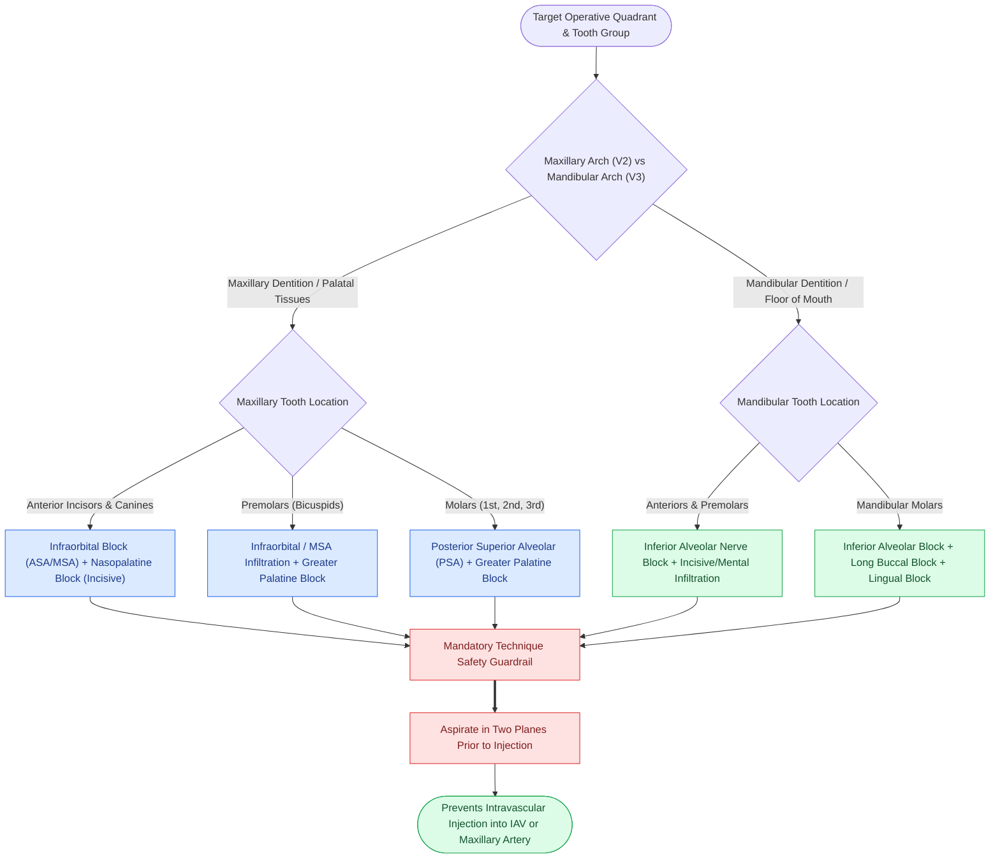

# Dental local anesthesia relies on anatomic landmarks to block the inferior alveolar, greater palatine, and superior alveolar nerves

## Active Recall

> [!question]- What anatomic landmarks, needle angulation, and penetration depth define the conventional Halsted inferior alveolar nerve block (IANB)?
> *Answer / Clinical Rationale*: The conventional Halsted IAN block targets the inferior alveolar nerve within the **pterygomandibular space** immediately superior to the mandibular foramen and lingula:
> - **Landmarks**: The coronoid notch (greatest concavity on the anterior border of the ramus), the **pterygomandibular raphe** (pterygomandibular fold), and the occlusal plane of the mandibular teeth.
> - **Needle Trajectory**: The syringe barrel is positioned over the **contralateral premolars**, directing the needle at a **$45^\circ$ angle** to the mandibular ramus.
> - **Height of Insertion**: The puncture point lies in the mucous membrane on the medial side of the mandibular ramus, approximately **$6\text{–}10\text{ mm}$ (roughly 1 cm) superior to the mandibular occlusal plane**, halfway between the coronoid notch and pterygomandibular raphe.
> - **Penetration Depth**: The needle is advanced **$20\text{–}25\text{ mm}$** until bone contact is gently made along the medial ramus wall above the lingula. After negative aspiration, 1.5–1.8 mL of local anesthetic is deposited.

> [!question]- What anatomic landmarks guide needle placement for the greater palatine and nasopalatine nerve blocks on the hard palate?
> *Answer / Clinical Rationale*:
> - **Greater Palatine Nerve Block**: The needle is inserted into the palatal mucosa overlying the **greater palatine foramen**, situated **halfway between the maxillary second molar and the midpalatal raphe** *(CummingsReview2017, Ch10, p.202, Fig. 10.1)*, approximately $3\text{–}4\text{ mm}$ anterior to the junction of the hard and soft palate. Depositing 0.3–0.5 mL anesthetizes the palatal mucoperiosteum from the third molar anteriorly to the canine.
> - **Nasopalatine Nerve Block**: The needle enters the palatal mucosa immediately lateral to the **incisive papilla** in the midline, located **$5\text{–}7\text{ mm}$ posterior to the maxillary central incisors**. Advancing slightly superiorly into the incisive foramen anesthetizes the palatal tissues of the premaxilla (canine-to-canine).

> [!question]- Which distinct sensory nerve blocks must be combined to achieve complete pulpal, lingual, and buccal anesthesia for a maxillary second molar versus a mandibular second molar?
> *Answer / Clinical Rationale*:
> - **Maxillary Second Molar**: Requires a **Posterior Superior Alveolar (PSA) block** (needle inserted into the mucobuccal fold above the second molar, angled $45^\circ$ superiorly, posteriorly, and medially to anesthetize molar pulp and buccal gingiva) PLUS a **Greater Palatine block** (to anesthetize the palatal gingiva and mucoperiosteum).
> - **Mandibular Second Molar**: Requires an **Inferior Alveolar Nerve block** (anesthetizing pulpal tissue and labial/alveolar bone) PLUS a **Long Buccal block** (needle inserted into the retromolar buccal mucosa along the anterior ascending ramus at the level of the occlusal plane to anesthetize the buccal gingiva and periosteum) PLUS a **Lingual block** (anesthetizing lingual gingiva, floor of mouth, and anterior two-thirds of tongue).

## Core Clinical & Mechanistic Principles

Surgical interventions involving the oral cavity—including dentoalveolar extractions, closed reduction with arch bars, rigid internal fixation of mandibular fractures, and transoral mucosal biopsies—rely on targeted regional anesthesia of the maxillary ($V_2$) and mandibular ($V_3$) divisions of the trigeminal nerve:

### Mandibular Nerve Blocks: Anatomy and Technique
1. **Inferior Alveolar Nerve Block (IANB)**:
   - The IAN is a branch of the posterior division of $V_3$. Prior to entering the mandibular foramen on the medial surface of the ramus, it traverses the **pterygomandibular space** (bounded laterally by the medial ramus and medially by the medial pterygoid muscle).
   - *Technique*: Syringe rests over contralateral premolars; needle enters $1\text{ cm}$ above occlusal plane medial to the temporal crest / coronoid notch; advances $20\text{–}25\text{ mm}$ to gentle bone contact above the **lingula**; aspirate to avoid the inferior alveolar artery and vein.
2. **Lingual Nerve Block**:
   - The lingual nerve runs anterior and medial to the IAN within the pterygomandibular space.
   - *Technique*: Depositing 0.2–0.3 mL of local anesthetic as the needle is withdrawn $10\text{ mm}$ during an IAN block successfully blocks the lingual nerve, providing profound anesthesia to the ipsilateral anterior two-thirds of the tongue, floor of the mouth, and lingual gingiva.
3. **Long Buccal Nerve Block**:
   - The long buccal nerve (anterior division of $V_3$) crosses the anterior border of the ramus at the level of the occlusal plane, supplying sensory innervation to the buccal gingiva, periosteum, and buccal mucosa of the mandibular molar region.
   - *Technique*: Insert needle into the buccal mucosa distal and buccal to the most posterior mandibular molar; deposit 0.3 mL.

### Maxillary Nerve Blocks: Anatomy and Technique
1. **Greater Palatine Nerve Block *(CummingsReview2017, Ch10, p.202, Fig. 10.1)*:**
   - The greater palatine nerve emerges from the greater palatine foramen onto the posterior hard palate.
   - *Landmark*: Depressed mucosal pit halfway between the maxillary second molar and the midline palatal suture.
   - *Anesthesia Field*: Posterior hard palate and overlying palatal mucosa forward to the canine.
2. **Nasopalatine Nerve Block**:
   - Emerges from the incisive foramen beneath the incisive papilla.
   - *Landmark*: $5\text{–}7\text{ mm}$ posterior to the maxillary central incisors in the dental midline.
   - *Anesthesia Field*: Bilateral palatal mucosa of the premaxillary region (mesial aspect of right canine to mesial aspect of left canine).
3. **Posterior Superior Alveolar (PSA) Block**:
   - Supplies the maxillary molars and adjacent buccal gingiva.
   - *Technique*: Insert needle into mucobuccal fold above the second molar at a $45^\circ$ angle superiorly, posteriorly, and medially along the posterior maxillary tuberosity.
   - *Complication Safeguard*: Over-insertion ($>16\text{ mm}$) risks penetrating the **pterygoid venous plexus** or maxillary artery, causing an immediate, disfiguring infratemporal / buccal hematoma.
4. **Infraorbital Nerve Block**:
   - Blocks the infraorbital nerve and its anterior and middle superior alveolar (ASA, MSA) branches.
   - *Landmark*: Infraorbital foramen ($5\text{–}7\text{ mm}$ inferior to the infraorbital rim, in the mid-pupillary / medial limbus line).
   - *Anesthesia Field*: Maxillary incisors, canines, premolars, upper lip, lateral nasal wall, and lower eyelid.

### Comprehensive Regional Anesthesia Protocol Matrix

| Clinical Procedure | Target Tooth Group | Primary Nerve Block(s) | Supplemental Soft-Tissue Block |
| :--- | :--- | :--- | :--- |
| Maxillary Incisor Extraction / Apicoectomy | Teeth #7–10 | Infraorbital block (ASA/MSA) | Nasopalatine block (palatal gingiva) |
| Maxillary Molar Extraction / Sinus Floor Lift | Teeth #1–3, #14–16 | Posterior superior alveolar (PSA) | Greater palatine block (palatal gingiva) |
| Mandibular Molar Extraction / Implants | Teeth #17–19, #30–32 | Inferior alveolar nerve (IANB) | Long buccal block + Lingual block |
| Mandibular Parasymphyseal Trauma / Fracture | Teeth #21–28 | Bilateral Mental / Incisive blocks or IANB | Labial infiltration + Lingual block |
| Arch Bar Application (Intermaxillary Fixation) | Full dentition | Bilateral IANB + PSA + Infraorbital | Bilateral Greater Palatine + Nasopalatine |

Comprehensive anatomical and therapeutic integration links these principles directly to [[Pre-plating the intact mandible before osteotomy preserves accurate dental occlusion and contour|Mandibular Pre-Plating & Occlusion]].

## Connected Concepts & Graph Traversal
- **Masticator Space Anatomy**: [[Retromolar trigone carcinoma invades the pterygomandibular raphe and masticator space|Pterygomandibular Space]]
- **🔗 Sinus Regional Blocks (Sinus)**: [[Regional sensory nerve blocks of the nose and paranasal sinuses target branches of V1 and V2|V1 & V2 Sensory Nerve Blocks]]
- **Odontogenic Infection Spread**: [[Ludwig angina presents with bilateral submandibular cellulitis and woody floor of mouth induration compromising the airway|Ludwig Angina]]
- **🔗 Mandibular Osteosynthesis (FPRS)**: [[Mandible fractures require anatomical reduction and load-sharing miniplate fixation along Champy lines of ideal osteosynthesis|Champy Lines of Osteosynthesis]]
- **Mandibulotomy Access**: [[Step-cut chevron mandibulotomy maximizes bone surface contact and rotational stability|Step-Cut Chevron Mandibulotomy]]
