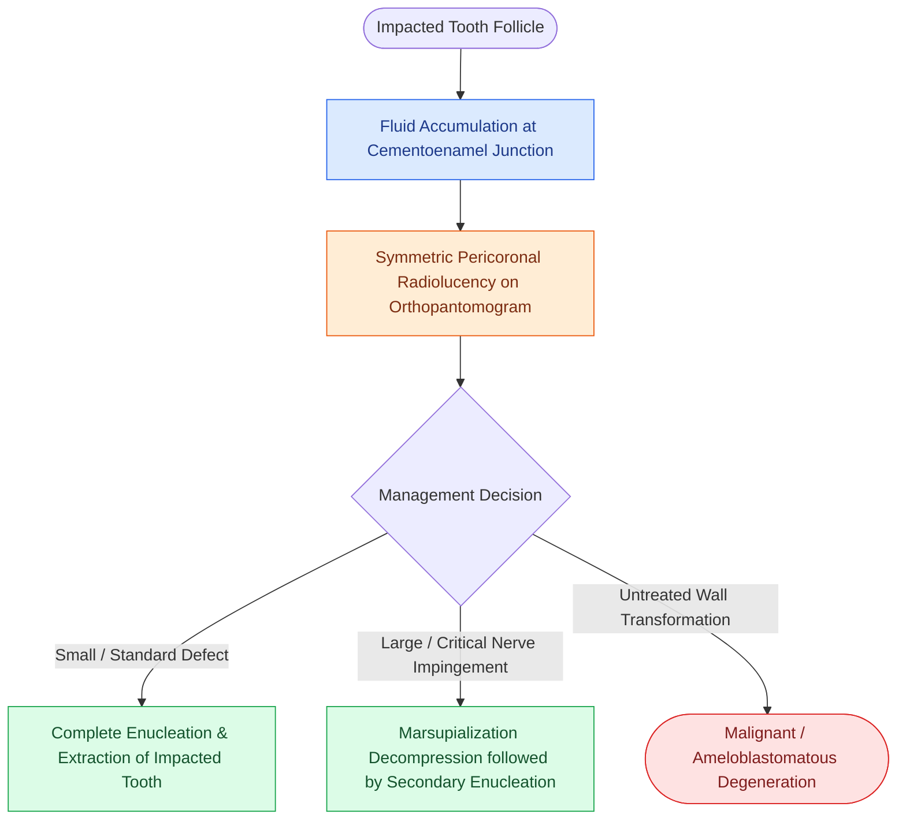

# Dentigerous cysts arise from the follicular epithelium surrounding the crown of an unerupted third molar

## Active Recall

> [!question]- What is the precise anatomical attachment and radiographic hallmark of a dentigerous cyst, and what is its most common site of occurrence?
> *Answer / Clinical Rationale*: A dentigerous (follicular) cyst attaches precisely at the **cementoenamel junction (CEJ)** and encloses the **crown of an unerupted or impacted tooth**. Radiographically, it presents as a **well-demarcated, unilocular, symmetric pericoronal radiolucency (>3–4 mm in pericoronal width)**. Its most common site is the **mandibular third molar (70%–75%)**, followed by maxillary permanent canines and mandibular second premolars.

> [!question]- What potential neoplastic transformations can occur within the epithelial lining of an untreated dentigerous cyst?
> *Answer / Clinical Rationale*: Although most dentigerous cysts are benign and cured by enucleation, their non-keratinized stratified squamous lining harbors metaplastic potential and can transform into **unicystic ameloblastoma**, **squamous cell carcinoma**, or **mucoepidermoid carcinoma** (arising from mucous cells within the cyst wall).

## Core Clinical & Mechanistic Principles
**Dentigerous cysts** are the second most common odontogenic cysts of the jaws (representing ~20% of all epithelium-lined jaw cysts, behind inflammatory periapical cysts). Pathophysiologically, fluid accumulates between the reduced enamel epithelium and the completely formed enamel surface of an impacted crown following expansion of the follicular space, creating a pericoronal radiolucency distinct from [[Odontogenic keratocysts arise from PTCH1 mutations in Gorlin syndrome and exhibit high recurrence after simple enucleation|odontogenic keratocysts]] or invasive [[Ameloblastoma exhibits multilocular soap-bubble radiolucency and requires segmental resection with one-centimeter bony margins|ameloblastoma]].

### Diagnostic Differentiation & Histopathology
1. **Clinical & Radiographic Distinctions**:
   - **Vitality**: Unlike periapical cysts (which require a non-vital, necrotic tooth), dentigerous cysts surround the crown of an unerupted tooth with vital adjacent dentition.
   - **Differential Diagnosis**:
     - **Odontogenic Keratocyst (OKC)**: OKCs typically attach apical to the cementoenamel junction, scallop between tooth roots, and show high recurrence.
     - **Ameloblastoma**: Displays multilocular ("soap-bubble" / "honeycomb") expansile remodeling with root resorption.
2. **Histopathologic Features**:
   - Thin (2–4 layers), non-keratinized stratified squamous epithelium lining a fibrous connective tissue capsule.
   - Cholesterol clefts, Rushton bodies (curvilinear eosinophilic structures), and chronic inflammatory infiltrates when secondary infection occurs.
3. **Surgical Craft**:
   - **Enucleation with Curettage**: Complete removal of the cyst lining along with extraction of the impacted molar cures the lesion with a near-zero recurrence rate.
   - **Marsupialization / Decompression**: Indicated for massive mandibular cysts that risk pathologic fracture or inferior alveolar nerve injury, allowing bony remodeling before definitive extirpation.

## Connected Concepts & Graph Traversal
- **Differential Aggressive Cyst**: [[Odontogenic keratocysts arise from PTCH1 mutations in Gorlin syndrome and exhibit high recurrence after simple enucleation|Odontogenic Keratocysts (OKC)]]
- **Differential Multilocular Tumor**: [[Ameloblastoma exhibits multilocular soap-bubble radiolucency and requires segmental resection with one-centimeter bony margins|Ameloblastoma Resection]]
- **Bony Reconstruction**: [[The fibula osteocutaneous free flap provides up to twenty-five centimeters of vascularized bone for mandible reconstruction|Fibula Free Flap Mandible Reconstruction]]
- **Adjacent Nerve Protection**: [[Level I dissection requires facial vessel ligation and preservation of the lingual and hypoglossal nerves|Submandibular & Lingual Corridor]]
- **Premalignant Transformation**: [[Mucoepidermoid carcinoma is graded by AFIP Brandwein criteria and driven by CRTC1-MAML2 translocation|Mucoepidermoid Carcinoma]]
- **Dental Numbering Reference**: [[The Universal Numbering System and Palmer Notation designate primary and permanent dentition across four oral quadrants|Universal Numbering & Palmer Notation]]
- **Differential Mixed Odontogenic Tumor**: [[Calcifying epithelial odontogenic tumors, adenomatoid odontogenic tumors, odontomas, and odontogenic myxomas exhibit distinct histopathologic hallmarks and biologic behaviors|AOT & Odontoma Differential]]
- **Regional Anesthesia for Extraction**: [[Dental local anesthesia relies on anatomic landmarks to block the inferior alveolar, greater palatine, and superior alveolar nerves|Dental Nerve Block Landmarks]]
