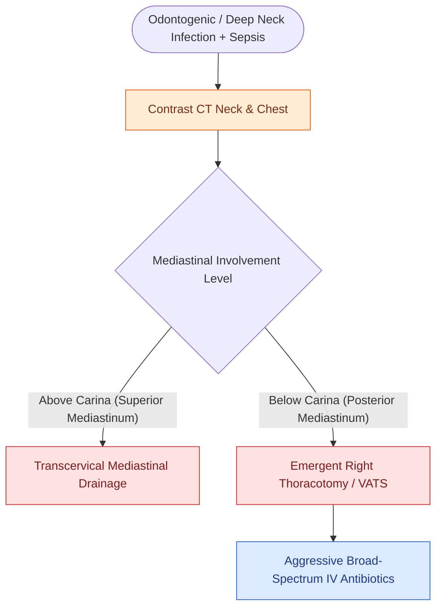

# Descending necrotizing mediastinitis from deep neck infections mandates urgent surgical drainage and broad-spectrum antimicrobial escalation

## Active Recall

> [!question]- What anatomical pathway is the primary highway for descending necrotizing mediastinitis (DNM) extending from the neck into the posterior mediastinum?
> *Answer / Clinical Rationale*: The **danger space (Space 4)**, bounded by the **alar layer of the deep cervical fascia anteriorly** and the **prevertebral fascia posteriorly**, extending without interruption from the skull base through the posterior mediastinum to the level of the diaphragm ($T_{12}\text{–}L_1$).

> [!question]- What anatomical boundary separates Estrera Type I from Type II descending necrotizing mediastinitis on CT imaging, and how does it dictate the surgical approach?
> *Answer / Clinical Rationale*: The **carina ($T_4$)**. **Estrera Type I (Focal / Upper Mediastinal)**: Confined to the anterior or posterior mediastinum *above the carina*; can be managed via a transcervical mediastinal approach. **Estrera Type II (Diffuse / Lower Mediastinal)**: Extends *below the carina* (Type IIA anterior, Type IIB posterior); mandates **open posterolateral thoracotomy, median sternotomy, or VATS (video-assisted thoracoscopic surgery)** combined with cervical drainage.

> [!question]- Why is transcervical drainage alone inadequate for descending infection extending into the lower posterior mediastinum?
> *Answer / Clinical Rationale*: Gravity, negative intrathoracic respiratory pressures, and fascial compartmentalization prevent dependent drainage from below the tracheal bifurcation upward through the neck, resulting in persistent mediastinal phlegmon, pericardial effusion, empyema, and septic shock ($>40\%$ mortality without thoracotomy).

## Core Clinical & Mechanistic Principles
**Descending necrotizing mediastinitis (DNM)** is one of the most lethal complications of otolaryngology ($25\text{–}40\%$ overall mortality), arising primarily from odontogenic infections ($40\text{–}60\%$), peritonsillar/parapharyngeal abscesses ($20\text{–}30\%$), or retropharyngeal trauma:

- **Fascial Transmission Corridors**:
  - *Retropharyngeal Space*: Terminates at the superior mediastinum / tracheal bifurcation ($T_4$).
  - *Pretracheal / Visceral Space*: Tracks anterior to the trachea into the **anterior mediastinum** down to the pericardium.
  - *Danger Space (Space 4)*: Travels unrestricted behind the alar fascia down to the **posterior diaphragm**, seeding the entire posterior mediastinum.
- **The Estrera Classification of DNM**:
  - **Type I (Upper Mediastinum)**: Infection localized above the carina ($T_4$).
  - **Type IIA (Diffuse Anterior)**: Extends into the lower anterior mediastinum below the carina.
  - **Type IIB (Diffuse Posterior)**: Extends into the lower posterior mediastinum below the carina.

### Urgent Surgical Protocol & Resuscitation
1. **Mandatory CT Imaging**:
   - Contrast-enhanced CT of the neck AND chest is diagnostic: Demonstrates mediastinal fat stranding, loss of tissue planes, loculated fluid/gas collections, pleural effusions, and pericardial fluid.
2. **Coordinated Multi-Disciplinary Decompression**:
   - *Transcervical Cervicotomy*: Wide drainage of parapharyngeal, retropharyngeal, and submandibular spaces with placement of large-bore closed-suction or corrugated drains.
   - *Thoracic Exploration*: For Type II disease, immediate **right posterolateral thoracotomy or bilateral VATS** with complete mediastinal debridement, decortication, and chest tube drainage.
3. **Broad-Spectrum Antimicrobial Escalation**:
   - Immediate initiation of **Vancomycin + Piperacillin-tazobactam ($4.5\text{ g}$ IV q6h)** or **Meropenem ($1\text{ g}$ IV q8h)** with aggressive ICU resuscitation and hemodynamic support (see [[Empiric antimicrobial therapy for deep neck space infections targets polymicrobial oral flora and MRSA|DNSI Antimicrobial Therapy]]).

## Connected Concepts & Graph Traversal
- **Pharmacotherapy Ladder**: [[Empiric antimicrobial therapy for deep neck space infections targets polymicrobial oral flora and MRSA|DNSI Antimicrobial Therapy]]
- **Danger Space Anatomy**: [[The danger space permits unrestricted infection spread from skull base to posterior mediastinum|The Danger Space]]
- **Deep Cervical Fascial Planes**: [[Deep neck space infections spread along cervical fascial planes between the pharynx, mediastinum, and skull base|Deep Neck Fascial Planes]]
- **Ludwig Angina Sepsis**: [[Ludwig angina presents with bilateral submandibular cellulitis and woody floor of mouth induration compromising the airway|Ludwig's Angina]]
- **Lemierre Septic Embolization**: [[Lemierre syndrome involves Fusobacterium necrophorum internal jugular thrombophlebitis and septic emboli|Lemierre Syndrome]]
