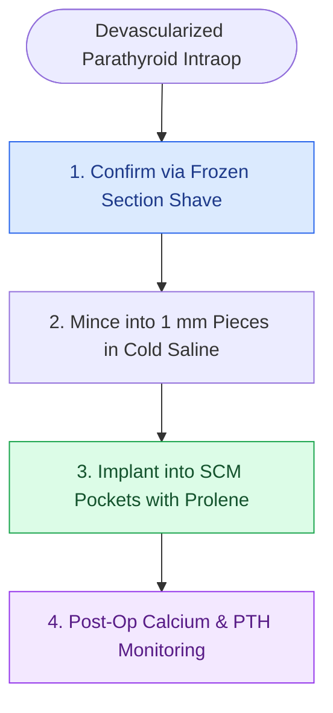

# Devascularized parathyroid glands require confirmation biopsy and autotransplantation into the SCM

## Active Recall

> [!question]- How is devascularized parathyroid tissue prepared for autotransplantation?
> *Answer / Clinical Rationale*: It is chilled in cold saline and **minced into $1.0\text{-mm}$ cubes** before implantation into individual muscle pockets.

> [!question]- Why is a non-absorbable suture or clip placed over the parathyroid autotransplantation site?
> *Answer / Clinical Rationale*: To securely close the muscle pocket and **mark the site** for localization if future graft-dependent hyperparathyroidism develops.

## Core Clinical & Mechanistic Principles
Inadvertent devascularization or accidental removal of parathyroid tissue during total thyroidectomy or central neck dissection requires immediate autotransplantation to prevent permanent hypoparathyroidism:
- **Assessment of Viability**:
  - A healthy parathyroid gland is mustard-yellow/tan and bleeds when lightly scratched with a needle.
  - A dark brown/black, cyanotic, or detached gland is non-viable.
- **Surgical Step-by-Step Autotransplantation Protocol**:
  1. **Confirmation Biopsy**: Take a microscopic sliver ($0.5\text{ mm}$) of the tissue and send for frozen section confirmation (to confirm parathyroid tissue and rule out metastatic carcinoma / lymph node).
  2. **Tissue Preparation**: Place the parathyroid tissue in cold sterile saline on ice; mince into **$1.0\text{-mm}$ cubes** with a fresh scalpel blade.
  3. **Pocket Creation**: Create individual muscular pockets within the sternocleidomastoid (SCM) muscle (or strap muscle).
  4. **Implantation**: Place 1–2 tissue cubes into each separate muscle pocket.
  5. **Closure & Marking**: Close the pocket with a non-absorbable suture (4-0 or 5-0 Prolene or silk) and mark with a titanium clip for future identification.

### Surgical Technique & Critical Safety Checks
- **Graft Revascularization**: The minced fragments survive initially by plasmatic imbibition and revascularize fully via host angiogenesis within 2–4 weeks (see [[Superior and inferior parathyroid glands maintain constant anatomical relationships to the RLN and ITA|Parathyroid Anatomy]]).

## Connected Concepts & Graph Traversal
- **Parathyroid Anatomy**: [[Superior and inferior parathyroid glands maintain constant anatomical relationships to the RLN and ITA|Parathyroid Anatomy]]
- **Post-op Hypocalcemia**: [[Post-thyroidectomy hypocalcemia is managed with oral calcium, calcitriol, and intravenous calcium gluconate|Post-op Hypocalcemia]]
- **Miami Criterion**: [[The Miami criterion requires a fifty percent intraoperative PTH drop at ten minutes post-excision|Miami Criterion]]
- **Anatomical Foundation**: [[Ludwig angina presents with bilateral submandibular cellulitis and woody floor of mouth induration compromising the airway]]
- **Surgical Lymphadenectomy**: [[Radical neck dissection removes levels I through V while sacrificing CN XI, the IJV, and the SCM]]
- **Oncologic Resection & Margins**: [[Step-cut chevron mandibulotomy maximizes bone surface contact and rotational stability]]
- **Aerodigestive / Pharyngolaryngeal**: [[Subglottic carcinoma spreads to level VI central compartment lymphatics and mediastinal nodes]]
