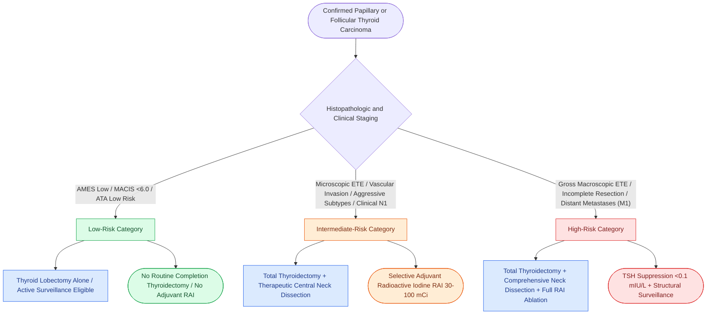

# Differentiated thyroid carcinoma prognostic scoring systems AMES, AGES, and MACIS stratify low and high risk disease to guide the extent of thyroidectomy

## Active Recall

> [!question]- What specific prognostic variables define the low-risk category in the Lahey Clinic AMES system, and what are the specific age thresholds?
> *Answer / Clinical Rationale*: **AMES** categorizes differentiated thyroid cancer based on **Age, Metastases, Extent, and Size**. Low-risk patients include: (1) **all young patients** (men $<41\text{ years}$, women $<51\text{ years}$) without distant metastases, and (2) **older patients** (men $\ge 41\text{ years}$, women $\ge 51\text{ years}$) with intrathyroidal papillary carcinoma or follicular carcinoma with only minor capsular invasion, primary tumor size $<5.0\text{ cm}$, and no distant metastases ($M0$). Low-risk patients exhibit a 20-year mortality rate under **2%**, whereas high-risk patients experience mortality rates approaching **45%**.

> [!question]- What five mathematical parameters comprise the Mayo Clinic MACIS scoring system, and how does the score stratify 20-year survival?
> *Answer / Clinical Rationale*: The **MACIS score** is calculated postoperatively using: (1) **M**etastases (distant metastases present $= +3$), (2) **A**ge ($<40\text{ years} = 3.1$; $\ge 40\text{ years} = 0.08 \times \text{age}$), (3) **C**ompleteness of surgical resection (gross residual disease $= +1$), (4) **I**nvasion (gross extrathyroidal invasion $= +1$), and (5) **S**ize ($0.3 \times \text{maximum tumor diameter in cm}$). A MACIS score $<6.0$ confers a **99% 20-year survival**, scores 6.0–6.99 have an **89% survival**, scores 7.0–7.99 have a **56% survival**, and scores $\ge 8.0$ suffer a **20-year mortality exceeding 75%**.

> [!question]- How does the American Thyroid Association (ATA) 3-tier risk-of-recurrence classification fundamentally differ from TNM staging in purpose and criteria?
> *Answer / Clinical Rationale*: While **AJCC TNM staging** predicts **disease-specific mortality** (overall survival), the **ATA 3-tier risk system (Low, Intermediate, High)** predicts the **probability of structural disease recurrence**. Because differentiated thyroid carcinoma has exceptionally low overall mortality ($<2\text{–}5\%$) despite relatively common regional relapse, the ATA system guides adjuvant radioactive iodine (RAI) administration and surveillance intensity: **Low Risk** ($<5\%$ recurrence risk: intrathyroidal, microscopic $N1 \le 5$ nodes $<2\text{ mm}$, no ETE), **Intermediate Risk** ($6\text{–}20\%$ recurrence: microscopic ETE, aggressive histology, vascular invasion, or clinical $N1$ / $>5$ involved nodes $<3\text{ cm}$), and **High Risk** ($>30\%$ recurrence: gross macroscopic ETE, incomplete tumor resection, distant metastasis, or pathologically involved lymph node $\ge 3\text{ cm}$ with extranodal extension).

## Core Clinical & Mechanistic Principles

Risk stratification in differentiated thyroid carcinoma (papillary and follicular carcinoma) has evolved from historic mortality-prediction staging systems to modern structural recurrence-prediction models:

### Historic Prognostic Systems Matrix *(Cummings p.106–107)*

| System | Institution | Core Variables Evaluated | High-Risk Defining Thresholds |
| :--- | :--- | :--- | :--- |
| **AMES** | Lahey Clinic | Age, Metastases, Extent, Size | Older patients (M $\ge 41$, F $\ge 51$) with extrathyroidal extension, tumor $\ge 5\text{ cm}$, or any distant metastasis |
| **AGES** | Mayo Clinic | Age, Grade, Extent, Size | Pathologic grade (poorly differentiated/nuclear pleomorphism), capsular/extrathyroidal invasion, tumor size |
| **MACIS** | Mayo Clinic | Metastases, Age, Completeness, Invasion, Size | Mathematical composite score $\ge 7.0$ (reflects gross incomplete resection, macroscopic ETE, distant metastases) |
| **University of Chicago** | DeGroot et al. | Clinical stages I through IV based on anatomical extent | Class I: Intrathyroidal; Class II: Cervical nodes; Class III: Extrathyroidal extension; Class IV: Distant metastases |

Risk stratification distinguishes differentiated tumors from [[Anaplastic thyroid carcinoma is an airway and molecular emergency requiring immediate BRAF testing|undifferentiated anaplastic carcinomas]] and neuroendocrine [[Medullary thyroid carcinoma arises from parafollicular C cells and mandates RET testing with calcitonin surveillance|medullary thyroid carcinomas]]. In all cases, meticulous surgical dissection aims for total gross clearance while ensuring [[Superior and inferior parathyroid glands maintain constant anatomical relationships to the RLN and ITA|parathyroid gland devascularization avoidance]].

### American Thyroid Association (ATA) Risk of Recurrence *(Cummings p.107, Box 5.3)*
The ATA guidelines classify patients postoperatively into three distinct categories determining adjuvant therapy and TSH suppression targets:

1. **Low Risk (<5% Recurrence Risk)**:
   - Intrathyroidal follicular or papillary thyroid cancer with no capsular or extrathyroidal extension.
   - Complete microscopic resection ($R0$).
   - No vascular invasion or distant metastases.
   - $cN0$ or microscopic $N1$ involving $\le 5$ lymph nodes with all foci $<2\text{ mm}$ in greatest dimension.
   - Non-aggressive histologies (classical PTC, encapsulated follicular variant).
   - *Clinical Management*: Adjuvant RAI is not routinely recommended; mild TSH suppression (0.5–2.0 mIU/L) is adequate.

2. **Intermediate Risk (6%–20% Recurrence Risk)**:
   - Microscopic extrathyroidal extension into perithyroidal soft tissues.
   - Aggressive histopathologic variants (tall cell, columnar cell, hobnail, diffuse sclerosing).
   - Follicular thyroid cancer with extensive lymphovascular invasion.
   - Clinical $cN1$ disease or $>5$ pathologically involved lymph nodes ($<3\text{ cm}$ in size).
   - *Clinical Management*: Consider adjuvant RAI remnant ablation (30–100 mCi); moderate TSH suppression (0.1–0.5 mIU/L).

3. **High Risk (>30% Recurrence Risk)**:
   - Macroscopic gross extrathyroidal extension invading strap muscles, trachea, larynx, esophagus, or recurrent laryngeal nerve.
   - Incomplete surgical resection with gross tumor residual ($R2$).
   - Distant hematogenous metastases ($M1$).
   - Any metastatic lymph node $\ge 3.0\text{ cm}$ in maximal dimension or displaying overt extranodal extension.
   - Postoperative thyroglobulin levels suggestive of distant metastatic disease.
   - *Clinical Management*: Mandatory high-dose radioactive iodine ($100\text{–}150+\text{ mCi}$); aggressive TSH suppression ($<0.1\text{ mIU/L}$).

### Surgical Decision Implications
These scoring metrics dictate whether a patient is adequately treated with thyroid lobectomy versus requiring total thyroidectomy, central neck dissection, and adjuvant therapy. Older patients with AMES/MACIS high-risk features or ATA intermediate/high-risk histology require total thyroidectomy to enable post-treatment radioactive iodine scanning and whole-body surveillance via serum thyroglobulin.

## Connected Concepts & Graph Traversal
- **Clinical Guideline Paradigm**: [[The 2025 ATA guidelines establish active surveillance criteria and lobectomy preference for low-risk differentiated thyroid cancer|2025 ATA Guidelines & Lobectomy Selection]]
- **Anatomical Clearance**: [[Central compartment neck dissection clears level VI nodes between the carotid sheaths and suprasternal notch|Central Compartment Level VI Lymphadenectomy]]
- **Molecular Driver**: [[BRAF V600E and TERT promoter mutations drive aggressive papillary thyroid carcinoma behavior|BRAF and TERT Prognostic Mutations]]
- **Cytopathologic Diagnostic Basis**: [[The Bethesda system for reporting thyroid cytopathology stratifies malignancy risk and guides surgical decision-making|Bethesda System Cytopathology]]
- **Surgical Craft / Nerve Preservation**: [[The recurrent laryngeal nerve is identified within Simon's triangle and followed through Berry's ligament|Recurrent Laryngeal Nerve Identification]]
- **Aggressive Histologic Variants**: [[High-risk papillary thyroid carcinoma histologic variants portend aggressive extrathyroidal invasion, radioiodine refractoriness, and adverse prognosis|Aggressive PTC Variants & Radioiodine Refractoriness]]
