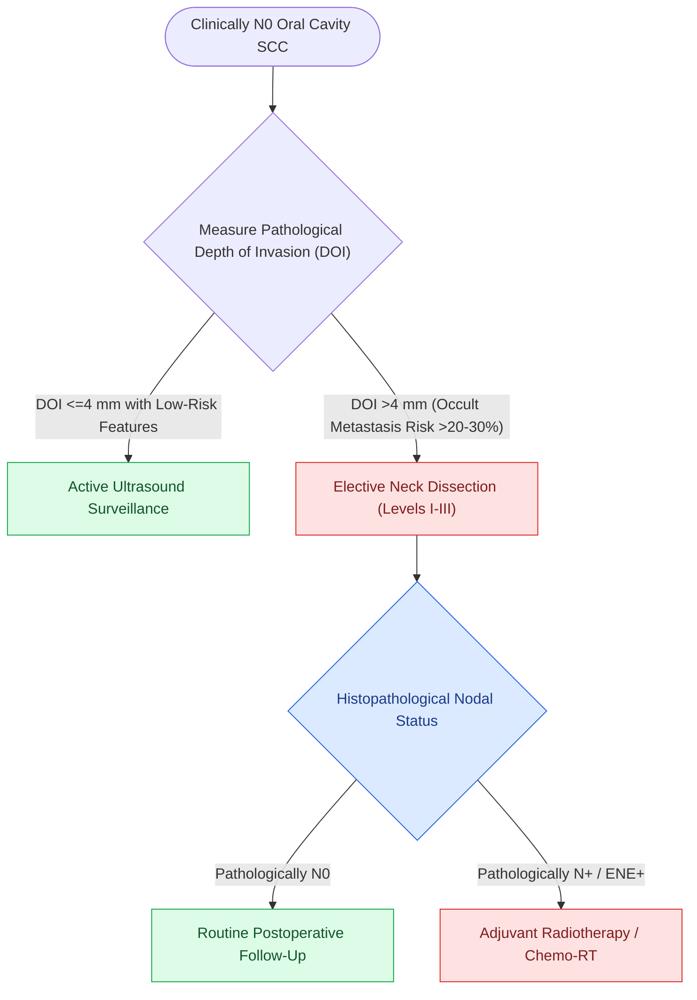

# Elective neck dissection is indicated for oral cavity squamous cell carcinoma with depth of invasion exceeding four millimeters

## Active Recall

> [!question]- What Depth of Invasion (DOI) threshold establishes the mandatory indication for elective neck dissection in cN0 oral cancer?
> *Answer / Clinical Rationale*: A **$\text{DOI} > 4.0\text{ mm}$**.

> [!question]- What specific lymph node levels are resected during an elective neck dissection for oral tongue cancer?
> *Answer / Clinical Rationale*: **Levels I, II, and III** (Supraomohyoid neck dissection).

## Core Clinical & Mechanistic Principles
In clinically node-negative ($cN0$) oral cavity squamous cell carcinoma, management of the cervical lymphatics is dictated by the risk of occult micrometastasis:
- **The 20% Rule (Weiss Threshold)**: When the probability of occult cervical lymph node metastasis exceeds **$15\text{–}20\%$**, [[Selective neck dissection targets high-risk nodal basins while sparing low-risk cervical levels|elective neck dissection]] (END) provides superior regional control and disease-specific survival compared to watchful waiting.
- **Depth of Invasion (DOI) Benchmark**:
  - A prospective randomized trial (D'Cruz et al., NEJM 2015) demonstrated that elective supraomohyoid neck dissection (SND I–III) significantly improves overall survival in $cN0$ oral cancer.
  - Tumors with a **$\text{DOI} > 4.0\text{ mm}$** have an occult nodal metastasis rate of **$25\text{–}40\%$**, establishing $\text{DOI} > 4\text{ mm}$ as the definitive indication for routine elective neck dissection.

### Surgical Technique & Critical Safety Checks
- **Surgical Extent**: Standard elective dissection for oral cavity is **Supraomohyoid Neck Dissection (Levels I, IIA, IIB, and III)**.
- **Sentinel Lymph Node Biopsy (SLNB)**: Radiotracer and lymphoscintigraphy can identify sentinel nodes in early T1/T2 tumors with $\text{DOI} \le 4\text{ mm}$ to avoid complete neck dissection.

## Connected Concepts & Graph Traversal
- **Depth of Invasion**: [[AJCC 8th edition incorporates depth of invasion into oral cavity T-staging|Depth of Invasion]]
- **Selective Dissection**: [[Selective neck dissection targets high-risk nodal basins while sparing low-risk cervical levels|Selective Neck Dissection]]
- **Clear Margins**: [[Oncologic clear margins require at least five millimeters of histological normal tissue|Oncologic Margins]]
- **Anatomical Foundation**: [[Deep cervical fascia divides into superficial, middle, and deep layers that define surgical planes]]
- **Surgical Lymphadenectomy**: [[Levels II through IV internal jugular chain dissection mobilizes the carotid sheath packet]]
- **Oncologic Resection & Margins**: [[Step-cut chevron mandibulotomy maximizes bone surface contact and rotational stability]]
- **Aerodigestive / Pharyngolaryngeal**: [[Prophylactic transcervical external carotid ligation reduces fatal secondary hemorrhage after TORS]]
- **Minimally Invasive Staging Alternative**: [[Sentinel lymph node biopsy accurately stages the clinically negative neck in early oral squamous cell carcinoma while reducing shoulder morbidity|Sentinel Lymph Node Biopsy (Oral SCC)]]
