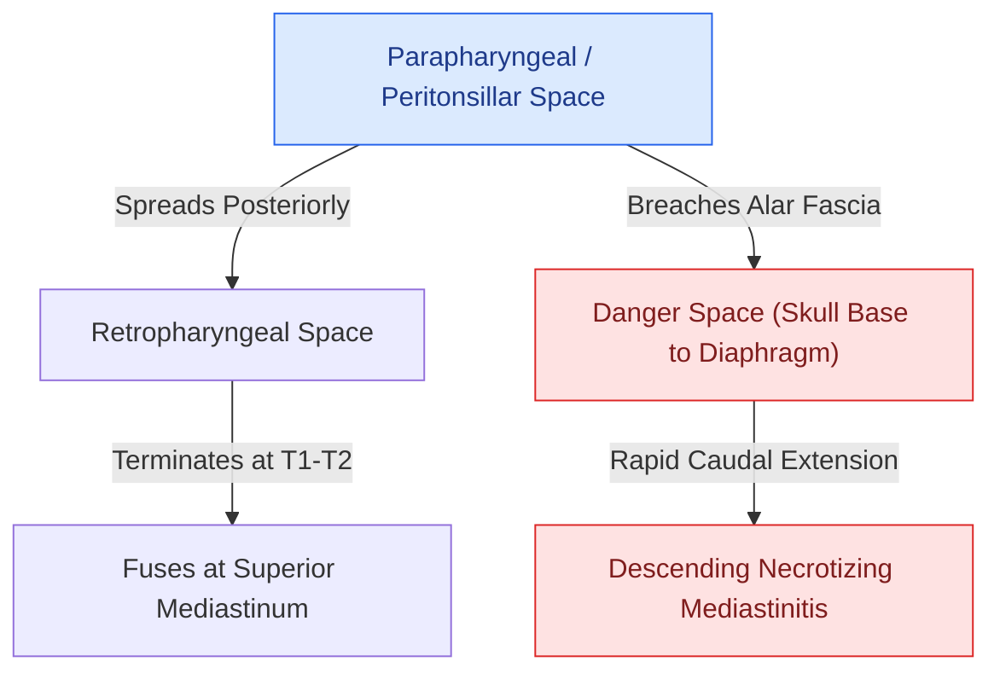

# Empiric antimicrobial therapy for deep neck space infections targets polymicrobial oral flora and MRSA

## Active Recall

> [!question]- What is the first-line intravenous empiric antimicrobial regimen for an immunocompetent adult with a severe deep neck space infection?
> *Answer / Clinical Rationale*: **Ampicillin-sulbactam (Unasyn) $3\text{ g}$ IV every 6 hours**, which provides excellent bactericidal coverage against oral streptococci, methicillin-susceptible *Staphylococcus aureus*, and beta-lactamase-producing oral anaerobes (*Prevotella*, *Fusobacterium*, *Peptostreptococcus*).

> [!question]- What empiric antimicrobial regimen is recommended for severe deep neck space infections in patients with severe penicillin anaphylaxis?
> *Answer / Clinical Rationale*: **Ceftriaxone ($2\text{ g}$ IV q24h) + Metronidazole ($500\text{ mg}$ IV q8h)** or **Moxifloxacin ($400\text{ mg}$ IV q24h)**; for patients with severe IgE-mediated anaphylaxis to cephalosporins, combine **Levofloxacin ($750\text{ mg}$ IV q24h) + Clindamycin ($600\text{–}900\text{ mg}$ IV q8h) / Metronidazole** $\pm$ **Vancomycin**.

> [!question]- When must empiric coverage for methicillin-resistant *Staphylococcus aureus* (MRSA) and *Pseudomonas aeruginosa* be added?
> *Answer / Clinical Rationale*: Add **Vancomycin ($15\text{–}20\text{ mg/kg}$ IV q12h)** or Linezolid in patients with purulent fluctuance, prior MRSA colonization, recent hospitalization, hemodialysis, or septic shock. Add **Cefepime ($2\text{ g}$ IV q8h)** or Piperacillin-tazobactam in diabetic, neutropenic, or post-surgical skull base patients at risk for *Pseudomonas*.

## Core Clinical & Mechanistic Principles
**Deep neck space infections (DNSIs)** arise from odontogenic ($>50\%$), tonsillar/pharyngeal ($25\%$), salivary, or traumatic sources. Due to the diverse polymicrobial ecology of the oral cavity and oropharynx, effective initial pharmacotherapy requires broad-spectrum coverage:

- **Microbial Synergy & Flora**:
  - *Gram-Positive Aerobes/Facultatives*: *Streptococcus viridans*, *Streptococcus anginosus* group (*S. constellatus*, *S. intermedius*), and *Staphylococcus aureus*.
  - *Anaerobes*: *Fusobacterium necrophorum*, *Prevotella melaninogenica*, *Porphyromonas*, and *Peptostreptococcus*.
  - *Gram-Negative Aerobes*: *Klebsiella pneumoniae* (especially in diabetic patients, prone to gas-forming multilocular abscesses).
- **The Antimicrobial Tier Ladder**:
  1. *First-Line Immunocompetent*: **Ampicillin-sulbactam $3\text{ g}$ IV q6h**.
  2. *Penicillin-Allergic*: **Ceftriaxone $2\text{ g}$ IV q24h + Metronidazole $500\text{ mg}$ IV q8h** OR **Moxifloxacin $400\text{ mg}$ IV q24h**.
  3. *MRSA Risk / Critical Sepsis*: Add **Vancomycin $15\text{–}20\text{ mg/kg}$ IV q12h** (targeting trough $15\text{–}20\ \mu\text{g/mL}$ or $\text{AUC/MIC} \ge 400$) or **Linezolid $600\text{ mg}$ IV q12h**.
  4. *Diabetic / Immunocompromised*: **Piperacillin-tazobactam $4.5\text{ g}$ IV q6h + Vancomycin**.

### Surgical Drainage Trigger & Pharmacotherapy Escalation
- **Failure of Medical Management**: If clinical fevers, leukocytosis, or neck induration fail to improve within **$24\text{–}48\text{ hours}$** of intravenous antibiotics, repeat contrast-enhanced CT of the neck and chest and perform urgent operative incision and drainage.
- **Microbiology Culture Adaptation**: Narrow empiric regimens once definitive intraoperative purulent Gram stain and aerobic/anaerobic culture and sensitivity results return (see [[Descending necrotizing mediastinitis from deep neck infections mandates urgent surgical drainage and broad-spectrum antimicrobial escalation|Descending Necrotizing Mediastinitis]]).

## Connected Concepts & Graph Traversal
- **Lethal Mediastinitis Escalation**: [[Descending necrotizing mediastinitis from deep neck infections mandates urgent surgical drainage and broad-spectrum antimicrobial escalation|Descending Necrotizing Mediastinitis]]
- **Deep Fascial Spread Corridors**: [[Deep neck space infections spread along cervical fascial planes between the pharynx, mediastinum, and skull base|Deep Neck Fascial Planes]]
- **Ludwig Angina Airway Rescue**: [[Ludwig angina presents with bilateral submandibular cellulitis and woody floor of mouth induration compromising the airway|Ludwig's Angina]]
- **Lemierre Septic Thrombophlebitis**: [[Lemierre syndrome involves Fusobacterium necrophorum internal jugular thrombophlebitis and septic emboli|Lemierre Syndrome]]
- **Danger Space Anatomy**: [[The danger space permits unrestricted infection spread from skull base to posterior mediastinum|The Danger Space]]
