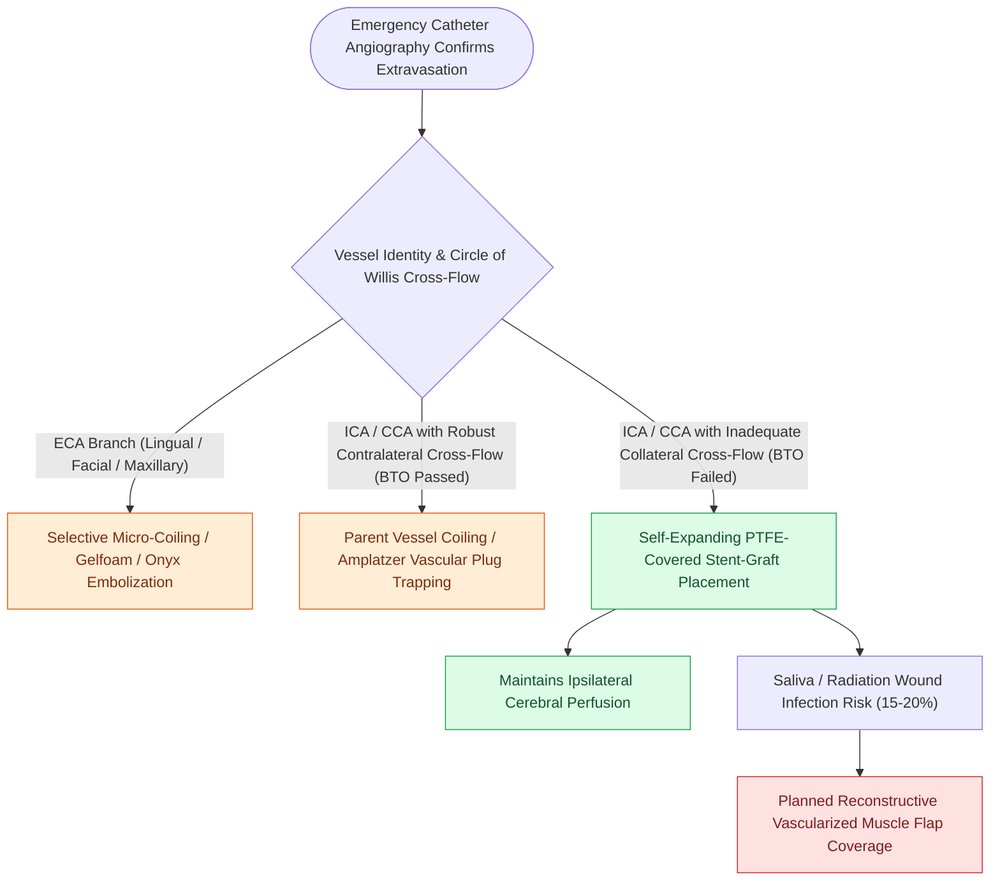

# Endovascular covered stenting and coil embolization provide emergent control of carotid blowout

## Active Recall

> [!question]- What is the main advantage of a covered stent over permanent coil embolization in carotid blowout?
> *Answer / Clinical Rationale*: It achieves immediate hemostasis while **preserving cerebral perfusion through the internal carotid artery**, avoiding acute stroke.

> [!question]- What is the major long-term risk of covered stent placement in an irradiated neck with an active salivary fistula?
> *Answer / Clinical Rationale*: **Stent graft infection and recurrent hemorrhage**.

## Core Clinical & Mechanistic Principles
Endovascular intervention has largely replaced emergent open surgical ligation as the first-line treatment for [[Carotid blowout syndrome is classified into threatened, impending, and acute hemorrhage|Carotid Blowout Syndrome]] (CBS):
- **Diagnostic Angiography**: Rapidly identifies the bleeding site, pseudoaneurysm formation, arterial wall irregularity, or extravasation from the common, internal, or external carotid artery branches.
- **Treatment Modalities**:
  1. **Permanent Vessel Occlusion (PVO) / Coil Embolization**:
     - *Indication*: Rupture of the External Carotid Artery (ECA) branches or ICA rupture in patients with adequate collateral intracranial cross-filling.
     - *Technique*: Endovascular coiling of the pseudoaneurysm and parent vessel trap (distal and proximal to the blowout).
     - *Balloon Test Occlusion (BTO)*: Evaluates circle of Willis cross-flow before sacrificing the ICA; if patient fails BTO, vessel sacrifice causes massive ischemic stroke ($15\text{–}20\%$ stroke risk even if passed).
  2. **Endovascular Covered Stent Placement**:
     - *Indication*: Rupture or pseudoaneurysm of the Common Carotid Artery (CCA) or Internal Carotid Artery (ICA) when vessel preservation is mandatory.
     - *Mechanism*: Deploys a self-expanding PTFE-covered stent across the defect, immediately excluding the rupture while maintaining cerebral perfusion.

### Surgical Technique & Critical Safety Checks
- **Complications of Covered Stents**: High rate of late stent infection ($15\text{–}20\%$) and re-bleeding in infected/irradiated fields; long-term antiplatelet therapy required.

## Connected Concepts & Graph Traversal
- **Classification & Staging**: [[Carotid blowout syndrome is classified into threatened, impending, and acute hemorrhage|Carotid Blowout Syndrome Staging]]
- **Bedside Resuscitation Algorithm**: [[Carotid blowout syndrome management includes throat packing, endovascular embolization, and carotid stenting|Carotid Blowout Management Protocol]]
- **Sentinel Bleed Workup**: [[Sentinel bleeding in head and neck cancer patients requires urgent CT angiography to evaluate for threatened carotid blowout|Sentinel Bleed & CTA Evaluation]]
- **Vascularized Muscle Coverage**: [[Pectoralis major muscle flap reinforcement prevents pharyngocutaneous fistula in salvage laryngectomy|Pectoralis Major Coverage]]
- **Radiation Vasculopathy**: [[Post-radiation carotid vasculopathy and osteoradionecrosis represent severe late radiotherapy sequelae|Late Radiation Vasculopathy]]
- **TORS Vascular Proximity**: [[TORS radical tonsillectomy requires careful identification of the internal carotid artery posterolaterally|TORS Internal Carotid Proximity]]
