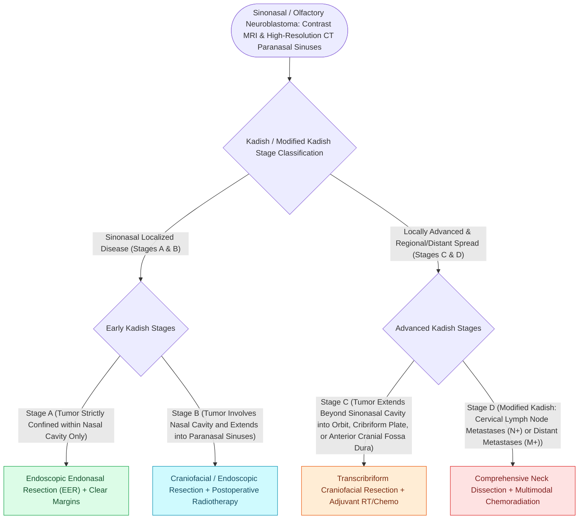

# Esthesioneuroblastoma arises from olfactory neuroepithelium and is staged by the Kadish classification

## Active Recall

> [!question]- Why is 'unilateral nasal polyp' the classic presentation trap?
> *Answer / Clinical Rationale*: The tumor mimics inflammatory polyposis but is unilateral at the olfactory cleft — unilateral disease earns imaging and histology, not steroid sprays.

> [!question]- Distinguish what Kadish and Hyams each encode.
> *Answer / Clinical Rationale*: Kadish is anatomic extent (A-C, modified D); Hyams is histologic grade — together they drive multimodality decisions and prognosis.

## Core Clinical & Mechanistic Principles
- Origin: olfactory neuroepithelium of the **cribriform niche** — the tumor is born straddling the anterior skull base, which is why the resection question is always a dural question; bimodal age distribution.
- **Kadish**: A confined to nasal cavity; B involving paranasal sinuses; C beyond sinonasal cavity (orbit, skull base, intracranial); (modified D adds nodal/distant disease). **Hyams grade** (I-IV) is the histologic prognosticator layered on top.
- Presentation is banal — unilateral obstruction, epistaxis, hyposmia — which buys the tumor time; the unilateral polypoid mass at the olfactory cleft earns imaging before biopsy thinking (vascular and intracranial mimics live here too).
- Nodal behavior is distinctive: **delayed cervical metastases years later**, justifying long surveillance and, in higher-risk disease, elective neck irradiation discussions.

### Management & Critical Safety Checks
- Treatment: complete resection including cribriform/dura as indicated — **expanded endoscopic endonasal** resection now rivals open craniofacial for appropriately selected disease — followed by radiation in most; chemotherapy for high-grade/advanced.
- Surveillance is measured in decades: late local, nodal, and dural-margin recurrences define this disease's follow-up (see [[The Hadad-Bassagasteguy nasoseptal flap is pedicled on the posterior septal artery|Nasoseptal Flap Repair]]).

## Connected Concepts & Graph Traversal
- **Reconstructive Skull Base Flap**: [[The Hadad-Bassagasteguy nasoseptal flap is pedicled on the posterior septal artery|Nasoseptal Flap Repair]]
- **Sinonasal Neoplastic Differential**: [[Sinonasal inverting papilloma requires subperiosteal excision and hyperostotic bone drill-out|Inverting Papilloma Differential]]
- **Olfactory Anatomy**: [[UPSIT and CCCRC tests quantify olfactory thresholds and odor identification in chemosensory disorders|Olfactory Testing]]
- **Skull Base Corridor Hazards**: [[Onodi cells place the optic nerve and carotid artery at risk during posterior ethmoidectomy|Posterior Ethmoid Hazards]]
- **CSF Leak Multi-Layer Closure**: [[CSF leak defect preparation requires circumferential bone de-mucosalization|Anterior Skull Base Dural Reconstruction]]
- **🔗 Embryological Origin (Pediatrics)**: [[Pediatric head and neck neuroblastoma originates from neural crest sympathoadrenal precursors and carries prognosis dictated by MYCN amplification|Shared Neural Crest/Neuroectodermal Lineage]]
- **Differential Diagnosis**: [[Biphasic sinonasal malignancies exhibit divergent epithelial, mesenchymal, and neural differentiation requiring diagnostic immunohistochemical panels|Biphasic Sinonasal Malignancy Differential]]
- **Open Craniofacial Exposure**: [[Midface degloving, lateral rhinotomy, and Weber-Fergusson approaches provide graded open exposure for sinonasal and skull base malignancies|Open Midface Approaches]]
