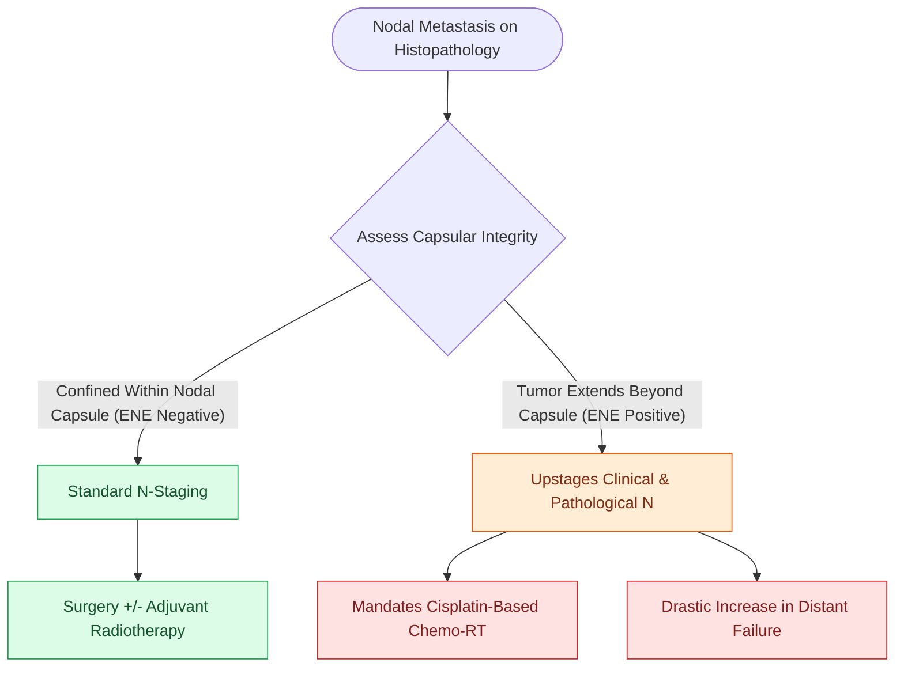

# Extranodal extension in cervical lymph nodes upstages nodal disease and dictates adjuvant chemoradiotherapy

## Active Recall

> [!question]- What are the two absolute Category 1 indications for adjuvant concurrent chemoradiotherapy in head and neck SCC?
> *Answer / Clinical Rationale*: **Pathological Extranodal Extension (pENE+)** and **positive microscopic surgical resection margins**.

> [!question]- How does the AJCC 8th edition categorize an ipsilateral 2.5-cm node with clinically overt ENE?
> *Answer / Clinical Rationale*: It is staged as **N3b**.

## Core Clinical & Mechanistic Principles
**Extranodal Extension (ENE)** is the extension of metastatic tumor cells through the lymph node capsule into surrounding connective tissue:
- **Clinical ENE ($ENE^+$)**: Evident on exam (skin/nerve fixation) or cross-sectional imaging (matted, infiltrating nodes).
- **Pathological ENE ($pENE^+$)**: Microscopic tumor invasion beyond the capsule.
- **AJCC 8th Edition Nodal Upstaging**:
  - Converts $N1$ to **$N2a$** (microscopic) or **$N3b$** (clinically overt or $>3\text{ cm}$ with ENE).
  - Any contralateral or bilateral node with $ENE^+$ is staged as **$N3b$**.
- **Therapeutic Imperative**: Pathological $ENE^+$ and positive surgical margins are the **two absolute indications for postoperative concurrent chemoradiotherapy (High-dose Cisplatin $100\text{ mg/m}^2$ Q3W + 60–66 Gy RT)**.

### Surgical Technique & Critical Safety Checks
- **Radiological Signs**: Central nodal necrosis, ill-defined borders, and loss of fat plane between node and IJV/carotid.
- **Surgical Margins in ENE**: Excise adjacent involved structures (SCM, adventitia, IJV) en bloc (see [[AJCC 8th edition incorporates depth of invasion into oral cavity T-staging|AJCC Staging]]).

## Connected Concepts & Graph Traversal
- **AJCC Staging**: [[AJCC 8th edition incorporates depth of invasion into oral cavity T-staging|AJCC Staging]]
- **Radiation & Chemo**: [[Intensity-modulated radiation therapy and cisplatin radiosensitization form the standard definitive chemoradiation regimen|Chemoradiation]]
- **Neck Dissection**: [[Radical neck dissection removes levels I through V while sacrificing CN XI, the IJV, and the SCM|Neck Dissection]]
- **Anatomical Foundation**: [[Cetuximab targets EGFR overexpression while pembrolizumab and nivolumab inhibit PD-1 in head and neck SCC]]
- **Surgical Lymphadenectomy**: [[Level I dissection requires facial vessel ligation and preservation of the lingual and hypoglossal nerves]]
- **Oncologic Resection & Margins**: [[Segmental mandibulectomy resects full-thickness bone for medullary invasion and irradiated bone recurrence]]
- **Aerodigestive / Pharyngolaryngeal**: [[Transoral laser microsurgery TLM resects early glottic carcinoma with vocal cord preservation]]
