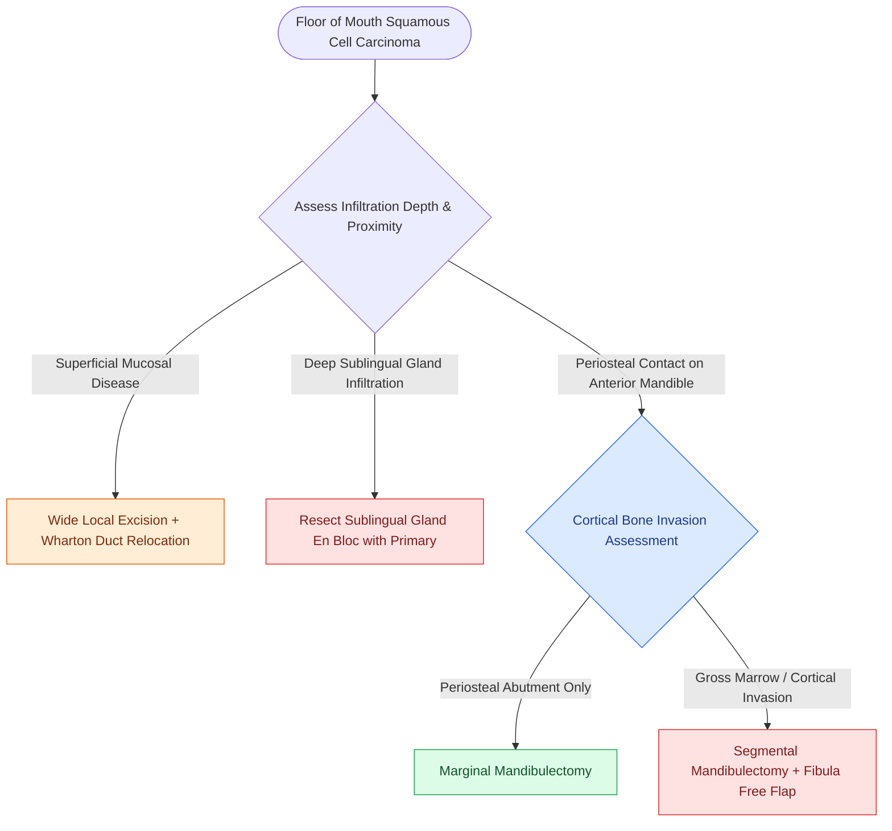

# Floor of mouth carcinoma requires sublingual gland excision and Wharton duct relocation

## Active Recall

> [!question]- Why is the sublingual gland routinely resected during floor of mouth cancer surgery?
> *Answer / Clinical Rationale*: Because floor of mouth carcinomas directly invade the parenchyma and capsule of the sublingual gland early in their growth.

> [!question]- What surgical maneuver is required when the anterior portion of Wharton's duct is resected?
> *Answer / Clinical Rationale*: **Sialodochoplasty / duct relocation**, transposing the proximal duct orifice into the posterior floor of mouth to maintain salivary drainage.

## Core Clinical & Mechanistic Principles
Squamous cell carcinoma of the **floor of mouth (FOM)** represents an anatomically complex entity with high propensity for early bone and deep muscular invasion:
- **Anatomical Relationships**:
  - Lies directly over the mylohyoid and hyoglossus muscles.
  - Intimately associated with the **sublingual salivary gland**, **[[Wharton duct sialolithiasis is managed with transoral sialodochoplasty or sialendoscopy|Wharton]] (submandibular) duct**, **lingual nerve**, and **hypoglossal nerve**.
- **Surgical Craft Nuances**:
  1. **Sublingual Gland Excision**: The sublingual gland must be resected en bloc with the primary tumor because cancer cells rapidly infiltrate its thin capsule.
  2. **Wharton's Duct Management**: If the duct orifice is involved or resected, the proximal duct must be dissected free, mobilized, and **transposed/sialodochoplastied** into the posterior floor of mouth or buccal mucosa to prevent obstructive [[Suppurative sialadenitis of the parotid and submandibular glands is treated with hydration, sialagogues, and anti-staphylococcal antibiotics|submandibular sialadenitis]].
  3. **Periosteal Stripping / Marginal Resection**: If tumor abuts the inner cortical plate, a [[Marginal mandibulectomy preserves basilar bone height when tumor abuts but does not invade marrow|marginal mandibulectomy]] is performed en bloc.

### Surgical Technique & Critical Safety Checks
- **Bilateral Nodal Drainage**: Anterior FOM carcinomas frequently cross the midline and drain bilaterally to [[Level I dissection requires facial vessel ligation and preservation of the lingual and hypoglossal nerves|Level IA and IB]] nodes, mandating bilateral neck dissection.

## Connected Concepts & Graph Traversal
- **Marginal Mandibulectomy**: [[Marginal mandibulectomy preserves basilar bone height when tumor abuts but does not invade marrow|Marginal Mandibulectomy]]
- **Level I Dissection**: [[Level I dissection requires facial vessel ligation and preservation of the lingual and hypoglossal nerves|Level I Dissection]]
- **Transoral Resection**: [[Transoral resection provides oncologic access for early-stage anterior oral cavity neoplasms|Transoral Resection]]
- **Anatomical Foundation**: [[Post-radiation carotid vasculopathy and osteoradionecrosis represent severe late radiotherapy sequelae]]
- **Surgical Lymphadenectomy**: [[Superior mediastinal level VII dissection clears paratracheal lymph nodes below the sternal notch]]
- **Oncologic Resection & Margins**: [[Lip-split paramedian mandibulotomy provides wide exposure for posterior oral cavity and oropharyngeal tumors]]
- **Aerodigestive / Pharyngolaryngeal**: [[Prophylactic transcervical external carotid ligation reduces fatal secondary hemorrhage after TORS]]
