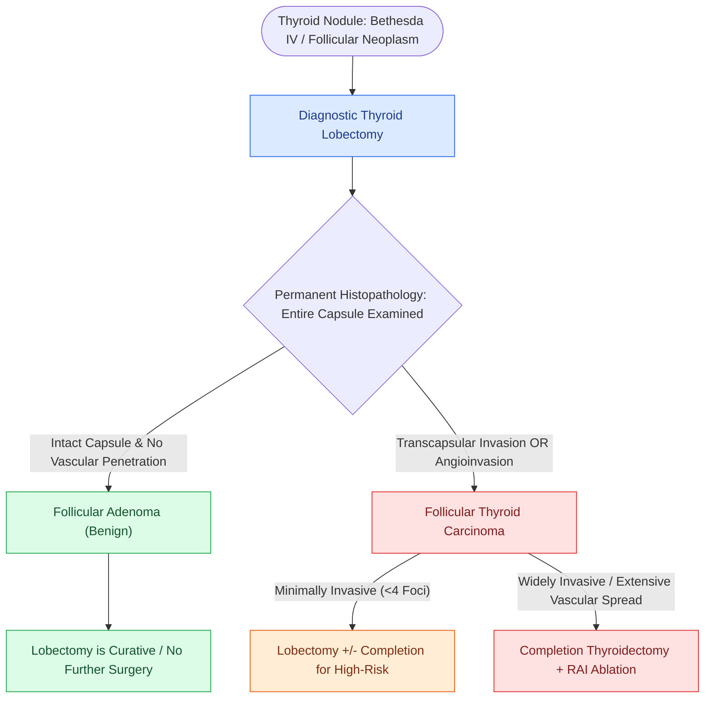

# Follicular thyroid carcinoma is distinguished from follicular adenoma by capsular and vascular invasion

## Active Recall

> [!question]- Why can fine-needle aspiration (FNA) not differentiate a follicular adenoma from a follicular carcinoma?
> *Answer / Clinical Rationale*: Because malignancy is defined by **full-thickness capsular invasion or vascular invasion**, which can only be evaluated on histological examination of the intact resected capsule.

> [!question]- What is the primary route of metastatic dissemination for follicular thyroid carcinoma?
> *Answer / Clinical Rationale*: **Hematogenous dissemination** to bone and lungs (lymphatic spread is rare).

## Core Clinical & Mechanistic Principles
**Follicular Thyroid Carcinoma (FTC)** comprises $10\text{–}15\%$ of differentiated thyroid malignancies and differs fundamentally from papillary carcinoma in its diagnostic criteria and metastatic behavior:
- **The Diagnostic Pathology Dilemma**:
  - Fine-needle aspiration (FNA) **CANNOT** distinguish benign follicular adenoma from follicular carcinoma because cytologic architecture alone cannot assess full-thickness capsular integrity.
  - FNA yields a diagnosis of **Bethesda IV (Follicular Neoplasm / SFN)**.
- **Definitive Histological Criteria for Malignancy**:
  1. **Full-Thickness Capsular Invasion**: Complete penetration of tumor cells through the fibrous capsule on permanent histological sections.
  2. **Vascular Invasion**: Tumor cells penetrating the endothelial lining of blood vessels within or outside the fibrous capsule.
- **Metastatic Pathway**: Spreads predominantly **hematogenously** (bone, lung, brain), with cervical lymph node metastases occurring in $<5\text{–}10\%$ of cases.

### Surgical Technique & Critical Safety Checks
- **Surgical Management**:
  - Initial **diagnostic lobectomy** for Bethesda IV nodule.
  - If permanent pathology confirms minimally invasive FTC, lobectomy alone may be curative.
  - If widely invasive FTC or extensive vascular invasion ($\ge 4$ foci) is identified, perform **completion thyroidectomy** followed by radioactive iodine ($^{131}\text{I}$) ablation (see [[The Bethesda system for reporting thyroid cytopathology stratifies malignancy risk and guides surgical decision-making|Bethesda System]]).

## Connected Concepts & Graph Traversal
- **Bethesda System**: [[The Bethesda system for reporting thyroid cytopathology stratifies malignancy risk and guides surgical decision-making|Bethesda System]]
- **Papillary Carcinoma**: [[Papillary thyroid carcinoma spreads via cervical lymphatics to central and lateral neck compartments|Papillary Thyroid Carcinoma]]
- **Total Thyroidectomy**: [[The recurrent laryngeal nerve is identified within Simon's triangle and followed through Berry's ligament|Total Thyroidectomy]]
- **Anatomical Foundation**: [[AJCC 8th edition incorporates depth of invasion into oral cavity T-staging]]
- **Surgical Lymphadenectomy**: [[Level V dissection requires skeletonization of the prevertebral fascia while protecting the phrenic nerve]]
- **Oncologic Resection & Margins**: [[Marginal mandibulectomy preserves basilar bone height when tumor abuts but does not invade marrow]]
- **Aerodigestive / Pharyngolaryngeal**: [[Subglottic carcinoma spreads to level VI central compartment lymphatics and mediastinal nodes]]
