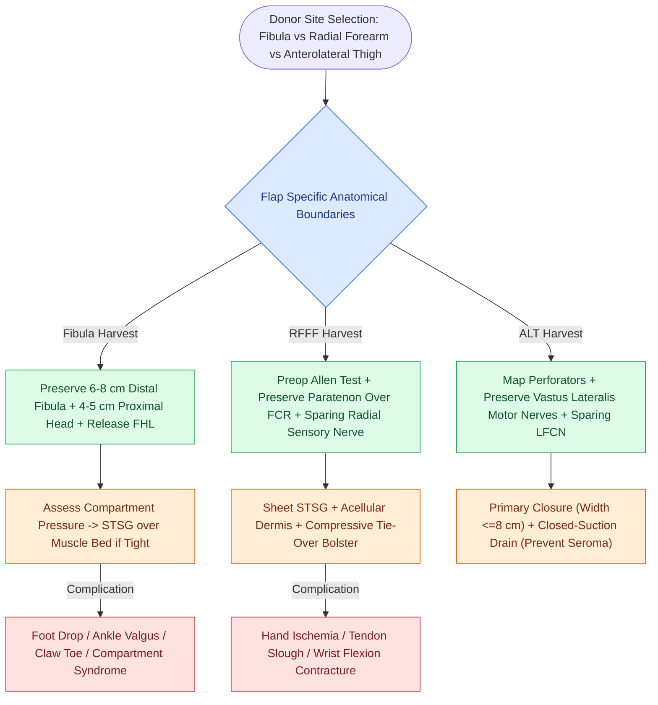

# Free tissue transfer donor site morbidity requires systematic risk stratification and anatomical preservation across fibular, radial forearm, and anterolateral thigh harvests

## Active Recall

> [!question]- What proximal and distal bony preservation metrics are mandatory during fibula free flap harvest to protect the peroneal nerve and prevent ankle valgus deformity?
> *Answer / Clinical Rationale*: The surgeon must preserve at least **$4.0\text{ to }5.0\text{ cm}$ of proximal fibula** below the fibular head to prevent traction injury to the common peroneal nerve (preventing foot drop) and preserve the lateral collateral ligament; distally, at least **$6.0\text{ to }8.0\text{ cm}$ of fibula** above the lateral malleolus must remain intact to preserve the inferior tibiofibular syndesmosis and maintain ankle mortise stability.
>
> [!question]- What anatomic layer must be preserved over the forearm flexor tendons during radial forearm free flap harvest to ensure split-thickness skin graft take?
> *Answer / Clinical Rationale*: The **paratenon** overlying the flexor carpi radialis (FCR) and brachioradialis tendons must be preserved intact. Tendon stripped bare of paratenon is avascular and cannot support plasmatic imbibition or inosculation, resulting in 100% skin graft necrosis, tendon exposure, desiccation, and permanent wrist flexion contracture.

## Core Clinical & Mechanistic Principles

Microvascular free tissue transfer is the premier reconstructive modality for composite head and neck ablative defects; however, donor site morbidity directly governs postoperative rehabilitation, mobility, and functional quality of life:
- **Fibula Osteocutaneous Donor Site Biomechanics**:
  - The [[The fibula osteocutaneous free flap provides up to twenty-five centimeters of vascularized bone for mandible reconstruction|fibula osteocutaneous flap]] yields up to 25 cm of vascularized tubular bone based on the peroneal artery and its venae comitantes.
  - *Distal Ankle Stability*: Resecting bone closer than $6.0\text{ to }8.0\text{ cm}$ from the lateral malleolus disrupts the anterior and posterior inferior tibiofibular ligaments, causing lateral widening of the ankle mortise, chronic pain, and progressive **valgus deformity** under axial load.
  - *Proximal Peroneal Nerve Safety*: The common peroneal nerve winds intimately around the neck of the fibula; retaining $4.0\text{ to }5.0\text{ cm}$ of proximal bone prevents thermal saw injury or traction neuropraxia resulting in loss of ankle dorsiflexion (**foot drop**).
  - *Muscular Contracture Prevention*: The flexor hallucis longus (FHL) muscle originates from the posterior two-thirds of the fibula; failure to cleanly dissect and release the FHL muscular belly leads to tethering and fixed **claw toe flexion contracture of the great toe**.
- **Radial Forearm Free Flap (RFFF) Morbidity Prevention**:
  - The [[The radial forearm free flap provides thin, pliable fasciocutaneous tissue for oral and pharyngeal defects|radial forearm free flap]] provides pliable skin, but sacrifices the radial artery.
  - *Preoperative Vascular Screening*: A modified Allen test or Doppler ultrasonography must verify that the ulnar artery and superficial palmar arch provide complete collateral circulation. If hand ischemia occurs following clamp placement, radial artery resection is aborted or an interposition saphenous vein graft must be constructed.
  - *Tendon Graft Bed Preservation*: Elevating the flap superficial to the deep investing paratenon preserves a rich vascular plexus over the flexor carpi radialis and brachioradialis tendons. Meshed split-thickness skin grafts (STSG) or non-meshed sheet grafts secured with a bolster prevent tendon adhesion.
  - *Radial Sensory Neuroma*: Preserving the subcutaneous branches of the superficial radial nerve prevents painful neuromas and numbness over the anatomical snuffbox.
- **Anterolateral Thigh (ALT) Flap Safeguards**:
  - The [[The anterolateral thigh flap provides versatile volume and can be harvested as a chimeric flap|anterolateral thigh flap]] offers tremendous tissue volume with minimal donor morbidity.
  - *Quadriceps Functional Preservation*: When dissecting musculocutaneous perforators through the vastus lateralis, motor nerve branches from the femoral nerve entering the muscle must be preserved to prevent significant quadriceps weakness during stair climbing.
  - *Compartment Syndrome & Primary Closure*: Flaps $\le 8.0\text{ cm}$ in width allow primary closure; closing wider defects under extreme tension risks thigh compartment syndrome.

### Surgical Technique, Dressing Protocols, & Graft Take Optimization

1. **Fibula Harvest Bed Management**:
   - The anterior and lateral compartments must be monitored for increased compartment pressure postoperatively.
   - Primary skin closure of the leg is performed only if muscle approximation can be achieved without tension. If skin edges blanch or compartment turgor increases, a split-thickness skin graft is placed directly over the soleus and flexor hallucis muscle beds.
   - A posterior plaster splint is applied with the ankle immobilized strictly at **90 degrees of neutral dorsiflexion** for 5 to 7 days to prevent Achilles tendon contracture (equinus deformity).
2. **Forearm Donor Defect Reconstruction**:
   - The flexor carpi radialis and brachioradialis tendons are approximated over the deep flexor compartment with absorbable 3-0 polyglactin sutures to reduce the exposed dead space.
   - A non-meshed, thick split-thickness skin graft ($0.015\text{ to }0.018\text{ inches}$) is harvested from the thigh or abdomen, fenestrated with small scalpel stabs, and sutured circumferentially to the skin edges.
   - A xeroform and cotton tie-over bolster (or negative pressure wound therapy sponge at 75–100 mmHg continuous suction) is applied for 5 to 7 days, accompanied by a volar wrist splint in neutral position to immobilize the wrist and ensure graft inosculation.
3. **ALT Seroma Mitigation**:
   - Seroma is the most common complications of ALT donor harvest (3% to 5%), resulting from dead space between the rectus femoris and vastus lateralis.
   - Dual closed-suction flat drains are placed beneath the fascial closure and maintained until drainage decreases to $<25\text{ to }30\text{ mL}$ over 24 hours.

## Connected Concepts & Graph Traversal

- **Massive Myocutaneous Alternative**: [[The latissimus dorsi myocutaneous free flap covers massive soft tissue and skull base defects|Latissimus Dorsi Donor Morbidity]]
- **Emergent Re-exploration Protocol**: [[Postoperative free flap compromise within forty-eight hours requires emergent surgical re-exploration for pedicle salvage|Free Flap Re-Exploration Criteria]]
- **Microvascular Venous Salvage**: [[Postoperative free flap venous congestion presents with purple discoloration, rapid pinprick dark bleeding, and hyperdynamic Doppler signals|Venous Congestion Management]]
- **Preoperative Planning & Bone Jigs**: [[Virtual surgical planning and 3D cutting guides optimize fibula contouring and dental implant rehabilitation|Virtual Surgical Planning & Cutting Guides]]
- **Pedicled Regional Alternative**: [[Pectoralis major muscle flap reinforcement prevents pharyngocutaneous fistula in salvage laryngectomy|Pectoralis Major Flap Preservation]]
