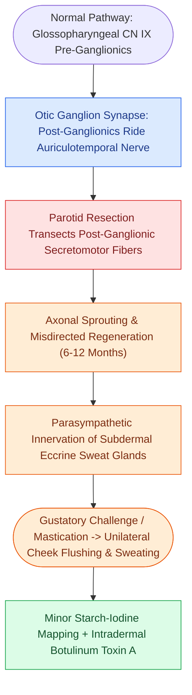

# Frey syndrome results from aberrant auriculotemporal reinnervation of sweat glands after parotidectomy

## Active Recall

> [!question]- Trace the misdirected reflex arc of Frey syndrome.
> *Answer / Clinical Rationale*: IX parasympathetics via the otic ganglion ride the auriculotemporal nerve; post-parotidectomy they regenerate into cutaneous sweat glands — gustatory stimuli now drive sweating instead of salivation.

> [!question]- How is the treatment field for botulinum toxin defined?
> *Answer / Clinical Rationale*: Minor starch-iodine test during a gustatory challenge maps the sweating zone for intradermal injection.

## Core Clinical & Mechanistic Principles
- Mechanism: severed **parasympathetic secretomotor fibers** (IX → otic ganglion → auriculotemporal nerve) regenerate into denervated **sweat glands and cutaneous vessels** of the flap — eating then triggers facial sweating and flushing over the parotid bed.
- Latency is months to a year-plus (regeneration speed); objective mapping is the **Minor starch-iodine test**, which turns gustatory sweat purple-black and outlines the field.
- Incidence depends on how hard one looks: objective testing finds it in a majority after parotidectomy, symptomatic complaint in a minority — consent for parotid surgery includes it.
- Prevention is a barrier problem: thicker flaps, SMAS advancement, or interposition (fascia, acellular dermis) between bed and skin reduce clinically significant disease.

### Management & Critical Safety Checks
- First-line treatment: **intradermal botulinum toxin** across the starch-iodine-mapped field — effective for months per cycle and repeatable; topical antiperspirants and glycopyrrolate wipes are adjuncts.
- Reoperative barriers are reserved for refractory disease; reassurance suffices for the merely curious forehead-dabbing patient (see [[Pleomorphic adenoma requires superficial parotidectomy with a cuff of normal tissue to prevent pseudopod recurrence|Superficial Parotidectomy]]).

## Connected Concepts & Graph Traversal
- **Parotidectomy Resection Standard**: [[Pleomorphic adenoma requires superficial parotidectomy with a cuff of normal tissue to prevent pseudopod recurrence|Superficial Parotidectomy]]
- **Facial Nerve Landmarks**: [[The facial nerve main trunk is localized using the tragal pointer, tympanomastoid suture, and digastric ridge|Parotid Dissection Anatomy]]
- **Gustatory Innervation Pathway**: [[Gustatory sensation is transmitted via the chorda tympani, greater superficial petrosal, glossopharyngeal, and superior laryngeal nerves|Gustatory Neural Pathways]]
- **Salivary Malignancy Context**: [[Mucoepidermoid carcinoma is graded by AFIP Brandwein criteria and driven by CRTC1-MAML2 translocation|Malignant Parotid Resection]]
- **SMAS Barrier Interposition**: [[Deep-plane rhytidectomy mobilizes the skin and SMAS as a composite flap across retaining ligaments|SMAS Interposition Flaps]]
