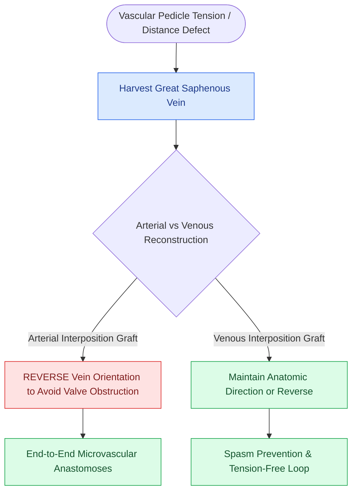

# Great saphenous vein interposition grafts bridge vascular defects during free flap revascularization

## Active Recall

> [!question]- Why must a saphenous vein graft be reversed when used as an arterial interposition graft?
> *Answer / Clinical Rationale*: To ensure that the **internal venous valves point in the direction of arterial flow**, preventing acute valve closure and arterial occlusion.

> [!question]- Where is the great saphenous vein most reliably identified for graft harvest?
> *Answer / Clinical Rationale*: Approximately **$1.0\text{ to }2.0\text{ cm}$ anterior and superior to the medial malleolus** at the ankle.

## Core Clinical & Mechanistic Principles
When donor pedicle length is insufficient or recipient neck vessels are compromised by prior surgery, radiation, or neck dissection, **Great Saphenous Vein (GSV) interposition grafts** restore vascular continuity:
- **Indications**:
  - Pedicle length deficiency to reach non-irradiated contralateral recipient vessels (e.g., contralateral transverse cervical or facial vessels).
  - Vessel-depleted neck (prior bilateral neck dissections and high-dose chemoradiation).
  - Salvage revascularization after arterial or venous pedicle thrombosis.
- **Harvest Craft & Technical Rules**:
  1. **Anatomical Landmark**: Locate the GSV **$1.0\text{–}2.0\text{ cm}$ anterior and superior to the medial malleolus** of the ankle.
  2. **THE VALVE ORIENTATION RULE**:
     - *For Arterial Grafts*: **REVERSE THE VEIN GRAFT ORIENTATION** (distal vein to proximal neck artery; proximal vein to flap artery) so venous valves do not obstruct arterial blood flow.
     - *For Venous Grafts*: Maintain anatomical direction (or reverse if flow requires).
  3. **Gentle Hydrodistension**: Flush with heparinized saline ($10\text{ units/mL}$) at physiological pressure to identify and clip all side branches with micro-clips.

### Surgical Technique & Critical Safety Checks
- **Preventing Torsion & Kinking**: Mark a longitudinal methylene blue stripe along the vein before harvest to prevent axial twisting during tunneling (see [[Microvascular venous couplers achieve rapid and reliable end-to-end and end-to-side anastomoses|Microvascular Couplers]]).

## Connected Concepts & Graph Traversal
- **Venous Couplers**: [[Microvascular venous couplers achieve rapid and reliable end-to-end and end-to-side anastomoses|Microvascular Couplers]]
- **Arterial Thrombosis**: [[Microvascular arterial thrombosis presents with a pale, flat flap and requires immediate surgical exploration|Arterial Thrombosis]]
- **Flap Salvage**: [[Microvascular free flap salvage requires urgent re-exploration within two hours of vascular compromise|Flap Salvage Protocol]]
- **Anatomical Foundation**: [[Post-radiation carotid vasculopathy and osteoradionecrosis represent severe late radiotherapy sequelae]]
- **Surgical Lymphadenectomy**: [[Central compartment neck dissection clears level VI nodes between the carotid sheaths and suprasternal notch]]
- **Oncologic Resection & Margins**: [[Pre-plating the intact mandible before osteotomy preserves accurate dental occlusion and contour]]
- **Aerodigestive / Pharyngolaryngeal**: [[Subglottic carcinoma spreads to level VI central compartment lymphatics and mediastinal nodes]]
