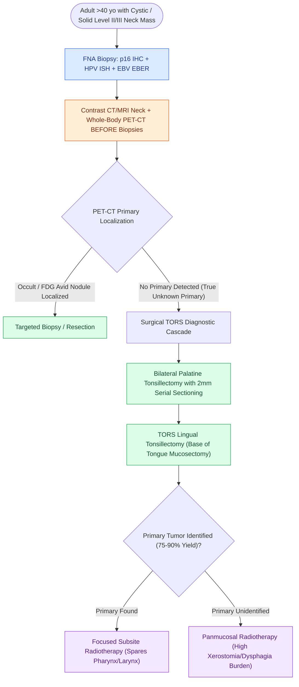

# HPV-positive carcinoma of unknown primary is localized by palatine tonsillectomy and TORS lingual mucosectomy

## Active Recall

> [!question]- Why must PET-CT imaging precede any endoscopic mucosal biopsies in the workup of an unknown primary neck mass?
> *Answer / Clinical Rationale*: Tissue manipulation and biopsy create acute inflammatory changes that produce **intense false-positive FDG avidity on PET-CT**, permanently destroying the ability to distinguish a millimetric tumor from biopsy artifact.

> [!question]- Why is HPV In-Situ Hybridization (ISH) performed when p16 immunohistochemistry is already positive on a nodal biopsy?
> *Answer / Clinical Rationale*: p16 is a surrogate marker that can be elevated via non-HPV oncogenic pathways; **HPV ISH demonstrates definitive viral DNA integration**, which is required to formally categorize the tumor under the **AJCC 8th edition HPV+ staging system**.

> [!question]- What is the clinical benefit of identifying a millimetric occult tonsil or tongue base primary with TORS mucosectomy?
> *Answer / Clinical Rationale*: It **eliminates the need for comprehensive panmucosal radiotherapy**, allowing radiation fields to be de-escalated to a single focused anatomical subsite and sparing salivary, swallowing, and laryngeal structures.

## Core Clinical & Mechanistic Principles
**Head and Neck Squamous Cell Carcinoma of Unknown Primary (HNSCCUP)** presents as malignant cervical lymphadenopathy (typically in Level II or III) with no clinically or radiographically apparent mucosal primary:

- **The Adult Cystic Neck Mass Axiom**:
  - Any cystic or solid lateral neck mass in an adult **$>40\text{ years}$ is metastatic carcinoma until proven otherwise**.
  - *Clinical Hazard*: Diagnosing a "congenital branchial cleft cyst" in an adult without histological confirmation risks delaying oncologic management and inappropriate enucleation.

- **Initial Diagnostic Cascade & Molecular Typing**:
  1. **Fine-Needle Aspiration (FNA)**: The mandatory initial tissue acquisition method. Provides cytological diagnosis with minimal risk of tumor seeding. **Open excisional biopsy is strictly contraindicated** as it disrupts fascial planes, increases wound recurrence, and complicates subsequent neck dissection.
  2. **p16 Immunohistochemistry (IHC) & HPV In-Situ Hybridization (ISH)**:
     - **p16 IHC**: Highly sensitive surrogate marker for transcriptionally active high-risk HPV ($E6/E7$ oncoproteins inactivate retinoblastoma protein $\text{pRb}$, driving compensatory p16 overexpression). Points directly to an **oropharyngeal primary (palatine tonsil or base of tongue)**.
     - **HPV ISH**: Directly detects high-risk viral DNA integration. *Critical Rule*: Although p16 IHC is sensitive, **HPV ISH confirmation is required** to formally stage the patient under the favorable **AJCC 8th edition HPV+ OPSCC staging system** (since non-viral *CDKN2A* alterations can rarely yield false-positive p16 staining).
     - *Alternative Markers*: **EBV EBER-ISH** points to the **nasopharynx**; cytokeratin profiles and cutaneous history point to [[High-risk cutaneous squamous cell carcinoma drains first to parotid and perifacial nodal basins|cutaneous SCC]]/melanoma draining to parotid nodes.

- **Imaging Sequence Discipline**:
  - Perform **Contrast-Enhanced Neck CT/MRI + Whole-Body PET-CT BEFORE any mucosal biopsies**.
  - *Rationale*: Diagnostic biopsy trauma and post-procedural inflammation produce intense false-positive FDG avidity on PET-CT, permanently obscuring the millimetric primary tumor.

- **Surgical Localization Algorithm (The TORS Diagnostic Cascade)**:
  - When cross-sectional imaging and PET-CT fail to localize the primary:
  1. **Examination Under Anesthesia (EUA) & Panendoscopy**: High-definition inspection of the nasopharynx, oral cavity, oropharynx, larynx, and hypopharynx.
  2. **Bilateral Palatine Tonsillectomy**: Occult primaries hide deep within the convoluted lymphoepithelial crypts. Bilateral tonsillectomy is performed because **up to $10\%$ of occult primaries are situated in the contralateral tonsil** relative to the nodal metastasis. The pathologist must perform **step-serial sectioning at $2\text{-mm}$ intervals**.
  3. **TORS Lingual Tonsillectomy (Base of Tongue Mucosectomy)**: If palatine tonsillectomy is negative, perform an en bloc robotic resection of the ipsilateral or bilateral lingual tonsil from the circumvallate papillae down to the vallecula.
  4. *Overall Yield*: This combined diagnostic approach successfully **identifies the occult primary in $75\text{–}90\%$ of cases**.

- **The Therapeutic Payoff (Targeted vs Panmucosal Radiation)**:
  - Finding the primary permits **focally targeted radiotherapy** to the involved oropharyngeal subsite and ipsilateral neck.
  - Failing to identify the primary forces the radiation oncologist to deliver **panmucosal irradiation** ("mucosal bath" covering the nasopharynx, entire oropharynx, hypopharynx, and larynx), resulting in severe lifelong xerostomia, radiation dysphagia, dysgeusia, and esophageal stricture.

### Surgical Technique & Critical Safety Checks
- **Avoidance of Open Biopsy**: If repeated FNA is nondiagnostic, perform ultrasound-guided core needle biopsy. If open biopsy is unavoidable, prepare for immediate frozen section and proceed directly to comprehensive neck dissection in the same operative setting to avoid tumor seeding into the skin flaps.

## Connected Concepts & Graph Traversal
- **Landmark HPV Trials**: [[The ECOG-3311 and ORATOR trials establish pathological risk-stratified de-escalation and functional trade-offs in HPV-positive OPSCC|ECOG-3311 & ORATOR De-escalation Trials]]
- **TORS Surgical Execution**: [[Transoral robotic surgery TORS achieves en bloc resection of tonsillar and base of tongue neoplasms|TORS Lingual Tonsillectomy Craft]]
- **Elective Neck Dissection Evidence**: [[Selective neck dissection targets high-risk nodal basins while sparing low-risk cervical levels|Selective Neck Dissection & D'Cruz Trial]]
- **Cervical Nodal Levels**: [[Cervical lymph node levels I through VII define regional metastatic drainage basins|Cervical Lymph Levels & Level II Presentation]]
- **Adult Cystic Node Pitfall**: [[Second branchial cleft anomalies represent the most common branchial anomaly situated anterior to the sternocleidomastoid|Branchial Cleft Cyst vs Cystic Node Metastasis]]
- **Perioperative Checkpoint Blockade**: [[KEYNOTE-689 establishes neoadjuvant and adjuvant pembrolizumab as standard for locally advanced head and neck squamous cell carcinoma|KEYNOTE-689 Perioperative Pembrolizumab]]
- **Poorly Differentiated Midline Differential**: [[NUT midline carcinoma is an aggressive poorly differentiated squamous neoplasm harboring BRD4-NUT fusions with abrupt keratinization|NUT Midline Carcinoma]]
