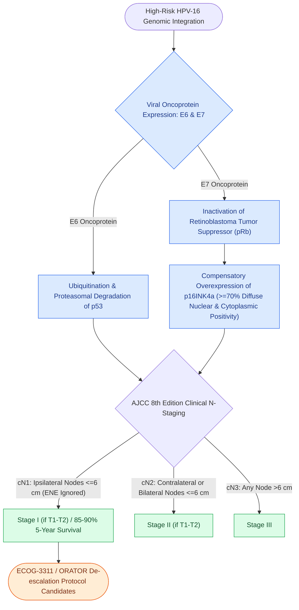

# HPV-positive oropharyngeal squamous cell carcinoma exhibits distinct biological behavior and staging

## Active Recall

> [!question]- What are the molecular functions of the HPV E6 and E7 oncoproteins?
> *Answer / Clinical Rationale*: **E6 degrades p53**, while **E7 inactivates retinoblastoma (Rb) protein**.

> [!question]- Why does extranodal extension (ENE) not upstage clinical N-category in p16+ oropharyngeal carcinoma?
> *Answer / Clinical Rationale*: Because ENE does not carry the same severe negative prognostic impact in HPV-positive disease.

## Core Clinical & Mechanistic Principles
Human Papillomavirus-mediated (**HPV-16**, $>90\%$) oropharyngeal SCC (OPSCC) is a distinct oncologic entity:
- **Molecular Pathogenesis**: Viral oncoproteins **E6** (degrades p53) and **E7** (inactivates Rb, causing compensatory overexpression of **p16INK4a**).
- **Diagnostic Marker**: Strong and diffuse nuclear and cytoplasmic **p16 positivity** ($\ge 70\%$ staining).
- **Patient Phenotype**: Younger, non-smokers, presenting with cystic level II/III neck masses from occult tonsil or base of tongue primaries.
- **AJCC 8th Edition Staging**:
  - Clinical N-staging: **N1** (ipsilateral nodes $\le 6\text{ cm}$), **N2** (contralateral/bilateral nodes $\le 6\text{ cm}$), **N3** (nodes $>6\text{ cm}$). [[Extranodal extension in cervical lymph nodes upstages nodal disease and dictates adjuvant chemoradiotherapy|ENE]] does *not* upstage p16+ disease.

### Surgical Technique & Critical Safety Checks
- **Treatment De-escalation**: Trials (e.g. ECOG-3311, ORATOR) investigate reducing radiation dose or avoiding chemotherapy in low-risk p16+ OPSCC resected via TORS.
- **Cystic Node Pitfall**: Cystic level II metastases from HPV+ OPSCC are frequently misdiagnosed as benign branchial cleft cysts on FNA in adults.

## Connected Concepts & Graph Traversal
- **Landmark De-escalation Trials**: [[The ECOG-3311 and ORATOR trials establish pathological risk-stratified de-escalation and functional trade-offs in HPV-positive OPSCC|ECOG-3311 & ORATOR Trials]]
- **TORS Surgical Craft**: [[Transoral robotic surgery TORS achieves en bloc resection of tonsillar and base of tongue neoplasms|TORS Oropharyngeal Resection]]
- **Unknown Primary Localization**: [[HPV-positive carcinoma of unknown primary is localized by palatine tonsillectomy and TORS lingual mucosectomy|Carcinoma of Unknown Primary & TORS]]
- **Tobacco Carcinogenesis Divergence**: [[Tobacco and alcohol carcinogenesis drives TP53 mutation and field cancerization in upper aerodigestive tract|HPV-Negative Field Cancerization]]
- **Cervical Nodal Levels**: [[Cervical lymph node levels I through VII define regional metastatic drainage basins|Cervical Lymph Node Basins]]
- **Prophylactic ECA Ligation**: [[Prophylactic transcervical external carotid ligation reduces fatal secondary hemorrhage after TORS|Transcervical ECA Ligation in TORS]]
