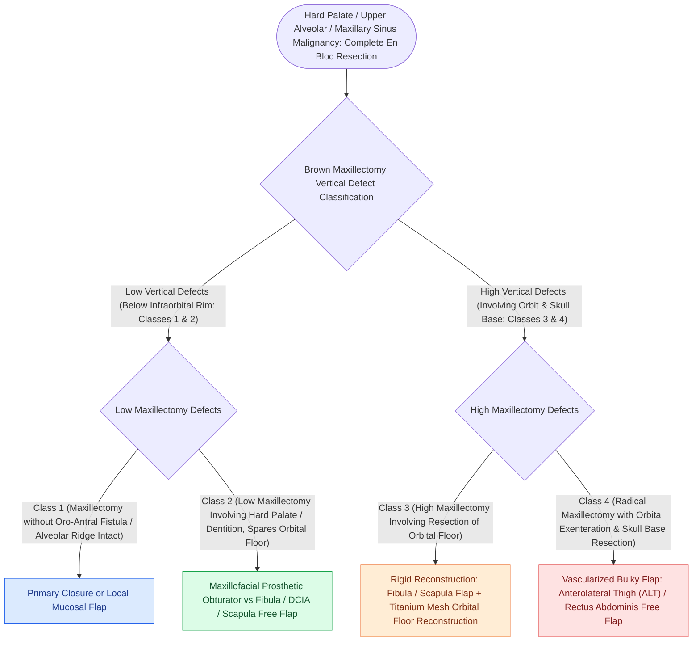

# Hard palate and upper alveolar carcinoma require partial or total maxillectomy

## Active Recall

> [!question]- What is a Brown Class II maxillectomy?
> *Answer / Clinical Rationale*: A **low maxillectomy** involving resection of the hard palate and lower maxillary sinus wall, sparing the orbital floor.

> [!question]- What are the two primary reconstructive options for hard palate maxillectomy defects?
> *Answer / Clinical Rationale*: A **custom prosthetic dental obturator** or **microvascular osteocutaneous free flap reconstruction**.

## Core Clinical & Mechanistic Principles
Carcinomas of the **hard palate and upper alveolar ridge** are unique oral cavity malignancies (staged under [[AJCC 8th edition incorporates depth of invasion into oral cavity T-staging|AJCC 8th edition oral cavity T-staging]]) that arise over thin mucoperiosteum directly abutting bone:
- **Pathophysiology**: Early cortical bone invasion of the palatine process of the maxilla or horizontal plate of the palatine bone is common, leading to spread into the maxillary sinus, nasal cavity, and greater palatine canal, requiring [[Oncologic clear margins require at least five millimeters of histological normal tissue|five-millimeter histologically clear margins]].
- **Maxillectomy Classification (Brown Classification)**:
  - **Class I**: Maxillectomy not involving an oroantral fistula.
  - **Class II**: Low maxillectomy (includes hard palate and dental alveolus, preserving the orbital floor).
  - **Class III**: High maxillectomy (includes orbital floor).
  - **Class IV**: Radical maxillectomy (includes orbital exenteration).

### Surgical Technique & Critical Safety Checks
- **Rehabilitation Options**:
  - **Prosthetic Obturator**: Lightweight, permits direct visual oncologic inspection of the cavity; ideal for Class II defects.
  - **Microvascular Reconstruction**: **Fibula osteocutaneous** or **Scapular tip** free flap to reconstruct the dental arch and orbital floor, combined with vascularized soft tissue for seal.

## Connected Concepts & Graph Traversal
- **Osteocutaneous Fibula Donor**: [[The fibula osteocutaneous free flap provides up to twenty-five centimeters of vascularized bone for mandible reconstruction|Fibula Free Flap Reconstruction]]
- **Subscapular System Chimeric Flap**: [[The subscapular system provides chimeric bone and soft tissue flaps based on the circumflex scapular artery|Subscapular System & Scapular Tip]]
- **Oncologic Margin Standards**: [[Oncologic clear margins require at least five millimeters of histological normal tissue|Five-Millimeter Clear Margins]]
- **Orbital Reconstruction Principles**: [[Orbital floor blowout fractures with muscle entrapment or significant enophthalmos mandate reconstruction|Orbital Volume & Floor Support]]
- **Oral Cavity Staging Framework**: [[AJCC 8th edition incorporates depth of invasion into oral cavity T-staging|Oral Cavity T-Staging & DOI]]
- **Adjacent Oral Floor Resection**: [[Floor of mouth carcinoma requires sublingual gland excision and Wharton duct relocation|Floor of Mouth Carcinoma]]
- **Open Surgical Approach**: [[Midface degloving, lateral rhinotomy, and Weber-Fergusson approaches provide graded open exposure for sinonasal and skull base malignancies|Open Midface Approaches]]
