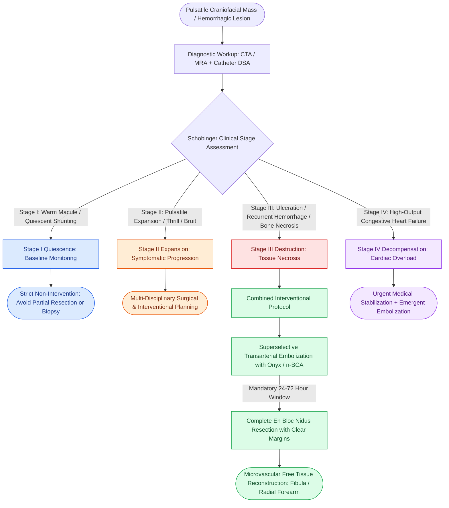

# Head and neck arteriovenous malformations are staged by the Schobinger classification to guide embolization and complete surgical nidus resection

## Active Recall

> [!question]- What clinical and hemodynamic features define Stages I through IV of the Schobinger classification for craniofacial arteriovenous malformations (AVMs)?
> *Answer / Clinical Rationale*: The Schobinger clinical staging system directs therapeutic triage:
> - **Stage I (Quiescence)**: Pink-bluish macule or warm cutaneous/mucosal patch, quiescent arteriovenous shunting detectable on Doppler ultrasonography; mimics an indolent capillary malformation or involuted hemangioma; zero systemic symptoms.
> - **Stage II (Expansion)**: Same as Stage I plus true enlargement, persistent localized hyperthermia, **palpable thrill**, audible **systolic or continuous bruit**, and tortuous engorged draining veins.
> - **Stage III (Destruction)**: Stage II findings plus severe destructive complications: persistent ischemic pain, **cutaneous or mucosal ulceration**, persistent spontaneous or life-threatening **hemorrhage**, tissue necrosis, and underlying osteolysis / bony resorption.
> - **Stage IV (Decompensation)**: Stage III findings complicated by **high-output congestive heart failure** and systemic left-to-right hemodynamic decompensation.

> [!question]- Why is proximal surgical ligation of feeding arteries strictly contraindicated in the management of head and neck AVMs?
> *Answer / Clinical Rationale*: Proximal ligation of feeding branches (e.g., external carotid artery or facial artery) fails to eradicate the central **nidus** of the malformation and permanently eliminates endovascular catheter access to the lesion. Depriving the nidus of its primary inflow induces profound regional hypoxia, triggering massive angiogenic factor release (VEGF, bFGF) that drives rapid recruitment of deep, inaccessible collateral arterial feeders from the internal carotid, vertebral, and contralateral circulations. This renders subsequent endovascular embolization impossible and transforms a surgically treatable lesion into an unmanageable, life-threatening hemorrhagic catastrophe.

> [!question]- What is the mandatory time window between preoperative superselective embolization and definitive surgical excision of an AVM, and why?
> *Answer / Clinical Rationale*: Definitive surgical resection must be performed **strictly within 24 to 72 hours (ideally 24–48 hours)** following superselective transarterial embolization. The biological objective of embolization (using permanent liquid embolic agents such as Onyx [ethylene vinyl alcohol copolymer] or n-BCA [n-butyl cyanoacrylate]) is to temporarily shut down high-flow through the nidus, minimize intraoperative blood loss, and demarcate surgical margins. Waiting longer than 72 hours allows extensive **collateral revascularization and neo-angiogenesis** to bypass the embolized vessels, restoring massive vascularity and drastically elevating intraoperative hemorrhage risks.

## Core Clinical & Mechanistic Principles

Head and neck arteriovenous malformations (AVMs) are congenital, high-flow vascular anomalies resulting from aberrant morphogenesis of the primitive embryonic vascular plexus:

### ISSVA Taxonomy: Hemodynamic and Structural Classification *(CummingsReview2017, Ch10, p.211–212, Table 10.1)*

| Parameter                | Slow-Flow: Capillary / Venous / Lymphatic                                               | High-Flow: Arteriovenous Malformation (AVM)                                                     | Vascular Tumor: Infantile Hemangioma                                                           |
| :----------------------- | :-------------------------------------------------------------------------------------- | :---------------------------------------------------------------------------------------------- | :--------------------------------------------------------------------------------------------- |
| **Hemodynamic Flow**     | Low-flow; absent pulsations, thrills, or bruits                                         | **High-flow**; rapid transit, continuous thrill and audible bruit                               | Intermediate-to-high flow during proliferative phase only                                      |
| **Histopathology**       | Dilated dysplastic venous channels or lymphatic spaces lined by mature flat endothelium | Dysplastic, tortuous arteries and veins connecting directly via a **nidus** without capillaries | Endothelial cell hyperplasia with elevated mitotic figures; **GLUT-1 positive**                |
| **Clinical Course**      | Present at birth, grows commensurately with child; never regresses                      | Present at birth, expands during puberty, trauma, or pregnancy; progressive destruction         | Appears at 1–4 weeks, rapid proliferation for 6–12 months, gradual **involution by 5–9 years** |
| **Primary Therapeutics** | Sclerotherapy (bleomycin, doxycycline, STS, ethanol) or laser                           | **Superselective transarterial embolization + 24–72h en bloc resection**                        | Systemic oral propranolol (beta-blocker) first-line                                            |

### Schobinger Clinical Staging Matrix *(Schobinger 1990; CummingsReview2017, Ch10, p.212)*
- **Stage I (Quiescent)**: Asymptomatic pink-warm macule; Doppler ultrasonography demonstrates high-velocity, low-resistance shunting. Management: Watchful waiting; avoid trauma, surgical incisional biopsy, or incomplete cauterization, which trigger accelerated progression.
- **Stage II (Expansion)**: Progressive enlargement with palpable thrill, audible bruit, and venous engorgement. Management: Preoperative angiography and embolization planning if rapid expansion threatens vital structures.
- **Stage III (Destruction)**: Dystrophic skin changes, intractable ischemic pain, persistent ulceration, life-threatening oral/nasal bleeding, and underlying mandibular or maxillary osteolysis. Management: Combined transcatheter embolization followed by en bloc nidus excision.
- **Stage IV (Decompensation)**: High-output congestive heart failure secondary to massive volumetric left-to-right shunting. Management: Intensive medical cardiac support, urgent endovascular flow reduction, and definitive resection.

### Reconstructive Strategy Post-Nidus Resection
Because craniofacial AVMs infiltrate across anatomical tissue planes, radical resection of the nidus often creates extensive composite soft-tissue and bony defects. Reconstruction requires healthy, non-ischemic vascularized tissue transfer:
- Soft-tissue oral and facial defects: [[The radial forearm free flap provides thin, pliable fasciocutaneous tissue for oral and pharyngeal defects|Radial forearm free flap]] or anterolateral thigh (ALT) flap.
- Composite mandibulectomy defects: [[The fibula osteocutaneous free flap provides up to twenty-five centimeters of vascularized bone for mandible reconstruction|Vascularized fibula osteocutaneous free flap]] anchored with [[Mandibular reconstruction plates require rigid bicortical screw fixation to withstand masticatory load|bicortical reconstruction plates]].

## Connected Concepts & Graph Traversal
- **Carotid Endovascular Control**: [[Endovascular covered stenting and coil embolization provide emergent control of carotid blowout|Endovascular Embolization]]
- **Catastrophic Hemorrhage Staging**: [[Carotid blowout syndrome is classified into threatened, impending, and acute hemorrhage|Hemorrhage Classification]]
- **🔗 Slow-Flow Vascular Anomalies (Pediatrics)**: [[Lymphatic malformations are slow-flow vascular anomalies classified into macrocystic and microcystic lesions|Lymphatic Malformations]]
- **🔗 Vascular Tumor Differential (Pediatrics)**: [[Oral propranolol is the first-line pharmacotherapy for proliferating infantile hemangiomas|Infantile Hemangioma]]
- **🔗 Soft Tissue Reconstruction (FPRS)**: [[The anterolateral thigh free flap provides versatile soft tissue volume based on the LCFA|Anterolateral Thigh Free Flap]]
- **Hypervascular Cervical Mass Differential**: [[Carotid body paragangliomas splay the bifurcation and are graded by the Shamblin classification|Carotid Body Paraganglioma]]
- **🔗 Slow-Flow Venous Differential (Pediatrics)**: [[Venous malformations are slow-flow vascular anomalies characterized by bluish compressible swelling, dependent engorgement, and pathognomonic phleboliths|Venous Malformations]]
