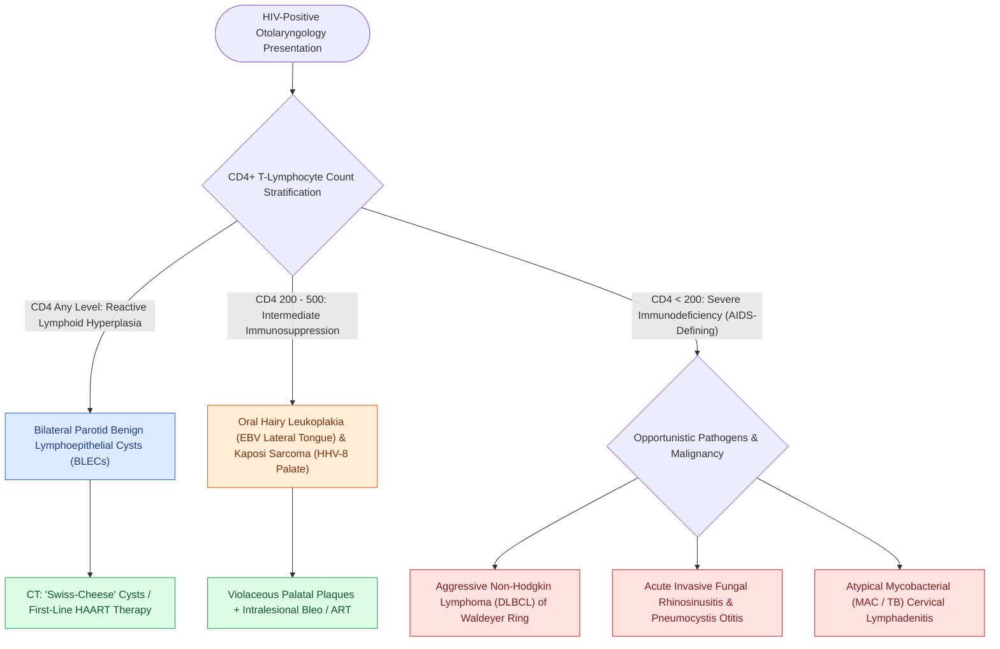

# Head and neck manifestations of HIV encompass Kaposi sarcoma, benign lymphoepithelial cysts of the parotid, and opportunistic infections

## Active Recall

> [!question]- What are the classic clinical, radiological, and histological features of Benign Lymphoepithelial Cysts (BLECs) of the parotid gland in HIV?
> *Answer / Clinical Rationale*: - **Clinical**: Painless, diffuse, bilateral parotid gland enlargement frequently accompanied by cervical lymphadenopathy. - **Radiological (CT/MRI)**: Multiple bilateral, thin-walled cystic and solid lesions throughout the parotid parenchyma giving a characteristic **"Swiss-cheese" appearance**, accompanied by intraparotid and cervical reactive lymphadenopathy. - **Histological**: Cystic dilatation of salivary ducts lined by stratified squamous or columnar epithelium embedded within dense, hyperplastic **lymphoid tissue with prominent germinal centers**. - **Management**: Highly Active Antiretroviral Therapy (HAART) as first-line (often induces dramatic cyst regression); needle aspiration, sclerotherapy (doxycycline), low-dose radiation, or superficial parotidectomy for refractory cosmetic deformity.

> [!question]- How does Kaposi Sarcoma (KS) manifest in the head and neck, and what oncogenic virus drives its pathogenesis?
> *Answer / Clinical Rationale*: Driven by **Human Herpesvirus 8 (HHV-8 / KSHV)**. It is the most common HIV-associated malignancy, presenting as painless, violaceous, blue-to-purple macules, plaques, or exophytic vascular nodular lesions. The most frequent head and neck site is the **hard and soft palate ($50\%$)**, followed by the gingiva, tongue, and skin of the tip of the nose. Histology demonstrates **spindle cell proliferation, slit-like vascular spaces, extravasated erythrocytes, and hemosiderin deposition**.

> [!question]- Which head and neck opportunistic infections and neoplasms define progression to AIDS when CD4 counts fall $<200\text{ cells/}\mu\text{L}$?
> *Answer / Clinical Rationale*: - **Neoplasms**: Kaposi Sarcoma, **Non-Hodgkin Lymphoma (Diffuse Large B-Cell Lymphoma [DLBCL] of Waldeyer ring and cervical nodes)**, and invasive cervical/anal carcinomas (HPV-driven). - **Fungal Infections**: Refractory esophageal and oral **Candidiasis**, Cryptococcal meningitis, Histoplasmosis, and fulminant **Pneumocystis jirovecii** otitis/mastoiditis. - **Viral & Mycobacterial**: Oral hairy leukoplakia (EBV-driven lateral tongue white corrugated plaques that *cannot* be wiped off), Ramsay Hunt syndrome / severe Herpes Zoster Oticus, CMV ulcerations, and *Mycobacterium avium-intracellulare* (MAC) or extra-pulmonary Tuberculosis.

## Core Clinical & Mechanistic Principles
Otolaryngic manifestations occur in $>40\text{–}70\%$ of HIV-positive individuals, often serving as the initial presenting sign of undiagnosed retroviral infection. Head and neck disease spans reactive lymphadenopathy, vascular neoplasms like Kaposi sarcoma, salivary lesions including [[Sjogren syndrome causes autoimmune sicca with parotid enlargement and markedly elevated MALT lymphoma risk|benign lymphoepithelial cysts]], and opportunistic fungal or mycobacterial infections requiring prompt diagnostic distinction from [[Suspected cervical lymphoma requires excisional or core biopsy because cytology cannot assess architecture|cervical lymphomas]]:

### High-Yield Diagnostic Differential
- **Oral Candidiasis vs. Oral Hairy Leukoplakia (OHL)**:
  - *Clinical Differentiation*: Candidal pseudomembranes easily scrape off with a tongue blade leaving an erythematous, bleeding mucosal base. In contrast, Oral Hairy Leukoplakia (driven by Epstein-Barr virus opportunistic replication) forms adherent, corrugated vertical white ridges along the lateral margins of the tongue that **cannot be scraped off**.
  - *Microscopic Triad & HIV Testing Mandate*: Biopsy of OHL demonstrates a classic histological triad of marked **hyperkeratosis (with parakeratosis), epithelial acanthosis (pronounced thickening of the stratum spinosum), and prominent ballooned cells with nuclear clearing resembling "koilocytes"** in the upper spinous layers. Detection of OHL is an early harbinger of cellular immunosuppression and **mandates prompt reflex HIV antibody/antigen testing** in patients with unknown serostatus.

## Connected Concepts & Graph Traversal
- **Lymphoma Diagnostics**: [[Suspected cervical lymphoma requires excisional or core biopsy because cytology cannot assess architecture|Cervical Lymphoma Diagnostics]]
- **Invasive Fungal Sinusitis**: [[Acute invasive fungal rhinosinusitis requires emergent surgical debridement and systemic amphotericin B|Invasive Fungal Rhinosinusitis]]
- **Parotid Neoplasms**: [[Warthin tumor presents as a cystic parotid neoplasm associated with smoking and bilateral occurrence|Warthin Tumor & Salivary Cysts]]
- **Specific Granulomatous Disease**: [[Specific granulomatous diseases of the head and neck are diagnosed by pathognomonic histology and serological markers|Granulomatous Head & Neck Pathologies]]
- **Antimicrobial Regimens**: [[Antimicrobial stewardship in otolaryngology selects targeted bactericidal agents based on tissue penetration and pathogen resistance|Antimicrobial Stewardship in ENT]]
